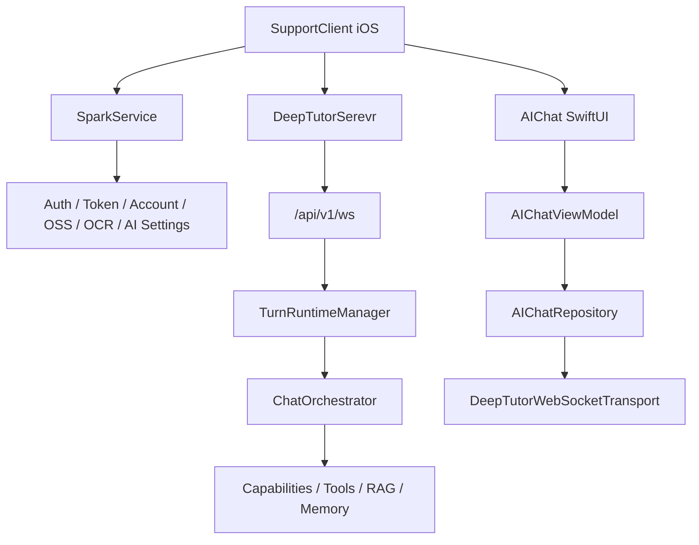
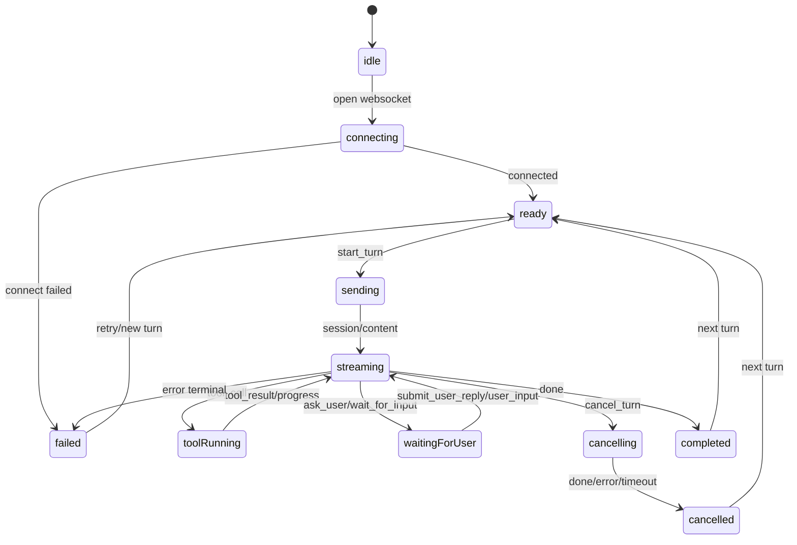

# P0 方案与协议冻结

## 1. 阶段定位

P0 的目标是把 iOS 接入 DeepTutorSerevr AI 对话前必须确认的边界、协议、状态机和风险一次性冻结，避免后续开发阶段一边写 UI 一边改服务归属。

本阶段不实现任何 Swift、Python、Web 或后端业务代码。P0 的交付物是本文档，以及后续可拆分的协议、鉴权和 UI 需求文档。

## 2. 结论

本项目采用“统一后端协议，三端分别原生实现 UI”的方案。

| 项目 | 冻结结论 |
| --- | --- |
| iOS UI | 使用 SwiftUI 原生实现，不使用 WebView 包 DeepTutor Web 页面 |
| 原业务服务 | 登录、Token、账号、OSS、OCR、AI 设置继续走 SparkService |
| AI 对话服务 | 对话运行时、Capability、Tool、RAG、Knowledge Base 走 DeepTutorSerevr |
| 对话入口 | DeepTutorSerevr 统一 WebSocket：`/api/v1/ws` |
| 客户端协议 | iOS 对齐 DeepTutorSerevr Web 当前 `unified-ws.ts` 与后端 `StreamEvent` |
| 首期能力 | P1 只验证最小文本对话，后续阶段再接工具、来源、历史和多端规范 |
| 账号原则 | 不为 DeepTutorSerevr 做第二套 iOS 登录 |

关键边界：

- SparkService 是 SupportClient 用户身份的唯一事实源。
- DeepTutorSerevr 是 AI 对话执行事实源。
- iOS 新增 `AIChat` 模块只消费两边服务，不重写登录、不复制 AI 设置、不接管 OSS/OCR。

## 3. 代码与文档证据

| 证据 | 路径 | 结论 |
| --- | --- | --- |
| DeepTutor WebSocket 前端协议 | `/Users/hua/Documents/project/DeepTutor/DeepTutorSerevr/web/lib/unified-ws.ts` | Web 端已定义 `StartTurnMessage`、`StreamEvent`、`cancel_turn`、`resume_from` 等类型 |
| DeepTutor WebSocket 后端入口 | `/Users/hua/Documents/project/DeepTutor/DeepTutorSerevr/deeptutor/api/routers/unified_ws.py` | 后端统一入口支持 `start_turn`、订阅、恢复、取消、重新生成、用户回复 |
| DeepTutor 事件模型 | `/Users/hua/Documents/project/DeepTutor/DeepTutorSerevr/deeptutor/core/stream.py` | 后端 `StreamEventType` 是所有客户端事件类型的源头 |
| DeepTutor turn runtime | `/Users/hua/Documents/project/DeepTutor/DeepTutorSerevr/deeptutor/services/session/turn_runtime.py` | turn 创建、偏好保存、取消、恢复、重新生成、`ask_user` 回复都在 runtime 收口 |
| DeepTutor WS 鉴权 | `/Users/hua/Documents/project/DeepTutor/DeepTutorSerevr/deeptutor/api/routers/auth.py` | 当前 WS 鉴权读取 query `token` 或 cookie `dt_token` |
| SupportClient 会话边界 | `/Users/hua/Documents/project/DeepTutor/SupportClient/总领文档/会话与认证/会话与认证需求.md` | 登录成功必须写入 Token、快照，并更新 `AppSessionStore.state` |
| SupportClient AI 设置边界 | `/Users/hua/Documents/project/DeepTutor/SupportClient/总领文档/AI 设置/AI 设置需求.md` | AI 设置是 Provider、模型、API Key 和运行时配置，不直接承担聊天消息状态 |
| 总领方案 | `/Users/hua/Documents/project/DeepTutor/SupportClient/总领文档/AI 对话/多客户端 AI 对话统一接入总领方案.md` | 已定义 AI 对话新模块与多端方案 |

## 4. 服务职责冻结

### 4.1 SparkService 继续负责

`/Users/hua/Documents/project/DeepTutor/SparkService`

| 能力 | 归属 |
| --- | --- |
| Apple 登录 | SparkService |
| 手机号验证码登录 | SparkService |
| 设备游客账号登录 | SparkService |
| access token / refresh token | SparkService |
| 401 刷新与会话失效 | SparkService |
| 用户资料与账号绑定 | SparkService |
| OSS STS、文件登记、文件业务绑定 | SparkService |
| OCR 编排与原业务 API | SparkService |
| AI 设置、Provider、模型、API Key、试用期 | SparkService |

冻结规则：

- iOS 现有登录链路不因 AI 对话接入而改造。
- iOS 登录态仍由 `AppSessionStore`、`AuthTokenProvider`、`SessionSnapshotStore` 等现有模块维护。
- AI 对话模块只读取当前会话状态，不直接持有 refresh token，不自行刷新 SparkService token。

### 4.2 DeepTutorSerevr 新增负责

`/Users/hua/Documents/project/DeepTutor/DeepTutorSerevr`

| 能力 | 归属 |
| --- | --- |
| AI 对话 WebSocket | DeepTutorSerevr |
| ChatOrchestrator | DeepTutorSerevr |
| Capability 选择与运行 | DeepTutorSerevr |
| Tool 调用事件 | DeepTutorSerevr |
| RAG / Knowledge Base / Memory | DeepTutorSerevr |
| 对话 session / turn / event | DeepTutorSerevr |
| 流式 token / progress / result | DeepTutorSerevr |

冻结规则：

- iOS 不直接调用 LLM Provider。
- iOS 不在本地复刻 Tool 调用逻辑。
- iOS 只发送用户意图、配置选择和上下文引用，执行交给 DeepTutorSerevr。

## 5. 接入架构冻结



iOS 目标依赖方向：

```text
Presentation
    ↓
Application
    ↓
Domain
    ↓
Infrastructure
    ↓
DeepTutorSerevr / SparkService
```

`Presentation` 不直接创建 WebSocket，不直接拼 JSON；`Infrastructure` 不负责 SparkService 登录刷新。

## 6. WebSocket 连接协议冻结

### 6.1 入口

| 项 | 冻结值 |
| --- | --- |
| 服务 | DeepTutorSerevr |
| 路径 | `/api/v1/ws` |
| 协议 | WebSocket |
| 数据格式 | JSON text frame |
| 服务端事件格式 | `StreamEvent` JSON |
| 心跳 | 客户端发送 `{ "type": "ping" }`，服务端返回 `{ "type": "pong" }` |

### 6.2 当前 DeepTutorSerevr 鉴权事实

当前 DeepTutorSerevr 的 WebSocket 鉴权读取：

```text
ws.query_params["token"]
ws.cookies["dt_token"]
```

当前 Web 端依赖浏览器 cookie 或 URL 生成逻辑；iOS 没有浏览器 cookie 上下文，因此移动端必须明确 token 传递方式。

### 6.3 P0 冻结的移动端鉴权方向

生产推荐方向：

```text
SupportClient 登录 SparkService
    ↓
SparkService 根据当前 access token 签发短期 ai_chat_token
    ↓
SupportClient 使用 ai_chat_token 连接 DeepTutorSerevr
    ↓
DeepTutorSerevr 校验 ai_chat_token 并映射 Spark 用户身份
```

P1 开发期允许的过渡方式：

| 方式 | 使用条件 | 风险 |
| --- | --- | --- |
| DeepTutorSerevr auth 关闭 | 本地开发最小连通 | 无法验证用户归属 |
| 使用 DeepTutorSerevr 原生 token query | DeepTutorSerevr 已有可用用户 token | 与 SparkService 用户体系未打通 |
| 临时调试 token | 仅限本地开发 | 不可进入正式方案 |

P0 结论：

- 连接协议先按 `/api/v1/ws` 和 JSON 消息冻结。
- 正式鉴权必须补 `AI Bridge Token` 或等效 introspection 方案后进入 P4。
- P1 不阻塞于正式鉴权，但必须在文档和调试 UI 中标记“开发鉴权”。

## 7. 客户端发送消息冻结

### 7.1 `start_turn` / `message`

用途：发起一轮用户输入。

| 字段 | 类型 | 必填 | iOS 首期 | 说明 |
| --- | --- | --- | --- | --- |
| `type` | string | 是 | 是 | 固定 `start_turn`，兼容 `message` |
| `content` | string | 是 | 是 | 用户输入文本 |
| `tools` | string array | 否 | 是 | 首期默认空数组 |
| `capability` | string/null | 否 | 是 | 首期默认 `chat` 或空值 |
| `knowledge_bases` | string array | 否 | 否 | P3/P5 后再接 |
| `session_id` | string/null | 否 | 是 | 新会话传 null，继续会话传已有 id |
| `attachments` | array | 否 | 否 | P5 后再定附件归属 |
| `language` | string | 否 | 是 | 建议随 App 语言传 `zh` / `en` |
| `config` | object | 否 | 是 | 首期空对象 |
| `persona` | string | 否 | 否 | 后续接个性化时使用 |
| `llm_selection` | object/null | 否 | 待确认 | 是否由 SparkService AI 设置映射，P0 不冻结 |
| `parent_message_id` | number/null | 否 | 否 | 编辑分支后续再接 |

首期最小 payload：

```json
{
  "type": "start_turn",
  "content": "你好",
  "capability": "chat",
  "tools": [],
  "knowledge_bases": [],
  "session_id": null,
  "language": "zh",
  "config": {}
}
```

### 7.2 `subscribe_turn`

用途：订阅指定 turn 的事件。

| 字段 | 类型 | 必填 | 说明 |
| --- | --- | --- | --- |
| `type` | string | 是 | 固定 `subscribe_turn` |
| `turn_id` | string | 是 | 目标 turn |
| `after_seq` | number | 否 | 只接收大于该 seq 的事件 |

### 7.3 `subscribe_session`

用途：订阅某个 session 当前 active turn。

| 字段 | 类型 | 必填 | 说明 |
| --- | --- | --- | --- |
| `type` | string | 是 | 固定 `subscribe_session` |
| `session_id` | string | 是 | 目标 session |
| `after_seq` | number | 否 | 只接收大于该 seq 的事件 |

### 7.4 `resume_from`

用途：断线重连后从指定 seq 恢复。

| 字段 | 类型 | 必填 | 说明 |
| --- | --- | --- | --- |
| `type` | string | 是 | 固定 `resume_from` |
| `turn_id` | string | 是 | 当前未完成 turn |
| `seq` | number | 否 | iOS 本地已消费的最大 seq |

规则：

- iOS 每消费一个带 `seq` 的事件，都更新 `lastSeq`。
- 断线后如仍有 `activeTurnId`，重连成功立即发送 `resume_from`。
- iOS reducer 必须按 `turn_id + seq` 去重。

### 7.5 `cancel_turn`

用途：停止当前生成。

| 字段 | 类型 | 必填 | 说明 |
| --- | --- | --- | --- |
| `type` | string | 是 | 固定 `cancel_turn` |
| `turn_id` | string | 是 | 要取消的 turn |

规则：

- 用户点击停止时立即进入本地 `cancelling` / `cancelledPending` 状态。
- 服务端若返回 `error` 且内容为 turn not found，本地显示“本轮已结束或不可取消”。
- 取消不清空已有内容。

### 7.6 `regenerate`

用途：重新生成最近一轮用户消息。

| 字段 | 类型 | 必填 | 说明 |
| --- | --- | --- | --- |
| `type` | string | 是 | 固定 `regenerate` |
| `session_id` | string | 是 | 目标 session |
| `overrides` | object | 否 | 可覆盖 capability、tools、knowledge_bases、language、config 等 |

已知错误：

| 错误 | 说明 |
| --- | --- |
| `regenerate_busy` | 当前 session 有正在运行的 turn |
| `nothing_to_regenerate` | 没有可重新生成的用户消息 |

P1/P2 不接 regenerate；P5 再进入产品化体验。

### 7.7 `submit_user_reply`

用途：回答 `ask_user` 暂停问题。

| 字段 | 类型 | 必填 | 说明 |
| --- | --- | --- | --- |
| `type` | string | 是 | 固定 `submit_user_reply` |
| `turn_id` | string | 是 | 暂停中的 turn |
| `text` | string | 否 | 旧版单问题文本 |
| `answers` | array | 否 | 新版 `{ questionId, text }` 列表 |

P3 前可以只显示等待提示；P3 后需要支持结构化回答。

### 7.8 `user_input`

用途：向后端 `wait_for_input` 的 StreamBus 提交普通文本输入。

| 字段 | 类型 | 必填 | 说明 |
| --- | --- | --- | --- |
| `type` | string | 是 | 固定 `user_input` |
| `turn_id` | string | 是 | 等待输入的 turn |
| `content` | string | 是 | 用户输入 |

说明：

- `submit_user_reply` 面向 `ask_user` 工具暂停。
- `user_input` 面向底层 `wait_for_input` 事件。
- iOS P0 同时冻结两者的 DTO，P3 再决定 UI 如何区分。

### 7.9 `check_active_turn`

用途：检查 session 是否有运行中的 active turn。

| 字段 | 类型 | 必填 | 说明 |
| --- | --- | --- | --- |
| `type` | string | 是 | 固定 `check_active_turn` |
| `session_id` | string | 是 | 目标 session |

返回：

```json
{
  "type": "active_turn_info",
  "turn_id": "...",
  "status": "running"
}
```

P2 可用于进入页面时恢复正在运行的对话。

## 8. 服务端事件冻结

### 8.1 `StreamEvent` 通用字段

| 字段 | 类型 | 必填 | 说明 |
| --- | --- | --- | --- |
| `type` | string | 是 | 事件类型 |
| `source` | string | 否 | 事件来源，如 capability、tool、runtime |
| `stage` | string | 否 | 当前阶段 |
| `content` | string | 否 | 文本内容 |
| `metadata` | object | 否 | 结构化扩展 |
| `session_id` | string | 否 | 会话 ID |
| `turn_id` | string | 否 | 轮次 ID |
| `seq` | number | 否 | 单 turn 内事件序号 |
| `timestamp` | number | 否 | Unix timestamp |

Swift DTO 建议：

```swift
struct StreamEventDTO: Decodable, Identifiable {
    var id: String { "\(turnID ?? ""):\(seq ?? -1):\(type.rawValue)" }
    let type: StreamEventTypeDTO
    let source: String?
    let stage: String?
    let content: String?
    let metadata: JSONValue?
    let sessionID: String?
    let turnID: String?
    let seq: Int?
    let timestamp: Double?
}
```

说明：这是设计骨架，P0 不写入工程代码。

### 8.2 事件类型

| 事件 | iOS P0 冻结语义 | 首期阶段 |
| --- | --- | --- |
| `session` | 绑定 `session_id`、`turn_id`，建立 active turn | P1 |
| `session_meta` | 更新标题、摘要等 session 元信息 | P5 |
| `stage_start` | 阶段开始 | P3 |
| `stage_end` | 阶段结束 | P3 |
| `thinking` | 思考/计划类文本 | P3 |
| `observation` | 观察或中间过程 | P3 |
| `content` | 助手流式正文增量 | P1 |
| `tool_call` | 工具调用开始，`content` 通常为工具名 | P3 |
| `tool_result` | 工具调用结果 | P3 |
| `progress` | 进度或特殊状态，如 ask_user resolved | P3 |
| `sources` | 来源列表在 `metadata.sources` | P3 |
| `result` | 能力最终结构化结果 | P3 |
| `error` | 错误事件 | P1 |
| `done` | 当前 turn 结束 | P1 |
| `wait_for_input` | 底层等待用户输入 | P3 |
| `pong` | 心跳响应，不进入消息列表 | P1 |
| `active_turn_info` | active turn 查询结果，不进入消息列表 | P2 |

注意：

- Web 前端 `StreamEventType` 当前未列 `wait_for_input`，但后端 `StreamEventType` 已包含。iOS DTO 应以后端为准。
- `pong`、`active_turn_info` 不是标准 `StreamEvent`，但会通过同一 WebSocket 返回，iOS 解码层必须能识别。

## 9. iOS Domain 模型冻结

### 9.1 `AIChatSession`

| 字段 | 类型 | 说明 |
| --- | --- | --- |
| `id` | String | DeepTutor session id |
| `title` | String? | P5 后可由 `session_meta` 或历史接口提供 |
| `sparkUserID` | String | SparkService 当前用户 ID，本地归属字段 |
| `activeTurnID` | String? | 当前运行中 turn |
| `lastSeq` | Int | 当前 active turn 已消费最大 seq |
| `createdAt` | Date? | 待历史接口确认 |
| `updatedAt` | Date? | 待历史接口确认 |

### 9.2 `AIChatTurn`

| 字段 | 类型 | 说明 |
| --- | --- | --- |
| `id` | String | DeepTutor turn id |
| `sessionID` | String | 所属 session |
| `status` | AIChatTurnStatus | idle / sending / streaming / completed / failed / cancelled |
| `capability` | String | 默认 chat |
| `startedAt` | Date? | 可从事件推断 |
| `endedAt` | Date? | `done` 或 terminal error |

### 9.3 `AIChatMessage`

| 字段 | 类型 | 说明 |
| --- | --- | --- |
| `id` | String | 本地消息 ID 或服务端消息 ID |
| `role` | enum | user / assistant / system |
| `turnID` | String? | 关联 turn |
| `content` | String | 对用户可见正文 |
| `events` | [AIStreamEvent] | 原始事件镜像 |
| `attachments` | array | P5 后确认 |
| `createdAt` | Date | 本地生成或服务端返回 |
| `status` | enum | sending / streaming / completed / failed |

### 9.4 `AIStreamEvent`

`AIStreamEvent` 是 Domain 层对 `StreamEventDTO` 的平台无关包装。Domain 不保留服务端 JSON 命名，不依赖 SwiftUI。

## 10. iOS 状态机冻结



状态规则：

- `content` 可多次到达，追加到当前 assistant message。
- `session` 必须先记录 `session_id` / `turn_id`，即使还没有正文。
- `done` 是 turn 结束信号，不代表一定成功；如前面已有 terminal error，状态保持 failed。
- `error.metadata.turn_terminal == true` 时，本轮进入 failed。
- `cancel_turn` 后本地不删除已有消息，只停止继续追加。
- 断线不等于失败；有 active turn 时进入 reconnecting，恢复后用 `resume_from`。

## 11. 错误语义冻结

| 错误来源 | 示例 | iOS 状态 | 用户可见策略 |
| --- | --- | --- | --- |
| WebSocket 连接失败 | 无法连接服务器 | failed / reconnecting | 显示连接失败，可重试 |
| JSON 解码失败 | Invalid JSON | failed | 显示协议解析失败，保留上下文 |
| start_turn 被拒绝 | No LLM model assigned | failed | 显示服务端错误，不清空登录态 |
| regenerate_busy | 重新生成时已有 turn | failed | 提示当前对话仍在生成 |
| nothing_to_regenerate | 无上一条用户消息 | failed | 禁用或提示无法重新生成 |
| cancel turn not found | Turn not found | cancelled 或 completed | 提示本轮已结束 |
| 鉴权失败 | WS close before accept | aiAuthFailed | 提示 AI 对话登录失效，尝试刷新 AI bridge token |
| SparkService 登录失效 | refresh 明确失败 | signedOut | 走现有会话失效逻辑 |

冻结规则：

- DeepTutorSerevr 鉴权失败不得直接触发 SparkService 登出。
- SparkService 明确会话失效时，AIChat 必须停止 active turn 并清理本地对话运行态。
- 错误日志不得记录 access token、refresh token、AI bridge token、完整请求体或用户完整对话正文。

## 12. 鉴权桥接冻结

### 12.1 目标方案

推荐新增 AI Bridge Token：

| 项 | 目标 |
| --- | --- |
| 签发方 | SparkService |
| 消费方 | DeepTutorSerevr |
| 客户端 | SupportClient iOS |
| 有效期 | 短期，建议分钟级 |
| 绑定 | Spark 用户 ID、设备 ID、App bundle、平台、过期时间 |
| 用途 | 仅用于 DeepTutorSerevr AI 对话 |

### 12.2 连接传递方式

DeepTutorSerevr 当前已支持 query `token`，因此 P1/P4 推荐兼容：

```text
wss://<deeptutor-host>/api/v1/ws?token=<ai_chat_token>
```

后续落地要求：

- iOS 首版使用 query `token` 传递 AI 对话凭证。
- DeepTutorSerevr 需要新增 Spark bridge token 解码与校验能力。
- SparkService 需要提供 AI Bridge Token 签发接口，例如 `POST /api/v1/ai/chat/token/`。
- bridge token 默认采用短有效期策略，优先在每次打开 AIChat 时重新签发；如果后续需要长会话，再补充刷新接口。

### 12.3 用户归属

DeepTutorSerevr 必须能把对话数据归属到 SparkService 用户。

最小字段：

| 字段 | 说明 |
| --- | --- |
| `spark_user_id` | SparkService 用户 ID |
| `support_account_id` | 如果项目内部使用 accountID，可映射到该字段 |
| `device_id` | 当前安装设备 ID，便于审计和风控 |
| `platform` | `ios` |
| `bundle_id` | SupportClient bundle identifier |

## 13. P1 最小连通冻结范围

P1 只做以下能力：

- 打开 WebSocket。
- 发送最小 `start_turn`。
- 接收 `session`、`content`、`error`、`done`。
- 保存 `session_id`、`turn_id`、`lastSeq`。
- 支持 `ping` / `pong`。
- 断线后可以手动或自动重连。

P1 不做：

- 完整 SwiftUI UI。
- 工具卡片。
- 知识库选择。
- 附件。
- 历史列表。
- 正式 bridge token 闭环。
- Android / Web 对齐实现。

P1 成功标准：

```text
输入一条文本
    ↓
iOS 发送 start_turn
    ↓
DeepTutorSerevr 返回 session
    ↓
DeepTutorSerevr 返回多段 content
    ↓
DeepTutorSerevr 返回 done
    ↓
iOS 合成一条 assistant message
```

## 14. 后续文档拆分

P0 完成后，应继续拆出：

| 文档 | 内容 |
| --- | --- |
| `AI 对话协议需求.md` | DTO 字段、编码/解码、事件 reducer、去重规则 |
| `AI 对话鉴权桥接需求.md` | SparkService bridge token、DeepTutorSerevr 校验、账号映射 |
| `AI 对话 SwiftUI UI 需求.md` | 页面结构、消息样式、Composer、错误和空态 |
| `AI 对话多端一致性矩阵.md` | iOS / Android / Web 状态机、事件渲染和验收对照 |

## 15. 已冻结决策项

以下事项已按本文推荐方案冻结，不再作为 P0 开放问题处理。后续阶段如果发现服务端真实实现与本表不一致，必须先更新协议文档和验收矩阵，再进入客户端实现。

| 编号 | 原待确认项 | 冻结结论 | 落地阶段 | 验收要求 |
| --- | --- | --- | --- | --- |
| P0-Q1 | SparkService 是否新增 AI Bridge Token 签发接口 | 采用新增 AI Bridge Token 签发接口。SparkService 继续作为登录与账号单一入口，iOS 不直接复用 SparkService 主业务 token 访问 DeepTutorSerevr。 | P4 | 明确接口 path、method、请求字段、响应字段、过期时间、刷新策略和错误码。 |
| P0-Q2 | DeepTutorSerevr 是否支持校验 SparkService bridge token | 采用 DeepTutorSerevr 校验 SparkService bridge token 的方案。DeepTutorSerevr 不重新承担主登录流程，只接受经过 SparkService 签发或背书的 AI 访问凭证。 | P4 | 明确 token 解码、签名校验、过期校验、用户映射字段、失效错误和审计日志。 |
| P0-Q3 | iOS WebSocket token 使用 query 还是 header | iOS 首版 WebSocket 鉴权采用 query token：`/api/v1/ws?token=<ai_bridge_token>`。如后端后续明确支持 `Authorization` 子协议或 header，再作为兼容能力补充。 | P1/P4 | P1 允许本地调试 token；P4 必须切换为 SparkService 签发的 AI Bridge Token，生产构建禁止使用固定 token。 |
| P0-Q4 | DeepTutorSerevr 对话历史是否提供移动端 list/detail API | 采用 DeepTutorSerevr 提供移动端会话历史能力。移动端会话列表、详情、分页和恢复均以 DeepTutorSerevr 为事实源。 | P5 | 明确 session list、session detail、message history、分页游标、排序、删除/归档和账号隔离规则。 |
| P0-Q5 | `llm_selection` 是否由 SparkService AI 设置映射 | 采用 SparkService AI 设置映射 `llm_selection`。iOS 对话入口不直接暴露底层 Provider/API Key 细节，只消费账号当前 AI 设置生成的选择结果。 | P3/P5 | 明确 Provider、模型、API Key 可用性、默认模型、缺失配置错误和多账号切换后的读取规则。 |
| P0-Q6 | 附件进入对话时走 SparkService 文件系统还是 DeepTutor 附件系统 | 附件上传与资产权限优先走 SparkService 文件系统；DeepTutorSerevr 在对话中消费附件引用，不直接成为主文件资产系统。 | P5 | 明确上传接口、文件引用字段、权限校验、过期/清理、OSS 地址脱敏和 DeepTutorSerevr 消费格式。 |
| P0-Q7 | `wait_for_input` 与 `submit_user_reply` 在 iOS UI 上如何区分 | 采用 UI 语义区分：`wait_for_input` 渲染为“AI 等待用户补充”的交互卡片；`submit_user_reply` 是用户对该等待状态的结构化回复动作。 | P3 | 明确 ask_user 卡片、普通等待输入卡片、按钮状态、取消规则、重复提交保护和恢复后的展示规则。 |
| P0-Q8 | DeepTutorSerevr auth disabled 的本地调试环境如何标记 | 采用显式本地调试标记。auth disabled 只能存在于本地开发环境，必须通过环境变量、构建配置和 UI 调试标识隔离。 | P1 | Debug 环境可见调试标记；Release/Production 构建不得允许 auth disabled；测试需覆盖误配置拦截。 |

## 16. P0 完成定义

P0 完成必须满足：

- 服务边界已冻结：登录与原业务归 SparkService，AI 对话归 DeepTutorSerevr。
- iOS 对话入口技术路线已冻结：SwiftUI 原生 UI，不使用 WebView。
- WebSocket 入口、客户端消息、服务端事件和状态机已冻结。
- P1 最小连通范围已冻结，且明确不包含完整 UI、正式鉴权和高级能力。
- 正式鉴权桥接方案已冻结为 AI Bridge Token 方向，并列出所有已关闭决策项。
- 本文档能作为 P1 开发和 `AI 对话协议需求.md` 的上游依据。
