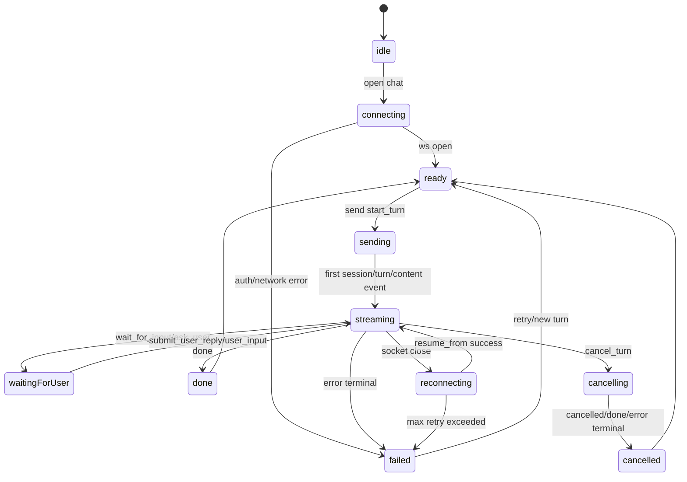

# P0 方案与协议冻结｜技术细节文档

> 本文档只描述 iOS SwiftUI 首版落地方案、目录结构、数据模型、协议 DTO、状态机和验收边界，不实现任何 Swift 业务代码。

## 1. 对标范围与结论

| 项目 | 平台/语言 | 工程根目录 | 当前状态 | 本阶段职责 |
| --- | --- | --- | --- | --- |
| SupportClient | iOS / SwiftUI | `/Users/hua/Documents/project/DeepTutor/SupportClient` | 已有登录、账号、AI 设置、网络、OSS、OCR、设置 Tab；尚无 AI 对话 Feature | P1 起新增 SwiftUI 原生 AI 对话入口、WebSocket Runtime、事件 Reducer 和账号级隔离 |
| DeepTutorSerevr | 后端 / Python FastAPI + Web / Next.js React | `/Users/hua/Documents/project/DeepTutor/DeepTutorSerevr` | 已有 `/api/v1/ws`、session history API、Web 端 `UnifiedWSClient`、Web 聊天 UI | 作为 AI 对话协议与运行时事实源 |
| SparkService | 原始业务服务 | `/Users/hua/Documents/project/DeepTutor/SparkService` | 继续承担登录、账号、AI 设置、文件/OSS 等原业务 | 后续新增 AI Bridge Token 签发接口，不承接 DeepTutor 对话流 |
| Web 端 | Next.js / React | `/Users/hua/Documents/project/DeepTutor/DeepTutorSerevr/web` | 已有可参考实现 | 只作为协议、事件 reducer、交互语义参考，不作为移动端 WebView 方案 |

结论：

- iOS 首版的事实源不是 Web 前端，而是 `DeepTutorSerevr` 的 WebSocket 协议、session API、StreamEvent 事件语义和服务端会话存储。
- iOS 首版使用 SwiftUI 原生实现聊天 UI；Web 端现有 React 代码只提炼协议、事件处理、AskUser 交互和恢复策略。
- 登录、账号、AI 设置、OSS/文件仍归 SparkService；AI 对话流、会话、工具、知识库、RAG、流式事件归 DeepTutorSerevr。
- P0 冻结的是“协议与架构”；P1/P2 才进入 iOS 最小连通和 UI 入口实现。

## 2. 代码事实与证据

| 证据类型 | 代码位置 | 结论 |
| --- | --- | --- |
| DeepTutor WebSocket 客户端协议 | `/Users/hua/Documents/project/DeepTutor/DeepTutorSerevr/web/lib/unified-ws.ts` | Web 端已定义 `StartTurnMessage`、订阅、恢复、取消、重新生成、用户回复、心跳和自动重连 |
| DeepTutor WebSocket 后端入口 | `/Users/hua/Documents/project/DeepTutor/DeepTutorSerevr/deeptutor/api/routers/unified_ws.py` | 后端 `/api/v1/ws` 支持 `start_turn`、`subscribe_turn`、`subscribe_session`、`resume_from`、`check_active_turn`、`cancel_turn`、`regenerate`、`submit_user_reply`、`user_input` |
| StreamEvent 后端枚举 | `/Users/hua/Documents/project/DeepTutor/DeepTutorSerevr/deeptutor/core/stream.py` | 后端事件包含 `wait_for_input`，iOS DTO 应以后端枚举为准 |
| DeepTutor 会话历史 API | `/Users/hua/Documents/project/DeepTutor/DeepTutorSerevr/deeptutor/api/routers/sessions.py` | 已有 `GET /api/v1/sessions`、`GET/PATCH/DELETE /api/v1/sessions/{session_id}`、branch selection、delete message、quiz results |
| Web 聊天页面 | `/Users/hua/Documents/project/DeepTutor/DeepTutorSerevr/web/app/(workspace)/home/[[...sessionId]]/page.tsx` | Web 已有 `useUnifiedChat` 消费路径，可参考会话恢复、模型选择、知识库选择和聊天主页面组织 |
| Web 消息渲染 | `/Users/hua/Documents/project/DeepTutor/DeepTutorSerevr/web/components/chat/home/ChatMessages.tsx` | 可参考消息、AskUser、inline segments、trace 面板触发语义 |
| Web AskUser 卡片 | `/Users/hua/Documents/project/DeepTutor/DeepTutorSerevr/web/components/chat/home/AskUserOptions.tsx` | 可参考 `wait_for_input` / `ask_user` 的问题、选项、answers 结构化提交 |
| iOS App 组合根 | `/Users/hua/Documents/project/DeepTutor/SupportClient/SupportClient/Projects/App/Sources/App/AppContainer.swift` | 当前已有 Auth、AISettings、Notification、OSS、OCR 等装配；AI 对话应作为新 Feature 接入 |
| iOS 主路由 | `/Users/hua/Documents/project/DeepTutor/SupportClient/SupportClient/Projects/App/Sources/App/AppCoordinatorView.swift` | 当前主界面为 TabView：Home、SecondCamera、Settings；AI 对话入口可作为新 Tab 或 Home/Settings 内入口 |
| iOS 账号运行时 | `/Users/hua/Documents/project/DeepTutor/SupportClient/SupportClient/Projects/App/Sources/App/Architecture/AccountSessionRuntime.swift` | 注释明确当前 Support 裁剪版“不含 Chat”；新增 AI 对话必须补断连、清理、账号切换隔离 |
| iOS 原服务网络门面 | `/Users/hua/Documents/project/DeepTutor/SupportClient/SupportClient/Core/Networking/SupportBackend.swift` | SparkService 网络仍通过 `SupportBackend`，AI 对话不应污染原业务 API |
| iOS 环境配置 | `/Users/hua/Documents/project/DeepTutor/SupportClient/SupportClient/Projects/App/Sources/App/SupportAppEnvironment.swift` | 当前只有 SparkService `apiBaseURL`；需新增 DeepTutor 服务地址配置 |
| iOS AI 设置 API | `/Users/hua/Documents/project/DeepTutor/SupportClient/SupportClient/Projects/Core/Networking/API/AI/AIConfigAPI.swift` | SparkService 已负责 AI 配置 bootstrap、试用、Provider 测试 |
| iOS AI 配置中心 | `/Users/hua/Documents/project/DeepTutor/SupportClient/SupportClient/Projects/Core/AI/AIConfigCenter.swift` | 可作为 `llm_selection` 的输入来源，但对话消息状态不能塞进 AI 设置模块 |

## 3. 总体项目架构

### 3.1 服务分层

```text
iOS SwiftUI
        ↓
SupportClient AIChat Feature
        ↓
AIChatService / AIChatRepository / AIChatWebSocketClient
        ↓
DeepTutorSerevr
        ├── /api/v1/ws                         # 流式对话、事件订阅、恢复、取消
        ├── /api/v1/sessions                   # 会话列表
        ├── /api/v1/sessions/{session_id}      # 会话详情、重命名、删除
        └── 工具 / 知识库 / RAG / StreamEvent

客户端 Auth / Account / AI Settings / File / OSS
        ↓
SupportBackend
        ↓
SparkService
        ├── 登录、刷新、登出
        ├── 账号与设备
        ├── AI 设置与 Provider/模型配置
        ├── 文件、OSS、OCR
        └── AI Bridge Token 签发
```

### 3.2 iOS 内部架构

```text
SupportClient/Projects/Features/AIChat/
        ↓
Presentation: SwiftUI 页面、消息气泡、输入栏、AskUser 卡片、Trace 卡片
        ↓
Application: ViewModel、UseCase、事件 reducer、恢复/取消/重试 orchestration
        ↓
Domain: Session、Turn、Message、StreamEvent、状态机、错误枚举
        ↓
Infrastructure: WebSocket client、Sessions HTTP API、Bridge Token API、DTO decoder
        ↓
Core: 日志、环境、AuthTokenProvider、AIConfigCenter、StorageRegistry
```

### 3.3 Web 参考边界

Web 端只作为以下内容的参考来源：

- WebSocket 消息类型、心跳、重连、`resume_from` 和 `seq` 处理。
- StreamEvent 的前端消费方式。
- AskUser 卡片的问题、选项和 answers 提交语义。
- ChatMessages、TracePanels 中对 `thinking`、`tool_call`、`tool_result`、`sources` 的渲染语义。

Web 端不作为以下内容的迁移对象：

- 不迁移 React hook、React state、DOM 滚动、CSS 布局。
- 不使用 WebView 作为 iOS 对话入口。
- 不复用 Web cookie/localStorage 鉴权方式。
- 不把 Web URL route 结构作为 iOS 导航结构。

## 4. 目标目录结构

### 4.1 iOS 目标文件结构

```text
SupportClient/SupportClient/Projects/
├── App/Sources/App/
│   ├── SupportAppEnvironment.swift
│   ├── AppContainer.swift
│   ├── AppCoordinatorView.swift
│   └── Architecture/
│       ├── FeatureAssemblies.swift
│       └── AccountSessionRuntime.swift
├── Core/
│   ├── AI/
│   │   └── AIConfigCenter.swift
│   └── Networking/
│       └── API/AI/
│           └── AIConfigAPI.swift
└── Features/
    └── AIChat/
        ├── Domain/
        │   ├── AIChatSession.swift
        │   ├── AIChatTurn.swift
        │   ├── AIChatMessage.swift
        │   ├── AIChatAttachment.swift
        │   ├── AIStreamEvent.swift
        │   ├── AIChatState.swift
        │   ├── AIChatError.swift
        │   └── AIChatProtocolModels.swift
        ├── Application/
        │   ├── AIChatViewModel.swift
        │   ├── AIChatEventReducer.swift
        │   ├── StartAIChatTurnUseCase.swift
        │   ├── ResumeAIChatTurnUseCase.swift
        │   ├── CancelAIChatTurnUseCase.swift
        │   ├── RegenerateAIChatTurnUseCase.swift
        │   ├── LoadAIChatSessionsUseCase.swift
        │   └── SubmitAIChatUserReplyUseCase.swift
        ├── Infrastructure/
        │   ├── AIChatWebSocketClient.swift
        │   ├── AIChatWebSocketConnection.swift
        │   ├── AIChatRepository.swift
        │   ├── DeepTutorSessionAPI.swift
        │   ├── AIBridgeTokenAPI.swift
        │   ├── AIChatDTOs.swift
        │   ├── AIChatEventDecoder.swift
        │   └── AIChatResumeStore.swift
        └── Presentation/
            ├── AIChatEntryView.swift
            ├── AIChatRootView.swift
            ├── AIChatMessageList.swift
            ├── AIChatMessageBubble.swift
            ├── AIChatComposer.swift
            ├── AIAskUserCard.swift
            ├── AIToolTraceCard.swift
            ├── AISourceReferencesView.swift
            ├── AIChatSessionListView.swift
            └── AIChatEmptyStateView.swift
```

状态说明：

- 以上是 P1-P5 的目标结构，P0 不创建这些 Swift 文件。
- `SupportBackend` 不直接增加 DeepTutor `/api/v1/ws` 逻辑；AIChat 使用独立 `DeepTutorBaseURL` 和独立 WebSocket client。
- SparkService 的 AI Bridge Token API 可以临时放入 `SupportAIConfigAPI`，但更推荐抽出 `AIBridgeTokenAPI`，避免“AI 设置”和“AI 对话鉴权”职责混淆。

### 4.1.1 `SupportAppEnvironment.swift` 中新增 DeepTutorSerevr 地址配置

当前代码证据：

```text
/Users/hua/Documents/project/DeepTutor/SupportClient/SupportClient/Projects/App/Sources/App/SupportAppEnvironment.swift
```

当前 `SupportAppEnvironment` 已有：

| 属性 | 当前职责 | 是否继续保持 |
| --- | --- | --- |
| `apiBaseURL` | SparkService 原始业务 API 地址 | 保持不变 |
| `siteBaseURL` | 官网、隐私政策、用户协议地址 | 保持不变 |
| `privacyPolicyURL` | 隐私政策 URL | 保持不变 |
| `termsOfServiceURL` | 用户协议 URL | 保持不变 |
| `logLevel` | 环境日志级别 | 保持不变 |
| `subsystem` | 日志 subsystem | 保持不变 |
| `ocrConfiguration` | OCR 环境配置 | 保持不变 |

新增 DeepTutorSerevr 地址时，不应复用 `apiBaseURL`，因为：

- `apiBaseURL` 已明确是 SparkService 地址，承载登录、账号、AI 设置、OSS、OCR 等原业务。
- AI 对话连接到 `DeepTutorSerevr`，服务边界不同。
- WebSocket 需要从 HTTP/HTTPS base URL 派生 WS/WSS URL，不能让调用方到处手写字符串。
- staging/production 后续可能与 SparkService 独立扩容、独立域名、独立灰度。

#### 推荐新增属性

建议在 `SupportAppEnvironment` 内新增 3 个只读属性：

| 属性 | 类型 | 职责 | 调用方 |
| --- | --- | --- | --- |
| `deepTutorBaseURL` | `URL` | DeepTutorSerevr HTTP API 根地址 | `DeepTutorSessionAPI`、`AIBridgeTokenAPI` 返回覆盖前的默认值 |
| `deepTutorWebSocketBaseURL` | `URL` | DeepTutorSerevr WebSocket 根地址 | `AIChatWebSocketClient` |
| `deepTutorWebSocketURL(token:)` | `URL` | 生成 `/api/v1/ws?token=` 最终连接地址 | `AIChatWebSocketConnection` |

命名建议：

- 使用 `deepTutor` 前缀，不使用 `aiBaseURL`，避免和 SparkService 的 AI 设置、Provider、模型配置混淆。
- 使用 `BaseURL` 表达服务根地址，具体 endpoint 由 API/Runtime 层拼接。
- `deepTutorWebSocketURL(token:)` 只负责 URL 拼接和 token query 编码，不负责获取 token。

#### 设计骨架

以下是文档级方案骨架，不是本阶段要直接写入代码：

```swift
// 伪代码/方案骨架，P1 实现时再写入 SupportAppEnvironment.swift
var deepTutorBaseURL: URL {
    switch self {
    case .debug:
        return URL(string: "http://localhost:3782")!
    case .staging:
        return URL(string: "https://deeptutor-staging.example.com")!
    case .production:
        return URL(string: "https://deeptutor.example.com")!
    }
}

var deepTutorWebSocketBaseURL: URL {
    switch self {
    case .debug:
        return URL(string: "ws://localhost:3782")!
    case .staging:
        return URL(string: "wss://deeptutor-staging.example.com")!
    case .production:
        return URL(string: "wss://deeptutor.example.com")!
    }
}

func deepTutorWebSocketURL(token: String) -> URL {
    deepTutorWebSocketBaseURL
        .appending(path: "api/v1/ws")
        .appending(queryItems: [
            URLQueryItem(name: "token", value: token)
        ])
}
```

注意：

- 上面的 staging/production 域名只是占位示例，P4 前必须替换成真实部署域名。
- 如果本地 DeepTutorSerevr 不是 `localhost:3782`，P1 实现时应按实际本地端口调整。
- 如果 Debug 真机访问 Mac 本地服务，不能使用 `localhost`，需要改成局域网 IP 或通过反向代理/隧道；该值应只存在 Debug 配置。

#### 环境值建议

| 环境 | `apiBaseURL` | `deepTutorBaseURL` | `deepTutorWebSocketBaseURL` | 说明 |
| --- | --- | --- | --- | --- |
| debug | 现有 `http://39.106.39.110:2026` | `http://localhost:3782` 或局域网调试地址 | `ws://localhost:3782` 或局域网调试地址 | iOS Simulator 可用 localhost；真机需 Mac 局域网 IP |
| staging | 现有 staging/production SparkService 地址 | DeepTutor staging HTTPS 地址 | DeepTutor staging WSS 地址 | 用于联调 AI Bridge Token |
| production | `https://api.dreamwhale.top` | DeepTutor production HTTPS 地址 | DeepTutor production WSS 地址 | 必须 HTTPS/WSS，不允许 auth disabled |

#### URL 派生规则

| 用途 | 生成方式 | 示例 |
| --- | --- | --- |
| WebSocket 连接 | `deepTutorWebSocketBaseURL + /api/v1/ws + ?token=` | `wss://deeptutor.example.com/api/v1/ws?token=...` |
| 会话列表 | `deepTutorBaseURL + /api/v1/sessions` | `https://deeptutor.example.com/api/v1/sessions` |
| 会话详情 | `deepTutorBaseURL + /api/v1/sessions/{session_id}` | `https://deeptutor.example.com/api/v1/sessions/abc` |
| 健康检查 | `deepTutorBaseURL + /health` 或后端实际 health path | P1/P4 按后端真实路由确认 |

#### 和 AI Bridge Token 的关系

`SupportAppEnvironment` 只保存 DeepTutorSerevr 地址，不保存 token。

```text
SupportAppEnvironment
    ↓ 提供 deepTutorBaseURL / deepTutorWebSocketBaseURL
AIBridgeTokenAPI
    ↓ 使用 SparkService apiBaseURL 签发 AI Bridge Token
AIChatWebSocketClient
    ↓ 使用 deepTutorWebSocketURL(token:)
DeepTutorSerevr /api/v1/ws
```

如果 SparkService 的 AI Bridge Token 签发响应返回 `deeptutor_ws_url` 或 `deeptutor_http_base_url`：

- Debug/P4 联调可以允许服务端返回值覆盖 `SupportAppEnvironment` 默认值。
- Production 是否允许覆盖必须谨慎，建议只允许同白名单域名，避免被错误配置导向非可信服务。
- 覆盖后的 URL 仍必须走同一个 URL builder，不允许拼接字符串。

#### Release 安全门槛

| 门槛 | 要求 |
| --- | --- |
| Production scheme | `deepTutorBaseURL` 必须是 `https` |
| Production WebSocket | `deepTutorWebSocketBaseURL` 必须是 `wss` |
| auth disabled | Release/Production 不允许连接 auth disabled 的 DeepTutorSerevr |
| token 日志 | URL 中 query token 不得完整写入日志 |
| 错误展示 | 连接失败时不展示完整 URL/token，只展示服务不可用或登录失效 |
| 白名单 | 如果支持远端覆盖 DeepTutor host，Production 必须做域名白名单 |

#### P1 实现时的文件影响

| 文件 | 变更类型 | 说明 |
| --- | --- | --- |
| `SupportAppEnvironment.swift` | 新增配置属性 | `deepTutorBaseURL`、`deepTutorWebSocketBaseURL`、`deepTutorWebSocketURL(token:)` |
| `AIChatWebSocketClient.swift` | 消费配置 | 不自己决定 host，只接收 environment 或 URL provider |
| `DeepTutorSessionAPI.swift` | 消费配置 | HTTP API 使用 `deepTutorBaseURL` |
| `AIBridgeTokenAPI.swift` | 不消费 DeepTutor host 为主 | 走 SparkService `apiBaseURL` 签发 token，必要时读取返回的 DeepTutor host |
| `AppContainer.swift` | 注入配置 | 把 `environment` 传入 AIChat Assembly |

#### P1 验收

| 验收项 | 标准 |
| --- | --- |
| SparkService 地址不变 | 登录、AI 设置、OSS、OCR 仍使用 `apiBaseURL` |
| DeepTutor 地址独立 | AIChat Runtime 不从 `apiBaseURL` 推断 DeepTutor 地址 |
| WS URL 正确 | `/api/v1/ws` 路径正确，token query 正确编码 |
| Debug 可配置 | Simulator 和真机调试地址有明确切换说明 |
| Release 安全 | Production 不允许 `http/ws/localhost/auth disabled` |
| 日志脱敏 | 不打印完整带 token 的 WebSocket URL |

### 4.2 Web 参考结构映射

| Web 代码 | 可提炼内容 | iOS 对应目标 | 不直接迁移的内容 |
| --- | --- | --- | --- |
| `web/lib/unified-ws.ts` | WebSocket 消息类型、心跳、重连、resume_from、seq | `AIChatWebSocketClient.swift` | React state、浏览器 WebSocket API 细节 |
| `web/app/(workspace)/home/[[...sessionId]]/page.tsx` | 会话页主流程、模型/知识库选择、发送、恢复 | `AIChatRootView.swift` + `AIChatViewModel.swift` | 桌面 Web 布局、URL route 结构 |
| `web/components/chat/home/ChatMessages.tsx` | 消息列表、assistant/user、事件内嵌渲染 | `AIChatMessageList.swift` | CSS、React memo、DOM 滚动实现 |
| `web/components/chat/home/AskUserOptions.tsx` | AskUser payload、选项、answers、resolved card | `AIAskUserCard.swift` | Web 表单控件样式 |
| `web/components/chat/home/TracePanels.tsx` | tool call/result、trace grouping、pending/finish 判断 | `AIToolTraceCard.swift` | 桌面侧栏 Trace 面板 |
| `web/lib/session-api.ts` / `deeptutor/api/routers/sessions.py` | 会话历史 list/detail/rename/delete | `DeepTutorSessionAPI.swift` | Web fetch helper 包装 |

## 5. 数据模型冻结

### 5.1 Domain 模型

| 模型 | 字段 | Swift 类型建议 | 来源 | 生命周期 |
| --- | --- | --- | --- | --- |
| `AIChatSession` | `id` | `String` | DeepTutor `session_id` | 服务端权威，本地只缓存最近入口/恢复状态 |
| `AIChatSession` | `title` | `String` | sessions API | 可显示、可重命名 |
| `AIChatSession` | `createdAt` | `Date?` | sessions API | 用于排序和列表 |
| `AIChatSession` | `updatedAt` | `Date?` | sessions API | 用于排序和恢复 |
| `AIChatTurn` | `id` | `String` | `turn_id` | 单次流式执行权威 ID |
| `AIChatTurn` | `sessionID` | `String` | `session_id` | 归属会话 |
| `AIChatTurn` | `status` | `AIChatTurnStatus` | events / active_turn_info | `idle/running/waitingForUser/cancelled/failed/done` |
| `AIChatMessage` | `id` | `String` 或 `Int64` | sessions API 或本地 optimistic id | 消息列表渲染 |
| `AIChatMessage` | `role` | `user/assistant/system/tool` | sessions API | 决定气泡样式 |
| `AIChatMessage` | `content` | `String` | sessions API / event reducer | 展示正文 |
| `AIChatMessage` | `events` | `[AIStreamEvent]` | StreamEvent | 渲染 thinking/tool/sources |
| `AIChatMessage` | `attachments` | `[AIChatAttachment]` | StartTurn / sessions API | P5 后启用 |
| `AIStreamEvent` | `type` | `AIStreamEventType` | 后端 `StreamEventType` | reducer 输入 |
| `AIStreamEvent` | `source` | `String` | 后端事件 | trace 分组 |
| `AIStreamEvent` | `stage` | `String` | 后端事件 | 阶段展示 |
| `AIStreamEvent` | `content` | `String` | 后端事件 | 正文/思考/错误 |
| `AIStreamEvent` | `metadata` | `[String: JSONValue]` | 后端事件 | tool/sources/ask_user 等结构化数据 |
| `AIStreamEvent` | `sessionID` | `String?` | `session_id` | 会话归属 |
| `AIStreamEvent` | `turnID` | `String?` | `turn_id` | turn 归属 |
| `AIStreamEvent` | `seq` | `Int?` | 后端递增 seq | 恢复和去重 |
| `AIStreamEvent` | `timestamp` | `TimeInterval` | 后端事件 | 排序/调试 |

### 5.2 事件类型

| 事件类型 | 用户可见含义 | iOS 渲染 | P 阶段 |
| --- | --- | --- | --- |
| `stage_start` | 阶段开始 | trace 折叠行 | P3 |
| `stage_end` | 阶段结束 | trace 完成状态 | P3 |
| `thinking` | 模型思考 | 轻量思考块，可折叠 | P3 |
| `observation` | 工具观察 | trace 明细 | P3 |
| `content` | assistant 增量正文 | 追加到当前 assistant 草稿 | P1 |
| `tool_call` | 工具调用 | 工具卡片 pending | P3 |
| `tool_result` | 工具结果 | 工具卡片结果 | P3 |
| `progress` | 进度 | inline progress | P3 |
| `sources` | 引用来源 | 引用列表/脚注 | P3 |
| `result` | 结构化结果 | 结果卡片或正文收束 | P3 |
| `error` | 错误 | 错误气泡/横幅 | P1 |
| `session` | 会话信息 | 更新 `sessionID/title` | P1 |
| `session_meta` | 会话元信息 | 更新会话元数据 | P3 |
| `done` | turn 结束 | assistant 草稿落定 | P1 |
| `wait_for_input` | AI 等用户补充 | AskUser/等待输入卡片 | P3 |
| `pong` | 心跳响应 | 不渲染，只刷新连接状态 | P1 |
| `active_turn_info` | 活跃 turn 检查结果 | 恢复/清理运行态 | P4 |

### 5.3 StartTurn 消息模型

| 字段 | 类型 | P1 必填 | P3/P5 使用 | 说明 |
| --- | --- | --- | --- | --- |
| `type` | string | 是 | 是 | 固定 `start_turn`，兼容后端 `message` |
| `content` | string | 是 | 是 | 用户输入 |
| `session_id` | string/null | 否 | 是 | 新会话为空，继续会话传 ID |
| `capability` | string/null | 否 | 是 | P1 可为空，P3 起按场景填充 |
| `tools` | string[] | 否 | 是 | P3 起启用工具 |
| `knowledge_bases` | string[] | 否 | 是 | P3/P5 起支持知识库 |
| `language` | string | 否 | 是 | 默认 `zh` 或跟随系统语言 |
| `config` | object | 否 | 是 | 场景配置，不放密钥 |
| `persona` | string | 否 | 是 | 人设或教学风格 |
| `llm_selection` | object/null | 否 | 是 | 由 SparkService AI 设置映射，不由聊天页直接编辑 |
| `attachments` | array | 否 | P5 | 附件引用，优先来自 SparkService 文件系统 |
| `parent_message_id` | number/null | 否 | P6 | 编辑分支/重新挂载 |

P1 最小消息：

```json
{
  "type": "start_turn",
  "content": "你好",
  "session_id": null,
  "language": "zh"
}
```

P3 目标消息：

```json
{
  "type": "start_turn",
  "content": "请结合图书馆发展历史知识库回答这个问题",
  "session_id": "session-id",
  "capability": "chat",
  "tools": [],
  "knowledge_bases": ["图书馆发展历史知识库"],
  "language": "zh",
  "llm_selection": {
    "profile_id": "spark-profile-id",
    "model_id": "model-id"
  },
  "config": {
    "client": "ios",
    "ui_schema_version": 1
  }
}
```

### 5.4 用户回复与 AskUser

| 操作 | WebSocket 消息 | 使用场景 | UI 语义 |
| --- | --- | --- | --- |
| 普通补充输入 | `user_input` | 底层 StreamBus 等待简单文本 | Composer 直接发送，不创建新 turn |
| AskUser 结构化回复 | `submit_user_reply` | `ask_user` 工具暂停，包含问题/选项 | AskUser 卡片提交答案 |

`submit_user_reply` 目标结构：

```json
{
  "type": "submit_user_reply",
  "turn_id": "turn-id",
  "answers": [
    {
      "questionId": "q1",
      "text": "选择 A"
    }
  ]
}
```

## 6. 请求链路与状态机

### 6.1 首次发送链路

```text
用户打开 AIChatEntryView
    ↓
AIChatViewModel.onAppear
    ↓
检查 AppSessionStore.signedIn
    ↓
向 SparkService 获取 AI Bridge Token
    ↓
AIChatWebSocketClient 连接 DeepTutorSerevr /api/v1/ws?token=<ai_bridge_token>
    ↓
用户输入 content，点击发送
    ↓
AIChatViewModel 生成本地 optimistic user message
    ↓
StartAIChatTurnUseCase 发送 start_turn
    ↓
DeepTutorSerevr 返回 session/turn/content/done 等事件
    ↓
AIChatEventReducer 按 seq 去重并更新 assistant draft
    ↓
done 后 assistant message 落定
```

### 6.2 恢复链路

```text
App 前后台切换 / 网络断开 / WebSocket close
    ↓
AIChatWebSocketClient 保留 activeTurnID + lastSeq
    ↓
重新连接 /api/v1/ws
    ↓
发送 resume_from { turn_id, seq }
    ↓
后端从 after_seq 后继续推事件
    ↓
AIChatEventReducer 去重、补齐、恢复 streaming UI
```

### 6.3 冷启动恢复链路

```text
App 冷启动
    ↓
SessionSnapshotStore 恢复 SparkService 登录态
    ↓
AccountSessionRuntime.activateUser(accountID)
    ↓
AIChatResumeStore 读取 account scoped 最近 sessionID/turnID/lastSeq
    ↓
AIChatViewModel 进入恢复检查
    ↓
发送 check_active_turn { session_id }
    ↓
active_turn_info.status == running
    ↓
resume_from
```

### 6.4 状态机



### 6.5 连接参数

| 参数 | P1 | P4/P5 |
| --- | --- | --- |
| WebSocket URL | Debug 可配置 DeepTutor host | 正式环境区分 staging/production |
| Token | Debug 可使用本地 token 或 auth disabled 环境 | SparkService 签发短期 AI Bridge Token |
| Heartbeat | 30 秒 ping，45 秒无响应判死 | 同 P1，并写入 iOS Runtime 基线 |
| 重连 | 最多 5 次，指数退避，保留 turnID/seq | 同 P1，增加账号切换/登出立即断连 |
| 恢复 | `resume_from` | `resume_from` + `check_active_turn` |

## 7. 鉴权桥接落地

### 7.1 目标职责

| 模块 | 职责 |
| --- | --- |
| SparkService | 继续校验主登录 token，签发短期 AI Bridge Token |
| SupportClient | 使用原登录态调用 SparkService，拿到 AI Bridge Token 后连接 DeepTutorSerevr |
| DeepTutorSerevr | 校验 AI Bridge Token，映射 Spark account/user 到 DeepTutor user context |
| AIChat Feature | 不保存 Spark 主业务 token，不在日志/UI 暴露任何 token |

### 7.2 SparkService 签发接口建议

```text
POST /api/v1/ai/chat/token/
Authorization: Bearer <spark_access_token>
```

请求体建议：

```json
{
  "client": "ios",
  "device_id": "installation-device-id",
  "app_bundle": "SupportClient",
  "purpose": "deeptutor_ai_chat"
}
```

响应体建议：

```json
{
  "token": "short-lived-ai-bridge-token",
  "expires_at": 1785400000,
  "deeptutor_ws_url": "wss://deeptutor-host/api/v1/ws",
  "deeptutor_http_base_url": "https://deeptutor-host"
}
```

### 7.3 DeepTutorSerevr 校验要求

| 要求 | 说明 |
| --- | --- |
| 签名校验 | 必须能验证 SparkService 签发来源 |
| 过期校验 | 短期有效，过期后 WebSocket 拒绝 |
| 用户映射 | 至少包含 Spark account/user ID、平台、设备 ID |
| 审计 | 记录脱敏 accountID、client、失败原因 |
| 失败语义 | 鉴权失败不要返回敏感细节；客户端显示“登录状态已失效，请重新登录” |

### 7.4 iOS 存储策略

| 数据 | 是否持久化 | 存储位置 | 说明 |
| --- | --- | --- | --- |
| Spark access/refresh token | 是 | 现有 Keychain | 由 AuthTokenProvider 管 |
| AI Bridge Token | 默认否 | 内存 | 每次打开 AIChat 重新签发 |
| AIChat 最近 sessionID | 可持久化 | account scoped 普通存储 | 不敏感，用于恢复入口 |
| AIChat active turnID/lastSeq | 可短期持久化 | account scoped 普通存储 | 仅用于恢复，登出/切换账号清理 |
| 消息全文 | 不作为 P0/P1 本地权威缓存 | DeepTutorSerevr session API | P5 如需离线缓存再单独设计 |

## 8. 关键技术落地方案

### 8.1 WebSocket Runtime

目标：

- 将 Web 端 `UnifiedWSClient` 的行为迁移为平台原生 Runtime。
- Runtime 只负责连接、发送、接收、心跳、重连、恢复，不直接拼 UI。

核心职责：

| 职责 | iOS 目标 |
| --- | --- |
| URL 构造 | `SupportAppEnvironment.deepTutorWebSocketURL(token:)` |
| 连接 | `URLSessionWebSocketTask` |
| 接收循环 | async loop 解析 text frame |
| 心跳 | 定时发送 `{"type":"ping"}` |
| 重连 | 退避 + max 5 |
| 恢复 | `resume_from(turn_id, seq)` |
| 断连 | 账号切换/登出/手动关闭立即 close |

验收：

- `pong` 不进入消息列表。
- 非 JSON frame 记录脱敏日志，不崩溃。
- 同一 `turn_id + seq` 重复事件只消费一次。
- 主动 `disconnect` 不触发自动重连。
- 账号切换时必须清空 active turn 和 last seq。

### 8.2 Event Reducer

目标：

- 所有平台使用同一 reducer 规则，把 StreamEvent 转换为可渲染消息状态。
- UI 不直接处理原始 WebSocket frame。

Reducer 输入：

```text
AIStreamEvent
```

Reducer 输出：

```text
AIChatState
├── connectionState
├── activeSession
├── activeTurn
├── messages
├── assistantDraft
├── pendingAskUserCard
├── traceGroups
├── sourceReferences
└── userFacingError
```

Reducer 规则：

| 事件 | 规则 |
| --- | --- |
| `session` | 如果本地无 sessionID，写入 activeSession |
| `content` | 追加到 assistant draft，不立即创建多条 assistant message |
| `thinking` | 写入当前 turn events；默认折叠展示 |
| `tool_call` | 按 `metadata.call_id` 或退化 key 分组，标记 pending |
| `tool_result` | 更新对应 tool group，标记 completed |
| `sources` | 写入 source references，和 assistant message 关联 |
| `wait_for_input` | 进入 waitingForUser，渲染 AskUser/等待输入卡片 |
| `error` | 若 `metadata.turn_terminal=true`，结束当前 turn；否则作为非阻断 trace |
| `done` | assistant draft 落定为 assistant message，清理 activeTurn |

### 8.3 Session API

目标：

- P1 不依赖完整历史。
- P4/P5 接入会话列表、详情、删除、重命名、恢复。

接口：

| 方法 | Path | 用途 | P 阶段 |
| --- | --- | --- | --- |
| GET | `/api/v1/sessions?limit=&offset=` | 会话列表 | P5 |
| GET | `/api/v1/sessions/{session_id}` | 会话详情与 messages/events | P4/P5 |
| PATCH | `/api/v1/sessions/{session_id}` | 重命名 | P5 |
| DELETE | `/api/v1/sessions/{session_id}` | 删除会话与附件 | P5 |
| PUT | `/api/v1/sessions/{session_id}/branch-selection` | 分支选择 | P6 |
| DELETE | `/api/v1/sessions/{session_id}/messages/{message_id}` | 删除消息 | P6 |

### 8.4 AI 设置映射 `llm_selection`

目标：

- iOS 对话页不直接编辑 Provider/API Key。
- `AIConfigCenter` 和 SparkService AI 设置继续作为模型选择来源。

落地规则：

| 场景 | 行为 |
| --- | --- |
| P1 | 不传 `llm_selection`，使用 DeepTutorSerevr 默认模型 |
| P3 | 从当前账号 AI 设置解析 chat 场景模型，映射为 `profile_id/model_id` |
| AI 设置缺失 | UI 提示“请先完成 AI 设置”，提供跳转设置入口 |
| 多账号切换 | `AIConfigCenter.resetRuntimeCaches()` 后重新解析 |
| 模型不可用 | 不在聊天页静默换模型，显示配置错误并引导设置 |

### 8.5 知识库与附件

知识库：

- UI 可从 DeepTutorSerevr 知识库能力选择 `knowledge_bases`。
- URL 中的 `kb=图书馆发展历史知识库` 在移动端应转成路由参数或入口预选，不写死到聊天 Runtime。
- P3 支持传 `knowledge_bases` 数组；P5 再做知识库选择器和最近使用。

附件：

- P5 前不做附件上传。
- 附件资产上传优先走 SparkService 文件/OSS 系统。
- DeepTutorSerevr 只消费附件引用：`url`、`filename`、`mime_type`、业务 file id。
- 不允许 iOS 直接把本地文件 base64 大量塞进 WebSocket，除非后端明确限制大小和超时。

### 8.6 账号隔离与清理

必须接入：

- `AccountSessionRuntime.activateUser(accountID:)`
- `AccountSessionRuntime.activateGuest()`
- `clearSessionScopedViewModels`
- `StorageRegistry.prepareForAccountSwitch`

AIChat 新增清理项：

| 时机 | 动作 |
| --- | --- |
| 登出 | close WebSocket，清空 active turn，清空 bridge token，清空 account scoped resume metadata |
| 切换账号 | cancel/close 当前连接，不复用上个账号 sessionID |
| token 失效 | 停止重连，交给现有登录态处理 |
| App 进入后台 | 保留连接或断开策略在 P2/P5 冻结；必须保存 lastSeq |
| App 被杀后重启 | 通过 sessionID + check_active_turn 判断是否恢复 |

## 9. iOS 页面结构与 UI 行为

### 9.1 SwiftUI 页面草图

```text
AIChatRootView
┌────────────────────────────┐
│ Navigation Bar              │
│ 标题：AI 对话 / 当前知识库   │
│ 右侧：会话列表 / 设置        │
├────────────────────────────┤
│ AIChatMessageList           │
│  ├─ user bubble             │
│  ├─ assistant bubble        │
│  ├─ thinking collapsed row  │
│  ├─ tool trace card         │
│  ├─ source references       │
│  └─ ask user card           │
├────────────────────────────┤
│ AIChatComposer              │
│  + 附件按钮(P5)             │
│  输入框                     │
│  发送/停止按钮              │
└────────────────────────────┘
```

### 9.2 iOS UI 行为矩阵

| 能力 | SwiftUI 行为 | Web 参考 | iOS 一致性要求 |
| --- | --- | --- | --- |
| 发送中 | Composer 禁用重复发送，显示停止按钮 | Web composer | 防重复 `start_turn` |
| 流式内容 | assistant draft 逐步增长 | ChatMessages | 不生成多条 assistant 气泡 |
| 思考 | 默认折叠，可展开 | ModelThinkingCard/TracePanels | 长内容不挤压主回答 |
| 工具调用 | 卡片 pending/completed/error | TracePanels | call group 语义一致 |
| 来源 | assistant 下方来源列表 | sources 渲染 | 来源不可混入正文 |
| AskUser | 问题卡片 + 选项 + 自定义输入 | AskUserOptions | 结构化 answers |
| 错误 | 非终止错误显示 trace，终止错误显示重试 | error event | 不把所有 error 都当登出 |
| 恢复 | 重连后继续当前 assistant draft | resume_from | seq 去重 |
| 取消 | 停止按钮发送 cancel_turn | cancel_turn | UI 进入 cancelled/ready |

## 10. 文件结构与阶段拆分

| 阶段 | iOS 目标文件 | 完成目标 |
| --- | --- | --- |
| P1 | `AIChatWebSocketClient`、`AIStreamEvent`、`AIChatEventDecoder`、最小 `AIChatViewModel` | 能连接、发送、接收 `content/done/error` |
| P2 | `AIChatRootView`、`AIChatMessageList`、`AIChatComposer` | 有 SwiftUI 原生聊天入口和基础消息 UI |
| P3 | `AIChatEventReducer`、`AIAskUserCard`、`AIToolTraceCard`、`AISourceReferencesView` | 完整事件渲染 |
| P4 | `AIChatResumeStore`、`DeepTutorSessionAPI`、账号清理接入 | 会话恢复与账号隔离 |
| P5 | `AIChatSessionListView`、附件/知识库入口、产品化错误态 | iOS 产品体验完善 |
| P6 | iOS 事件 reducer tests、UI snapshot tests、协议回归测试 | iOS 质量基线 |

## 11. 测试与验收

### 11.1 P1 最小连通测试

| 测试项 | 验收 |
| --- | --- |
| WebSocket URL 构造 | Debug DeepTutor host 正确，token query 正确 URL 编码 |
| JSON 编解码 | `start_turn`、`content`、`done`、`error` 能往返解析 |
| 心跳 | `ping` 后收到 `pong` 不进入消息列表 |
| 流式内容 | 多个 `content` 合并为一条 assistant draft |
| done | turn 结束，输入框恢复可用 |
| error | 终止错误显示可重试，不清空登录态 |
| 断线 | 自动重连最多 5 次 |
| resume_from | 使用 `turn_id + seq` 恢复，不重复渲染旧事件 |

### 11.2 P3 完整事件测试

| 测试项 | 验收 |
| --- | --- |
| thinking | 可折叠渲染 |
| tool_call/tool_result | 同一 call 分组展示 |
| sources | 来源和回答绑定 |
| wait_for_input | 进入等待用户状态 |
| submit_user_reply | 提交 answers 后恢复 streaming |
| observation 大内容 | 截断展示，不影响主回答 |

### 11.3 P4 账号隔离测试

| 测试项 | 验收 |
| --- | --- |
| 登出 | WebSocket close，resume metadata 清空 |
| 切换账号 | 不复用上个账号 sessionID |
| token 过期 | 显示登录失效，不死循环重连 |
| 冷启动 | 能通过 `check_active_turn` 判断是否恢复 |
| 多账号 AI 设置 | `llm_selection` 跟随当前账号 |

## 12. 风险与关闭条件

| 编号 | 风险 | 影响 | 关闭条件 |
| --- | --- | --- | --- |
| R1 | DeepTutorSerevr 当前 WS auth 支持 query/cookie，移动端正式 token 桥接未实现 | P4 正式鉴权 | SparkService 签发接口 + DeepTutor 校验逻辑完成 |
| R2 | Web 端 TS 事件枚举缺 `wait_for_input`，后端有 | P3 AskUser | 移动端 DTO 以后端 `StreamEventType` 为准 |
| R3 | SupportClient 当前账号运行时注释明确不含 Chat | P4 账号隔离 | AIChat Runtime 接入登出/切换清理 |
| R4 | DeepTutor session API 的返回字段需按移动端实际消费再逐字段冻结 | P5 会话历史 | P5 前补 session list/detail 字段级契约文档 |
| R5 | 附件如果直接走 WebSocket base64 会造成大包和超时 | P5 | 附件上传走 SparkService 文件系统，DeepTutor 只消费引用 |

## 13. P0 技术完成定义

P0 技术方案完成需满足：

- 已明确 iOS、Web 参考、DeepTutorSerevr、SparkService 的边界。
- 已给出 SwiftUI 业务目录结构。
- 已冻结 Domain 模型、StreamEvent、StartTurn、AskUser、Session API 的核心字段。
- 已明确 Web 端迁移到 SwiftUI 的方式：提炼协议和事件语义，不照搬 React UI。
- 已明确账号隔离、鉴权桥接、恢复、重连、错误和日志脱敏要求。
- 已把 P1-P6 每阶段 iOS 落地文件和验收目标拆开。
