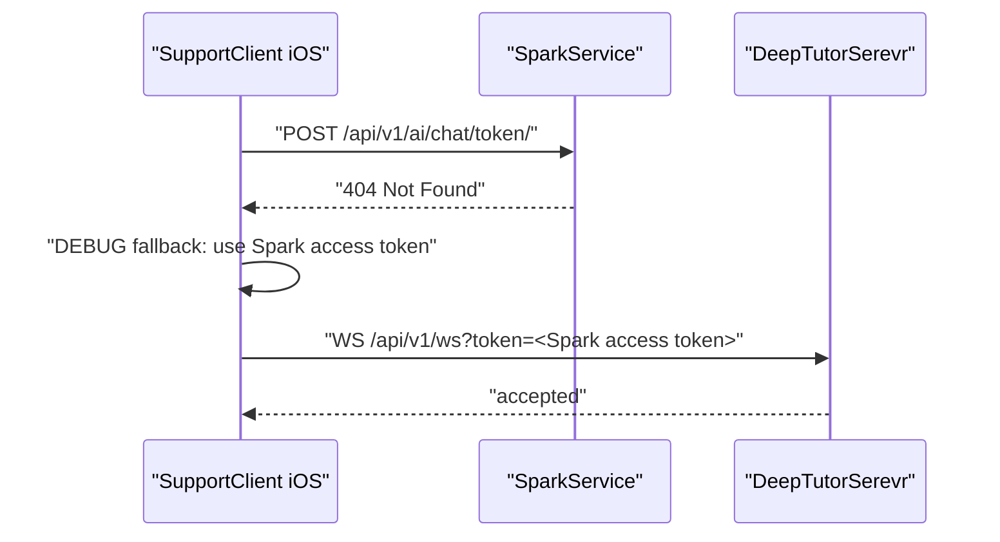
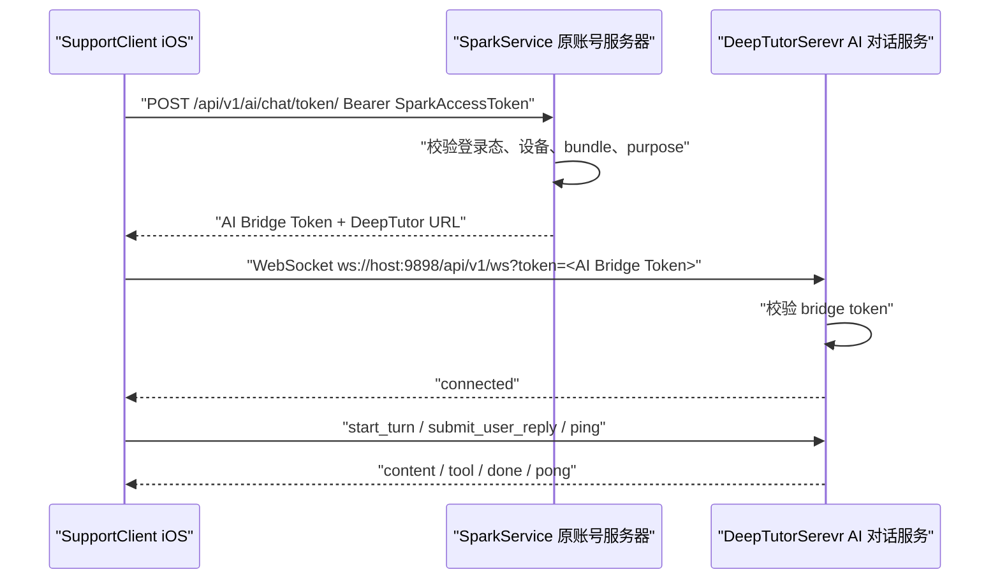

# 问题修复工单｜AI Bridge Token 签发接口 404

## 1. 工单摘要

当前 iOS 端发起 AI 对话前，会先向 SparkService 请求 AI Bridge Token：

```http
POST /api/v1/ai/chat/token/
Authorization: Bearer <Spark access token>
Content-Type: application/json
X-Request-ID: 49FCBA41-21C9-449B-82E7-7F7F32DB4CD9
```

请求体：

```json
{
  "app_bundle": "cn.zhaodk.SupportClient",
  "purpose": "deeptutor_ai_chat",
  "client": "ios"
}
```

SparkService 返回：

```http
HTTP/1.1 404 Not Found
Server: daphne
Content-Type: text/html; charset=utf-8
```

iOS Debug 构建随后回退使用 Spark access token 作为 DeepTutorSerevr 调试凭证，并成功建立 WebSocket：

```text
AI Bridge Token 签发失败，将尝试回退 access token（仅开发联调）
使用 Spark access token 作为 DeepTutor 调试凭证
AIChat WebSocket 连接中 url=ws://192.168.1.152:9898/api/v1/ws?token=<redacted>
backend INFO: 192.168.1.212:60873 - "WebSocket /api/v1/ws?token=<full-jwt>" [accepted]
```

结论：WebSocket 地址已经修正为 `ws://`，当前新问题是 SparkService 缺少 `/api/v1/ai/chat/token/` 签发接口，导致 iOS 无法走正式 Bridge Token 链路。

## 2. 影响范围

| 维度 | 当前影响 |
| --- | --- |
| iOS Debug | 可通过 access token fallback 临时连通，但日志会持续出现 404 和降级提示 |
| iOS Release | 不允许 fallback 时，AI 对话入口会因为 token 签发失败而无法连接 |
| SparkService | 缺少 AI Bridge Token 签发 API |
| DeepTutorSerevr | 当前环境可接受传入 token，但正式方案需要校验专用 bridge token |
| 安全 | DeepTutorSerevr access log 打印了完整 query token，需要脱敏或关闭该类日志 |

## 3. 当前链路



当前链路只是开发联调可用，不能视为正式鉴权闭环。

## 4. 根因定位

### 4.1 SparkService 路由未挂载

SparkService 总路由存在：

```python
path('api/v1/ai/', include('ai_config.urls')),
path('api/v1/ai/chat/', include('chat_sync.urls')),
```

`ai_config.urls` 当前仅包含：

```python
path("config/bootstrap/", AIBootstrapConfigView.as_view(), name="ai_config_bootstrap")
path("trial/status/", TrialStatusView.as_view(), name="ai_trial_status")
path("trial/apply/", TrialApplyView.as_view(), name="ai_trial_apply")
path("providers/test-connection/", AIProviderConnectionTestView.as_view(), name="ai_provider_test_connection")
```

`chat_sync.urls` 当前仅包含：

```python
path("sync/push/", ChatSyncPushView.as_view(), name="chat_sync_push")
path("sync/pull/", ChatSyncPullView.as_view(), name="chat_sync_pull")
path("sync/thread-pull/", ChatSyncThreadPullView.as_view(), name="chat_sync_thread_pull")
path("sync/thread-push/", ChatSyncThreadPushView.as_view(), name="chat_sync_thread_push")
path("sync/thread-delete/", ChatSyncThreadDeleteView.as_view(), name="chat_sync_thread_delete")
path("sync/thread-head/", ChatSyncThreadHeadView.as_view(), name="chat_sync_thread_head")
```

因此 `/api/v1/ai/chat/token/` 没有匹配路由，Django/Daphne 返回 HTML 404。

### 4.2 iOS 请求路径符合 P0 设计，但后端尚未落地

iOS `AIBridgeTokenAPI` 当前请求路径为：

```swift
path: "/api/v1/ai/chat/token/"
```

请求字段为：

```swift
client: "ios"
device_id: deviceID
app_bundle: Bundle.main.bundleIdentifier ?? "SupportClient"
purpose: "deeptutor_ai_chat"
```

iOS 期望解析的 `data` 字段为：

```swift
token: String
expires_at: TimeInterval?
deeptutor_ws_url: String?
deeptutor_http_base_url: String?
```

SupportClient 网络层默认按统一响应壳解析：

```json
{
  "code": 0,
  "msg": "ok",
  "data": {}
}
```

所以 SparkService 不能返回裸对象，必须返回统一 envelope。

## 5. 修复目标

1. SparkService 新增 `POST /api/v1/ai/chat/token/`。
2. SparkService 使用原有登录体系校验 `Authorization: Bearer <Spark access token>`。
3. SparkService 签发短时效 AI Bridge Token，不直接把 Spark access token 下发给 DeepTutorSerevr。
4. DeepTutorSerevr 支持校验 AI Bridge Token，并映射到 DeepTutor 当前用户上下文。
5. iOS Debug fallback 仅用于本地联调，Release 禁止 fallback。
6. DeepTutorSerevr 不再把 query token 明文打印到 access log。

## 6. 推荐架构



## 7. SparkService 落地方案

### 7.1 接口定义

接口：

```http
POST /api/v1/ai/chat/token/
Authorization: Bearer <Spark access token>
Content-Type: application/json
```

请求体：

```json
{
  "client": "ios",
  "device_id": "optional-device-id",
  "app_bundle": "cn.zhaodk.SupportClient",
  "purpose": "deeptutor_ai_chat"
}
```

成功响应：

```json
{
  "code": 0,
  "msg": "ok",
  "data": {
    "token": "<short-lived-ai-bridge-token>",
    "expires_at": 1785410772,
    "deeptutor_ws_url": "ws://192.168.1.152:9898/api/v1/ws",
    "deeptutor_http_base_url": "http://192.168.1.152:9898"
  }
}
```

失败响应：

```json
{
  "code": 40404,
  "msg": "ai_chat_bridge_token_endpoint_not_available",
  "data": null
}
```

建议业务错误码：

| HTTP 状态 | code | msg | 场景 |
| --- | ---: | --- | --- |
| 400 | 40001 | invalid_request | 缺少必填字段或字段非法 |
| 401 | 40101 | unauthorized | Spark access token 缺失、过期或无效 |
| 403 | 40301 | forbidden_bundle | app_bundle 不在允许列表 |
| 403 | 40302 | forbidden_purpose | purpose 非 `deeptutor_ai_chat` |
| 429 | 42901 | rate_limited | 签发频率超过限制 |
| 500 | 50001 | bridge_token_sign_failed | 签名失败或密钥未配置 |

### 7.2 路由挂载建议

推荐把签发接口放在 `ai_config` 侧，因为它属于 AI 服务入口配置和授权能力，不属于聊天历史同步。

目标路由：

```python
# SparkService/ai_config/urls.py
from django.urls import path

from ai_config.views import (
    AIBootstrapConfigView,
    AIChatBridgeTokenView,
    AIProviderConnectionTestView,
    TrialApplyView,
    TrialStatusView,
)

urlpatterns = [
    path("config/bootstrap/", AIBootstrapConfigView.as_view(), name="ai_config_bootstrap"),
    path("chat/token/", AIChatBridgeTokenView.as_view(), name="ai_chat_bridge_token"),
    path("trial/status/", TrialStatusView.as_view(), name="ai_trial_status"),
    path("trial/apply/", TrialApplyView.as_view(), name="ai_trial_apply"),
    path("providers/test-connection/", AIProviderConnectionTestView.as_view(), name="ai_provider_test_connection"),
]
```

由于 `SparkService/urls.py` 已经挂载：

```python
path('api/v1/ai/', include('ai_config.urls'))
```

最终路径就是：

```text
/api/v1/ai/chat/token/
```

可选方案是放入 `chat_sync.urls`：

```python
path("token/", AIChatBridgeTokenView.as_view(), name="ai_chat_bridge_token")
```

该方案也能得到同样路径，但会让 token 签发与 chat sync 模块耦合，不作为首选。

### 7.3 Serializer 示例

```python
from rest_framework import serializers


class AIChatBridgeTokenRequestSerializer(serializers.Serializer):
    client = serializers.ChoiceField(choices=["ios"])
    device_id = serializers.CharField(required=False, allow_blank=True, allow_null=True)
    app_bundle = serializers.CharField(max_length=128)
    purpose = serializers.ChoiceField(choices=["deeptutor_ai_chat"])
```

### 7.4 View 示例

```python
from datetime import datetime, timedelta, timezone
import uuid

import jwt
from django.conf import settings
from rest_framework.permissions import IsAuthenticated
from rest_framework.views import APIView
from rest_framework.response import Response


class AIChatBridgeTokenView(APIView):
    permission_classes = [IsAuthenticated]

    def post(self, request):
        serializer = AIChatBridgeTokenRequestSerializer(data=request.data)
        serializer.is_valid(raise_exception=True)
        data = serializer.validated_data

        if data["app_bundle"] not in settings.AI_CHAT_ALLOWED_BUNDLES:
            return Response(
                {"code": 40301, "msg": "forbidden_bundle", "data": None},
                status=403,
            )

        now = datetime.now(timezone.utc)
        expires_at = now + timedelta(minutes=settings.AI_CHAT_BRIDGE_TOKEN_TTL_MINUTES)

        payload = {
            "token_type": "deeptutor_bridge",
            "purpose": "deeptutor_ai_chat",
            "iss": "SparkService",
            "aud": "DeepTutorSerevr",
            "sub": str(request.user.id),
            "user_id": str(request.user.id),
            "client": data["client"],
            "device_id": data.get("device_id") or "",
            "bundle_id": data["app_bundle"],
            "iat": int(now.timestamp()),
            "exp": int(expires_at.timestamp()),
            "jti": uuid.uuid4().hex,
        }

        token = jwt.encode(
            payload,
            settings.DEEPTUTOR_BRIDGE_JWT_SECRET,
            algorithm="HS256",
        )

        return Response({
            "code": 0,
            "msg": "ok",
            "data": {
                "token": token,
                "expires_at": int(expires_at.timestamp()),
                "deeptutor_ws_url": settings.DEEPTUTOR_WS_URL,
                "deeptutor_http_base_url": settings.DEEPTUTOR_HTTP_BASE_URL,
            },
        })
```

### 7.5 SparkService settings 示例

```python
AI_CHAT_ALLOWED_BUNDLES = [
    "cn.zhaodk.SupportClient",
]

AI_CHAT_BRIDGE_TOKEN_TTL_MINUTES = 10

DEEPTUTOR_HTTP_BASE_URL = "http://192.168.1.152:9898"
DEEPTUTOR_WS_URL = "ws://192.168.1.152:9898/api/v1/ws"

DEEPTUTOR_BRIDGE_JWT_SECRET = env("DEEPTUTOR_BRIDGE_JWT_SECRET")
```

环境变量建议：

```bash
DEEPTUTOR_HTTP_BASE_URL=http://192.168.1.152:9898
DEEPTUTOR_WS_URL=ws://192.168.1.152:9898/api/v1/ws
DEEPTUTOR_BRIDGE_JWT_SECRET=<shared-secret>
AI_CHAT_BRIDGE_TOKEN_TTL_MINUTES=10
```

## 8. DeepTutorSerevr 落地方案

### 8.1 当前 WebSocket 入口

DeepTutorSerevr 当前 WebSocket 入口为：

```text
ws://192.168.1.152:9898/api/v1/ws
```

已确认 iOS 使用下面形式可以连通：

```text
ws://192.168.1.152:9898/api/v1/ws?token=<token>
```

### 8.2 Token 校验目标

DeepTutorSerevr 当前 `ws_require_auth` 从 query 或 cookie 读取 token：

```python
token = ws.query_params.get("token") or ws.cookies.get("dt_token")
```

正式方案需要在当前 `decode_token` 之外增加 AI Bridge Token 校验能力，至少校验：

| 字段 | 要求 |
| --- | --- |
| `token_type` | 必须是 `deeptutor_bridge` |
| `purpose` | 必须是 `deeptutor_ai_chat` |
| `iss` | 必须是 `SparkService` |
| `aud` | 必须是 `DeepTutorSerevr` |
| `exp` | 必须未过期 |
| `sub` / `user_id` | 必须能映射到 DeepTutor 当前用户 |
| `bundle_id` | 必须在允许列表内 |
| `client` | 当前 P0 只接受 `ios` |

### 8.3 DeepTutorSerevr 校验示例

```python
from jose import JWTError, jwt


def decode_bridge_token(token: str) -> TokenPayload | None:
    try:
        payload = jwt.decode(
            token,
            DEEPTUTOR_BRIDGE_JWT_SECRET,
            algorithms=["HS256"],
            audience="DeepTutorSerevr",
            issuer="SparkService",
        )
    except JWTError:
        return None

    if payload.get("token_type") != "deeptutor_bridge":
        return None
    if payload.get("purpose") != "deeptutor_ai_chat":
        return None
    if payload.get("bundle_id") not in DEEPTUTOR_ALLOWED_BRIDGE_BUNDLES:
        return None
    if payload.get("client") != "ios":
        return None

    user_id = str(payload.get("user_id") or payload.get("sub") or "")
    if not user_id:
        return None

    return TokenPayload(
        username=f"spark:{user_id}",
        role="user",
        user_id=user_id,
    )
```

集成方式建议：

```python
def decode_token(token: str) -> TokenPayload | None:
    bridge_payload = decode_bridge_token(token)
    if bridge_payload is not None:
        return bridge_payload

    return decode_original_deeptutor_token(token)
```

注意：不要在生产环境继续依赖 Spark access token fallback。Bridge Token 应该是 DeepTutorSerevr 唯一认可的跨服务凭证。

### 8.4 DeepTutorSerevr 环境变量

```bash
DEEPTUTOR_BRIDGE_JWT_SECRET=<same-as-spark-service>
DEEPTUTOR_ALLOWED_BRIDGE_BUNDLES=cn.zhaodk.SupportClient
DEEPTUTOR_ALLOWED_BRIDGE_ISSUER=SparkService
DEEPTUTOR_BRIDGE_AUDIENCE=DeepTutorSerevr
```

## 9. iOS 行为方案

### 9.1 当前可保留行为

iOS 当前 Debug 逻辑可保留：

```swift
#if DEBUG
if let accessToken = await tokenProvider.currentAccessToken() {
    logger.warning("使用 Spark access token 作为 DeepTutor 调试凭证", module: .aiChat)
    httpBaseURL = environment.deepTutorBaseURL
    webSocketURLBuilder = nil
    return (accessToken, .debugAccessTokenFallback)
}
#endif
```

用途仅限本地联调：

| 构建类型 | bridge token 失败后的行为 |
| --- | --- |
| Debug | 可 fallback，但 UI/日志要明确显示正在使用开发调试凭证 |
| Release | 不允许 fallback，直接展示 AI 服务配置错误或登录状态失效 |

### 9.2 生产约束

Release 构建必须满足：

1. `POST /api/v1/ai/chat/token/` 成功返回 `code=0`。
2. iOS 使用 `data.token` 连接 DeepTutorSerevr。
3. iOS 如果收到 404，不应继续请求 WebSocket。
4. iOS 不应把 Spark access token 作为 DeepTutorSerevr token。
5. iOS 日志继续保持 token 脱敏。

### 9.3 重试策略建议

当前日志显示：

```text
retryEnabled=true maxRetry=2
```

建议对 `AIChat.BridgeToken` 做错误分类：

| 错误 | 是否重试 | 原因 |
| --- | --- | --- |
| 404 | 否 | 接口不存在，重试无意义 |
| 400 / 401 / 403 | 否 | 请求或权限问题 |
| 408 / timeout | 是 | 临时网络问题 |
| 429 | 按 `Retry-After` | 服务端限流 |
| 500 / 502 / 503 / 504 | 是 | 服务端临时错误 |

## 10. 日志与安全修复

### 10.1 当前风险

iOS 已经输出：

```text
ws://192.168.1.152:9898/api/v1/ws?token=<redacted>
```

但 DeepTutorSerevr access log 输出了完整 token：

```text
"WebSocket /api/v1/ws?token=<full-jwt>" [accepted]
```

这是凭证泄漏风险，尤其当日志被上传、复制到工单、CI 或集中日志系统时。

### 10.2 必做修复

DeepTutorSerevr 需要满足：

1. WebSocket access log 不打印 query token。
2. 认证失败日志不打印原始 token。
3. 调试日志只允许打印 token 哈希前 8 位或 `<redacted>`。
4. 如果仍使用 query token，bridge token TTL 必须短，建议 10 分钟。

### 10.3 可选实现方式

方式一：关闭 uvicorn access log。

```bash
uvicorn deeptutor.api.main:app --host 0.0.0.0 --port 9898 --no-access-log
```

方式二：自定义 access logger，在写日志前清理 query。

```python
from urllib.parse import parse_qsl, urlencode, urlsplit, urlunsplit


def redact_token_in_url(url: str) -> str:
    parts = urlsplit(url)
    query = urlencode([
        (key, "<redacted>" if key == "token" else value)
        for key, value in parse_qsl(parts.query, keep_blank_values=True)
    ])
    return urlunsplit((parts.scheme, parts.netloc, parts.path, query, parts.fragment))
```

方式三：后续协议升级为 header 或 subprotocol 传 token。

当前 iOS `URLSessionWebSocketTask` 可支持 request header 方式，但 DeepTutorSerevr 当前 `ws_require_auth` 明确读取 query 或 cookie。因此 P0 先保持 query token，配合短 TTL 和日志脱敏；P1 之后再评估 header/subprotocol。

## 11. 手动验证方式

### 11.1 验证 SparkService 路由

```bash
curl -i \
  -X POST "http://192.168.1.152:<spark-port>/api/v1/ai/chat/token/" \
  -H "Authorization: Bearer <spark-access-token>" \
  -H "Content-Type: application/json" \
  -d '{
    "client": "ios",
    "device_id": "debug-device",
    "app_bundle": "cn.zhaodk.SupportClient",
    "purpose": "deeptutor_ai_chat"
  }'
```

预期：

```json
{
  "code": 0,
  "msg": "ok",
  "data": {
    "token": "<bridge-token>",
    "expires_at": 1785410772,
    "deeptutor_ws_url": "ws://192.168.1.152:9898/api/v1/ws",
    "deeptutor_http_base_url": "http://192.168.1.152:9898"
  }
}
```

### 11.2 验证 WebSocket

```bash
wscat -c "ws://192.168.1.152:9898/api/v1/ws?token=<bridge-token>"
```

连接后发送：

```json
{"type":"ping"}
```

预期收到：

```json
{"type":"pong"}
```

### 11.3 验证日志脱敏

DeepTutorSerevr 日志中允许出现：

```text
WebSocket /api/v1/ws?token=<redacted> [accepted]
```

不允许出现：

```text
WebSocket /api/v1/ws?token=eyJhbGciOi...
```

## 12. 自动化测试建议

### 12.1 SparkService 测试

| 测试项 | 预期 |
| --- | --- |
| 未登录请求 `/api/v1/ai/chat/token/` | 401 |
| 非法 `purpose` | 400 或 403 |
| 非法 `app_bundle` | 403 |
| 合法请求 | 200，`code=0`，返回 `data.token` |
| `expires_at` | 当前时间之后，TTL 约 10 分钟 |
| token claims | 包含 `token_type`、`purpose`、`iss`、`aud`、`user_id`、`client`、`bundle_id` |

### 12.2 DeepTutorSerevr 测试

| 测试项 | 预期 |
| --- | --- |
| 无 token 连接 `/api/v1/ws` | 拒绝 |
| 过期 bridge token | 拒绝 |
| 错误 `aud` | 拒绝 |
| 错误 `purpose` | 拒绝 |
| 正确 bridge token | accepted |
| access log | 不包含原始 JWT |

### 12.3 iOS 测试

| 测试项 | 预期 |
| --- | --- |
| SparkService 返回 200 | iOS 使用 bridge token 连接 |
| SparkService 返回 404 Debug | iOS 显示/记录开发 fallback |
| SparkService 返回 404 Release | iOS 不 fallback，不连接 WebSocket |
| SparkService 返回 `deeptutor_ws_url` | iOS 使用返回的 ws 地址 |
| token 日志 | iOS 只打印 `<redacted>` |

## 13. 验收标准

| 编号 | 标准 |
| --- | --- |
| AC1 | SparkService `POST /api/v1/ai/chat/token/` 不再返回 404 |
| AC2 | 成功响应符合 `{ code, msg, data }` 统一响应壳 |
| AC3 | `data` 包含 `token`、`expires_at`、`deeptutor_ws_url`、`deeptutor_http_base_url` |
| AC4 | iOS Debug 可用 bridge token 连接 DeepTutorSerevr |
| AC5 | iOS Release 不再使用 Spark access token fallback |
| AC6 | DeepTutorSerevr 可校验 `token_type=deeptutor_bridge` 的 token |
| AC7 | DeepTutorSerevr 拒绝过期、aud 错误、purpose 错误、bundle 错误的 token |
| AC8 | DeepTutorSerevr access log 不打印完整 JWT |
| AC9 | token TTL 不超过 15 分钟，推荐 10 分钟 |
| AC10 | 404、401、403 不触发无意义重试 |

## 14. 优先级

P0 必修：

1. SparkService 新增 `/api/v1/ai/chat/token/`。
2. SparkService 返回 iOS 当前 DTO 可解析的统一响应壳。
3. DeepTutorSerevr 支持 bridge token 校验。
4. DeepTutorSerevr 日志脱敏 query token。

P1 优化：

1. 对 `AIChat.BridgeToken` 做非重试错误分类。
2. 增加 bridge token 签发频率限制。
3. 增加 token `jti` 黑名单或撤销能力。
4. 评估 WebSocket header/subprotocol 传 token，减少 query token 暴露面。

## 15. 风险与注意事项

1. 不能把 Spark access token 当作长期跨服务凭证，否则 DeepTutorSerevr 会过度信任 SparkService 的主登录 token。
2. 不能只在 iOS 修复，因为 404 根因在 SparkService 路由缺失。
3. 不能只让 DeepTutorSerevr 接受任意 JWT，需要校验 `iss`、`aud`、`purpose` 和 `token_type`。
4. 不能把 `deeptutor_ws_url` 返回成 `http://` 或 `https://`，WebSocket 必须是 `ws://` 或 `wss://`。
5. 真机调试不要使用 `localhost`，应使用 Mac 局域网 IP，例如 `192.168.1.152`。
6. 生产环境必须使用 `https://` 和 `wss://`，本地联调才使用 `http://` 和 `ws://`。

## 16. 建议实施顺序

1. SparkService 增加路由和 View，让 `/api/v1/ai/chat/token/` 返回 200。
2. SparkService 增加环境变量和短时效 bridge token 签名。
3. DeepTutorSerevr 增加 bridge token verifier。
4. DeepTutorSerevr access log 对 query token 脱敏。
5. iOS 用真实 bridge token 验证 WebSocket 连接。
6. 禁止 Release fallback，保留 Debug fallback。
7. 补齐服务端和 iOS 单测。

