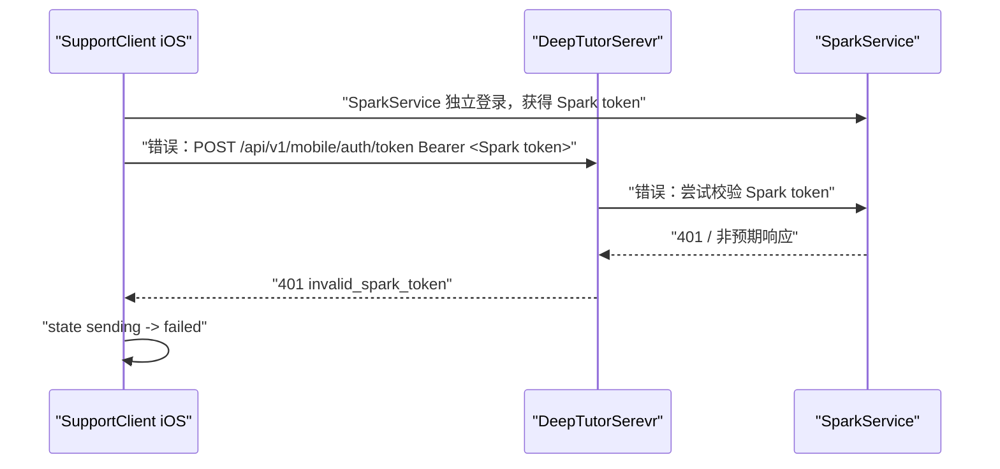
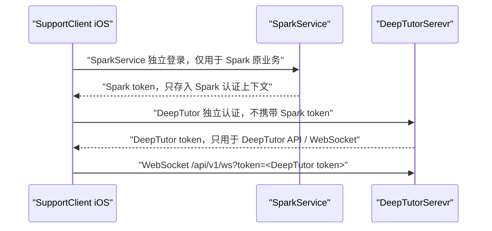

# 问题修复工单｜DeepTutor Mobile Auth 401

## 1. 工单摘要

当前 iOS 已经切换到向 DeepTutorSerevr 获取 AI 对话专用 token：

```text
AIChat token_resolve_start source=DeepTutorSerevr endpoint=http://192.168.1.152:9898/api/v1/mobile/auth/token ai_trace_id=AIC-20260730-225810-A513FF84
```

但 DeepTutorSerevr 返回 401：

```text
backend WARNING deeptutor.api.routers.mobile_auth - mobile auth rejected: invalid Spark access token
backend 192.168.1.212 - "POST /api/v1/mobile/auth/token HTTP/1.1" 401
```

iOS 侧状态：

```text
AIChat state_change from=failed to=sending trigger=user_send ai_trace_id=AIC-20260730-225810-A513FF84
AIChat token_resolve_start source=DeepTutorSerevr endpoint=http://192.168.1.152:9898/api/v1/mobile/auth/token ai_trace_id=AIC-20260730-225810-A513FF84
AIChat state_change from=sending to=failed trigger=send_error ai_trace_id=AIC-20260730-225810-A513FF84
```

结论：当前失败发生在 DeepTutorSerevr 的 mobile auth token 交换阶段，尚未进入 WebSocket，也尚未进入 `start_turn`。

重要架构修正：

```text
DeepTutorSerevr 与 SparkService 必须完全独立。
DeepTutor token 与 Spark token 不通用、不互换、不互相校验。
```

因此，本工单中任何“DeepTutorSerevr 使用 Spark access token 换取 DeepTutor token”的方案均废弃，只保留为历史错误设计记录。新的修复方向是：iOS 单独完成 DeepTutorSerevr 认证，获取 DeepTutorSerevr 自己签发的 token；SparkService token 只用于 SparkService 原有业务。

## 2. 当前链路

当前错误链路：



目标正确链路：



## 3. 代码事实

### 3.1 iOS token 请求

iOS `DeepTutorTokenAPI` 请求：

```swift
let endpoint = environment.deepTutorBaseURL.appending(path: "api/v1/mobile/auth/token")
request.setValue(try await tokenProvider.authorizationHeaderValue(), forHTTPHeaderField: "Authorization")
```

说明 iOS 当前会把 Spark access token 放到 `Authorization` header 中，交给 DeepTutorSerevr 换取 DeepTutor mobile token。

该设计现在判定为错误设计，必须废弃。

### 3.2 DeepTutorSerevr mobile auth

DeepTutorSerevr 路由：

```python
app.include_router(mobile_auth.router, prefix="/api/v1/mobile/auth", tags=["mobile-auth"])
```

最终接口：

```text
POST /api/v1/mobile/auth/token
```

服务端逻辑：

```python
spark_token = authorization.split(" ", 1)[1].strip()
spark_session = await verify_spark_access_token(spark_token)
if spark_session is None:
    logger.warning("mobile auth rejected: invalid Spark access token")
    raise HTTPException(status_code=401, detail="invalid_spark_token")
```

### 3.3 DeepTutorSerevr 校验 Spark token 的方式

`verify_spark_access_token` 当前有两条路径：

```python
spark_base = os.getenv("SPARK_API_BASE_URL")
if spark_base:
    GET {spark_base}/api/v1/auth/session/
    Authorization: Bearer <Spark token>
```

如果没有配置 `SPARK_API_BASE_URL`，才会尝试本地 JWT fallback：

```python
spark_secret = os.getenv("SPARK_JWT_SIGNING_KEY") or os.getenv("SPARK_JWT_SECRET")
jwt.decode(token, spark_secret, algorithms=["HS256"], options={"verify_aud": False})
```

### 3.4 SparkService 真实 session endpoint

SparkService 确实存在：

```python
path("auth/session/", CurrentSessionView.as_view(), name="auth_current_session")
```

由于 SparkService 总路由挂载：

```python
path('api/v1/', include('accounts.urls'))
```

最终路径是：

```text
/api/v1/auth/session/
```

所以这不是 endpoint 不存在导致的问题。

该实现现在判定为错误实现方向：

1. DeepTutorSerevr 不应该读取 `SPARK_API_BASE_URL` 来校验 Spark token。
2. DeepTutorSerevr 不应该配置 `SPARK_JWT_SIGNING_KEY` 或 `SPARK_JWT_SECRET`。
3. DeepTutorSerevr 不应该接收 Spark token 作为换票凭证。
4. Spark token 与 DeepTutor token 不允许通用。

### 3.5 SparkService session 校验不只是解 JWT

SparkService `CurrentSessionView` 要求：

```python
permission_classes = [IsAuthenticated]
```

项目认证类 `SparkJWTAuthentication` 会额外校验设备会话：

```python
DeviceSessionService.validate_access_claims(user=user, validated_token=validated_token)
```

因此 Spark access token 可能因为以下原因被拒绝：

1. token 过期；
2. token 不是 access token；
3. token 签名/secret 不匹配；
4. token 里的 `device_session_id` 找不到；
5. 设备会话被新登录替换；
6. 设备会话已 revoked/logout；
7. access token 的 bundle/device claims 与当前会话不一致；
8. DeepTutorSerevr 请求到了错误的 SparkService 实例。

## 4. 根因分析

### 4.0 架构根因：两个独立服务的 token 被混用了

本次 401 的根本原因不是“Spark token 应该怎样被 DeepTutor 校验”，而是这个校验动作本身不应该存在。

错误假设：

```text
iOS 可以拿 Spark token 去 DeepTutorSerevr 换 token。
```

正确假设：

```text
iOS 分别登录/授权两个服务。
Spark token 只访问 SparkService。
DeepTutor token 只访问 DeepTutorSerevr。
两个 token 不互认、不共享 secret、不做服务间校验。
```

因此，后续修复重点不应继续排查 Spark token 为什么 invalid，而应移除 DeepTutorSerevr 对 Spark token 的依赖。

### 4.1 历史错误分支 A：`SPARK_API_BASE_URL` 未配置或指向错误

如果 DeepTutorSerevr 的 `SPARK_API_BASE_URL` 没有指向当前 iOS 登录使用的 SparkService，就会出现：

```text
mobile auth rejected: invalid Spark access token
```

典型错误配置：

| 错误配置 | 结果 |
| --- | --- |
| 未配置 `SPARK_API_BASE_URL`，且无 `SPARK_JWT_SECRET` | 本地 fallback 无法解 token，返回 None |
| 指向旧 SparkService 实例 | token 签名或 DB 会话不一致 |
| 指向 localhost | DeepTutorSerevr 进程所在环境的 localhost，不是 iOS/用户想象的服务 |
| 使用外网/内网不一致地址 | 请求失败或打到错误服务 |

### 4.2 历史错误分支 B：iOS 本地 access token 已过期

iOS 当前日志显示：

```text
AIChat state_change from=failed to=sending trigger=user_send
AIChat token_resolve_start ...
AIChat state_change from=sending to=failed trigger=send_error
```

但没有看到：

```text
Spark access token refresh start
Spark access token refresh success
DeepTutor mobile token retry
```

说明 DeepTutor token 获取失败后，iOS 可能没有针对 DeepTutor 401 做 Spark token refresh + retry。

修复方向：当 `/api/v1/mobile/auth/token` 返回 401 且 detail 为 `invalid_spark_token` 时，iOS 应刷新 Spark access token，然后只重试一次 DeepTutor mobile token 请求。

### 4.3 历史错误分支 C：SparkService `/api/v1/auth/session/` 返回业务失败，但 DeepTutorSerevr 日志没有打印细节

当前 DeepTutorSerevr 只打印：

```text
invalid Spark access token
```

没有打印：

1. 实际请求的 Spark URL；
2. Spark HTTP status；
3. Spark 返回 body 的 `code/msg`；
4. Spark `X-Request-Id`；
5. 异常类型；
6. 是否走了 remote validate 还是 local JWT fallback。

这会让排查卡住。

### 4.4 历史错误分支 D：DeepTutorSerevr 只接受 Spark access token，但 iOS 传错 token 类型

iOS `tokenProvider.authorizationHeaderValue()` 理论上应返回：

```text
Authorization: Bearer <access_token>
```

但需要用日志确认不是：

1. refresh token；
2. 空 token；
3. DeepTutor token；
4. 已被清空的旧 token；
5. 其他环境账号 token。

## 5. 修复方案

### 5.0 新修复方向：彻底拆开 DeepTutorSerevr 与 SparkService token

必须删除当前跨服务 token 交换设计：

```text
删除：iOS -> DeepTutorSerevr Bearer <Spark access token>
删除：DeepTutorSerevr -> SparkService /api/v1/auth/session/
删除：DeepTutorSerevr 校验 Spark JWT secret
删除：Spark token fallback 连接 DeepTutor WebSocket
```

新增独立 DeepTutor 认证：

```text
iOS -> DeepTutorSerevr 独立登录/授权
DeepTutorSerevr -> iOS DeepTutor token
iOS -> DeepTutorSerevr WebSocket 使用 DeepTutor token
```

可选认证方式：

| 方式 | 说明 | 推荐 |
| --- | --- | --- |
| DeepTutor 独立账号登录 | DeepTutorSerevr 提供自己的账号、密码、设备登录或一次性调试登录 | 推荐用于完全独立服务 |
| DeepTutor 开发调试 token | 本地开发由 DeepTutorSerevr 提供固定调试签发接口或 CLI 生成 token | 推荐用于 P1 联调 |
| DeepTutor 匿名本地 token | AUTH_DISABLED / local-admin 场景下由 DeepTutorSerevr 签发短期 local token | 可用于本地 |
| Spark token 换 DeepTutor token | 依赖 SparkService token | 禁止 |

### 5.0.1 推荐 P1 本地联调方案

DeepTutorSerevr 提供独立调试 token endpoint：

```http
POST /api/v1/mobile/auth/debug-token
Content-Type: application/json
```

请求：

```json
{
  "client": "ios",
  "app_bundle": "cn.zhaodk.SupportClient",
  "purpose": "deeptutor_ai_chat",
  "device_id": "debug-device"
}
```

响应：

```json
{
  "code": 0,
  "msg": "ok",
  "data": {
    "token": "<deeptutor-mobile-token>",
    "token_type": "deeptutor_mobile_access",
    "expires_at": 1785424376,
    "deeptutor_ws_url": "ws://192.168.1.152:9898/api/v1/ws",
    "deeptutor_http_base_url": "http://192.168.1.152:9898",
    "user": {
      "id": "local-admin"
    }
  }
}
```

约束：

1. 只能 Debug 使用。
2. 只能本地网络或开发环境打开。
3. Release 构建不能调用。
4. token 仍由 DeepTutorSerevr `AUTH_SECRET` 签发。
5. 不依赖 SparkService。

### 5.0.2 推荐正式方案

DeepTutorSerevr 建立自己的移动端登录：

```text
POST /api/v1/mobile/auth/login
POST /api/v1/mobile/auth/refresh
POST /api/v1/mobile/auth/logout
GET  /api/v1/mobile/auth/session
```

iOS 持有两套 token store：

| Store | 用途 |
| --- | --- |
| `SparkAuthTokenProvider` | SparkService 登录、Pro、设置、原业务 |
| `DeepTutorAuthTokenProvider` | DeepTutorSerevr AI 对话、session、history、WebSocket |

两个 Store 不共享 token，不共享 refresh，不共享过期时间。

### 5.0.3 iOS 修复

iOS `DeepTutorTokenAPI` 不再调用：

```swift
tokenProvider.authorizationHeaderValue()
```

因为这是 Spark token provider。

改为：

```swift
deepTutorTokenProvider.authorizationHeaderValue()
```

或 P1 Debug：

```swift
DeepTutorDebugTokenAPI.issueDebugToken()
```

日志要求：

```text
AIChat token_resolve_start source=DeepTutorSerevr auth_context=deeptutor endpoint=...
AIChat token_resolve_request auth_header=DeepTutor <redacted>
```

禁止再出现：

```text
AIChat token_resolve_request auth_header=Spark <redacted>
mobile auth rejected: invalid Spark access token
```

### 5.1 历史补充：mobile_auth 增加详细但脱敏日志

目标：让 401 能定位具体失败分支。

建议日志：

```text
mobile auth verify_start mode=remote spark_base=http://192.168.1.152:8000 path=/api/v1/auth/session/ token_hash=sha256:abcd1234
mobile auth spark_response status=401 code=40104 msg=device_session_revoked request_id=<spark-request-id>
mobile auth rejected reason=spark_session_http_401 spark_status=401 spark_code=40104
```

异常日志：

```text
mobile auth spark_request_failed error_type=ConnectError spark_base=http://192.168.1.152:8000
```

本地 fallback 日志：

```text
mobile auth verify_start mode=local_jwt secret_configured=true token_hash=sha256:abcd1234
mobile auth rejected reason=jwt_decode_failed
```

禁止打印：

```text
Authorization: Bearer eyJ...
token=eyJ...
```

### 5.2 历史补充：返回稳定错误码

当前返回：

```json
{"detail":"invalid_spark_token"}
```

建议改成统一响应，或至少 detail 细化。

推荐：

```json
{
  "code": 40121,
  "msg": "spark_token_invalid",
  "data": {
    "reason": "spark_session_http_401",
    "recoverable": true
  }
}
```

错误映射：

| reason | HTTP | recoverable | 说明 |
| --- | --- | --- | --- |
| `missing_authorization` | 401 | false | iOS 未传 Authorization |
| `spark_session_http_401` | 401 | true | Spark access token 过期或设备会话失效 |
| `spark_session_http_403` | 403 | false | Spark 拒绝当前 token |
| `spark_session_nonzero_code` | 401 | true/false | Spark 返回业务失败 |
| `spark_session_missing_user_id` | 401 | false | Spark 成功但响应缺 user_id |
| `spark_service_unreachable` | 503 | true | DeepTutorSerevr 连不上 SparkService |
| `spark_jwt_secret_missing` | 500 | false | 本地 fallback 配置缺失 |
| `spark_jwt_decode_failed` | 401 | true | 本地 JWT 解码失败 |

### 5.3 废弃项：明确 `SPARK_API_BASE_URL`

该方向废弃。DeepTutorSerevr 不应该依赖 `SPARK_API_BASE_URL` 做移动端认证。

如果环境里存在以下变量，应从 DeepTutorSerevr mobile auth 主链路移除：

```bash
SPARK_API_BASE_URL
SPARK_JWT_SIGNING_KEY
SPARK_JWT_SECRET
```

这些变量不能成为 DeepTutorSerevr mobile token 签发的依赖。

历史说明如下，仅保留用于解释当前 401：

本地联调建议：

```bash
SPARK_API_BASE_URL=http://192.168.1.152:<spark-port>
```

注意：

1. 不能写 iPhone 的 IP；
2. 不能写 DeepTutorSerevr 自己的 `9898`；
3. 不能写前端 Web 端口；
4. 如果 SparkService 在 Mac 本机，DeepTutorSerevr 也在 Mac 本机，可以用 `http://127.0.0.1:<spark-port>`；
5. 如果 DeepTutorSerevr 在容器里，`127.0.0.1` 指向容器自身，必须改为宿主机地址。

### 5.4 废弃项：DeepTutor mobile auth 401 时刷新 Spark access token 后重试一次

该方向废弃。

原因：

```text
刷新 Spark access token 后再请求 DeepTutorSerevr，仍然是在复用 Spark token。
这违背“DeepTutorSerevr 与 SparkService 完全独立，token 不通用”的架构边界。
```

正确修复：

1. iOS 不拿 Spark token 请求 DeepTutorSerevr。
2. iOS 使用 DeepTutor 独立登录或 Debug token 获取 DeepTutor token。
3. DeepTutor token 过期时，刷新 DeepTutor token，而不是刷新 Spark token。

历史说明如下，仅保留用于解释错误方向：

当前 iOS 在收到 401/403 时直接：

```swift
throw AIChatError.authFailed
```

建议流程：

```text
POST DeepTutor /mobile/auth/token
  -> 401 invalid_spark_token
  -> AuthTokenProvider refresh Spark access token
  -> retry POST DeepTutor /mobile/auth/token once
  -> success: continue WebSocket
  -> still 401: fail and show login expired
```

伪代码：

```swift
func issueToken(deviceID: String?) async throws -> DeepTutorTokenResult {
    do {
        return try await issueTokenOnce(deviceID: deviceID)
    } catch AIChatError.authFailed {
        diagnostics.logTokenRefreshForDeepTutorStart()
        try await tokenProvider.refreshAccessToken()
        diagnostics.logTokenRefreshForDeepTutorSuccess()
        return try await issueTokenOnce(deviceID: deviceID)
    }
}
```

要求：

1. 只重试一次；
2. 只对 401 且可恢复原因重试；
3. refresh 失败要触发原有登录态失效处理；
4. 日志必须标记 `retry_after_refresh=true`；
5. 不要陷入无限重试。

### 5.5 iOS 修复 B：补充 DeepTutor token 请求响应日志

新增日志：

```text
AIChat token_resolve_request method=POST endpoint=http://192.168.1.152:9898/api/v1/mobile/auth/token auth_header=Bearer <redacted> body_keys=[client,app_bundle,purpose,device_id] ai_trace_id=...
AIChat token_resolve_response status=401 detail=invalid_spark_token cost=0.085s ai_trace_id=...
AIChat token_resolve_failed status=401 reason=deeptutor_auth_required auth_context=deeptutor ai_trace_id=...
AIChat token_resolve_result auth_mode=DeepTutor Mobile Access expires_in=1800s token=<redacted> ai_trace_id=...
```

### 5.6 iOS 修复 C：失败 UI 文案分类

| 场景 | 用户文案 |
| --- | --- |
| DeepTutor token 过期，refresh 成功 | 用户无感 |
| DeepTutor token 过期，refresh 失败 | AI 对话登录已过期，请重新连接 DeepTutor |
| DeepTutor 未登录 | 请先连接 AI 对话服务 |
| DeepTutor token endpoint 404 | AI 服务版本不匹配 |
| DeepTutor 返回 forbidden bundle | 当前 App 未被允许使用 AI 对话 |

## 6. 手动验证

### 6.1 废弃验证：从 DeepTutorSerevr 所在机器验证 Spark session

该验证只用于解释历史 401，不作为新架构验收项。

在 DeepTutorSerevr 运行环境中执行：

```bash
curl -i \
  -H "Authorization: Bearer <spark-access-token>" \
  "$SPARK_API_BASE_URL/api/v1/auth/session/"
```

预期：

```json
{
  "code": 0,
  "msg": "success",
  "data": {
    "user_id": 860
  }
}
```

如果这里失败，iOS 不可能成功换取 DeepTutor mobile token。

### 6.2 验证 DeepTutor mobile auth

```bash
curl -i \
  -X POST "http://192.168.1.152:9898/api/v1/mobile/auth/token" \
  -H "Authorization: Bearer <deeptutor-login-or-debug-token>" \
  -H "Content-Type: application/json" \
  -d '{
    "client": "ios",
    "app_bundle": "cn.zhaodk.SupportClient",
    "purpose": "deeptutor_ai_chat",
    "device_id": "debug-device"
  }'
```

预期：

```json
{
  "code": 0,
  "msg": "ok",
  "data": {
    "token": "<deeptutor-mobile-token>",
    "token_type": "deeptutor_mobile_access"
  }
}
```

### 6.3 验证过期 token 恢复

1. 使用过期 DeepTutor token 请求 DeepTutor mobile auth/refresh。
2. iOS 收到 401。
3. iOS refresh DeepTutor token。
4. iOS 重试 DeepTutor mobile auth。
5. 成功后连接 WebSocket。

## 7. 验收标准

| 编号 | 标准 |
| --- | --- |
| AC1 | iOS 不再把 Spark access token 发送给 DeepTutorSerevr |
| AC2 | DeepTutorSerevr 不打印原始 Spark token |
| AC3 | DeepTutorSerevr mobile auth 主链路不依赖 `SPARK_API_BASE_URL` |
| AC4 | DeepTutorSerevr 使用自己的登录/debug/refresh 机制签发 `deeptutor_mobile_access` |
| AC5 | iOS 收到 DeepTutor mobile auth 401 时只刷新 DeepTutor token，不刷新 Spark token |
| AC6 | refresh 成功后，iOS 能拿到 `deeptutor_mobile_access` token |
| AC7 | refresh 失败后，iOS 展示登录过期，不继续 WebSocket |
| AC8 | 成功后日志出现 `token_resolve_result auth_mode=DeepTutor Mobile Access` |
| AC9 | 失败后日志包含 status/detail/reason/request_id，但不包含 token |
| AC10 | 进入 WebSocket 前不再停在 `token_resolve_start -> failed` |

## 8. 实施拆分

| 阶段 | 目标 | 文件/模块 | 说明 |
| --- | --- | --- | --- |
| T0 | 架构清理 | DeepTutorSerevr env / mobile_auth | 移除 Spark token 校验主链路 |
| T1 | DeepTutor 独立认证 | `deeptutor/api/routers/mobile_auth.py` | 增加 login/debug-token/refresh 中至少一种 |
| T2 | DeepTutor token provider | iOS AIChat Infrastructure | 新建 DeepTutor token store，不复用 Spark token provider |
| T3 | iOS 401 DeepTutor refresh | `DeepTutorTokenAPI.swift` | 对 DeepTutor token 过期做一次恢复 |
| T4 | iOS token 请求日志增强 | `AIChatDiagnostics.swift` / `DeepTutorTokenAPI.swift` | 记录请求/响应摘要 |
| T5 | 端到端验证 | iOS + SparkService + DeepTutorSerevr | token -> ws -> start_turn |

## 9. 风险与注意事项

1. 不要把 Spark access token 或 Spark refresh token 传给 DeepTutorSerevr。
2. DeepTutorSerevr 不要保存、解析、校验 Spark token。
3. iOS 必须维护 DeepTutor 独立 token store。
4. SparkService 登录状态不等于 DeepTutorSerevr 登录状态。
5. DeepTutor token 过期只能刷新 DeepTutor token，不能刷新 Spark token 来恢复。
6. mobile auth 成功后仍需继续处理后续 `chat.config` 和 `start_turn` 契约问题，本工单只覆盖 DeepTutor 独立 token 边界。

## 10. 本工单结论

当前问题是 iOS 把 Spark access token 传给了 DeepTutorSerevr，而 DeepTutorSerevr 又尝试校验 Spark token。

最小修复闭环：

1. 移除 DeepTutorSerevr 对 Spark token 的依赖。
2. iOS 不再用 Spark token 请求 DeepTutorSerevr。
3. DeepTutorSerevr 提供独立登录/debug-token/refresh。
4. iOS 使用 DeepTutor 独立 token 连接 WebSocket。
5. 成功后再进入 `start_turn`。
