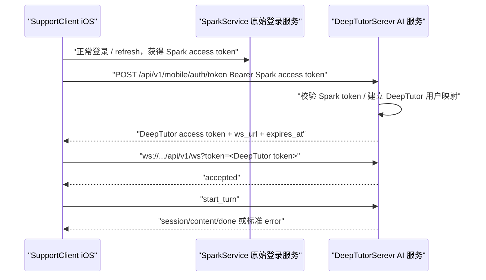

# 问题修复工单｜客户端完整日志与 DeepTutor Token 直连

## 1. 工单摘要

当前 AI 对话联调仍未修复，主要表现为：

```text
Invalid chat config: ui_schema_version: Extra inputs are not permitted; client: Extra inputs are not permitted
```

服务端已能接收 WebSocket，但 `start_turn` 被拒绝：

```text
backend WARNING deeptutor.api.routers.ws_errors - WS start_turn rejected user_id=local-admin session_id= code=turn_rejected reason=start_turn_rejected client_message_id=
```

iOS 仍在请求 SparkService 的 AI Bridge Token 接口：

```text
POST /api/v1/ai/chat/token/ -> 404
AI Bridge Token 签发失败，使用 Spark access token 作为 DeepTutor 调试凭证
```

本工单冻结新的修复方向：

1. 客户端增加超级详细的 AIChat 诊断日志。
2. 当前问题只定位，不在本工单内修复代码。
3. AI 对话 token 改为只从 DeepTutorSerevr 获取，不再从 SparkService 获取 `/api/v1/ai/chat/token/`。

## 2. 当前未修复问题

| 编号 | 问题 | 当前状态 | 证据 |
| --- | --- | --- | --- |
| DT-TOKEN-1 | iOS 仍请求 SparkService `/api/v1/ai/chat/token/` | 未修复 | 返回 404，`Server=daphne` |
| DT-TOKEN-2 | iOS fallback 使用 Spark access token 连接 DeepTutorSerevr | 未修复 | `使用 Spark access token 作为 DeepTutor 调试凭证` |
| DT-WS-1 | DeepTutorSerevr access log 明文打印完整 JWT | 未修复 | `WebSocket /api/v1/ws?token=eyJ...` |
| DT-WS-2 | `start_turn` 被服务端拒绝 | 未修复 | `WS start_turn rejected` |
| DT-CONFIG-1 | `chat.config` 传入了 DeepTutorSerevr 不允许的字段 | 未修复 | `client/ui_schema_version Extra inputs are not permitted` |
| DT-LOG-1 | iOS 诊断日志仍不足以完整还原 send/receive payload | 待增强 | 服务端 `client_message_id=` 为空 |

## 3. 根因定位

### 3.1 `Invalid chat config` 的直接根因

DeepTutorSerevr 的 `chat` capability 配置模型禁止额外字段。

代码事实：

```python
class ChatRequestConfig(BaseModel):
    model_config = ConfigDict(extra="forbid")
```

因此 `config` 中不能出现：

```json
{
  "client": "ios",
  "ui_schema_version": "1"
}
```

当前错误：

```text
Invalid chat config: ui_schema_version: Extra inputs are not permitted; client: Extra inputs are not permitted
```

含义是：

1. WebSocket 握手成功。
2. iOS 发送了 `start_turn`。
3. DeepTutorSerevr 收到 `start_turn`。
4. DeepTutorSerevr 在 `validate_capability_config("chat", config)` 阶段拒绝。
5. AI 模型还没有真正开始推理。

### 3.2 iOS 当前存在两套 payload 行为

P1 Debug 最小入口已经设计为：

```swift
config: [:]
```

这个理论上不会触发 `client/ui_schema_version` 错误。

但正式聊天入口使用：

```swift
AIStartTurnPayload(
    content: text,
    sessionID: state.activeSession?.id,
    capability: "chat",
    llmSelection: llmSelection
)
```

而 `AIStartTurnPayload` 的默认值是：

```swift
config: [String: String]? = ["client": "ios", "ui_schema_version": "1"]
```

所以只要正式入口没有显式传 `config: [:]` 或 `config: nil`，就会继续发送 DeepTutorSerevr 不允许的字段。

结论：问题没有修复的核心原因，是正式聊天入口仍可能走默认 `config`，而 DeepTutorSerevr 对 `chat.config` 是严格空对象契约。

### 3.3 `agent-19-15-doubao-seed-2-0-pro-260215` 的作用

日志：

```text
已解析场景=chat，来源=proOverlay，模型=agent-19-15-doubao-seed-2-0-pro-260215
```

含义：

| 字段 | 说明 |
| --- | --- |
| `场景=chat` | 当前业务场景是 AI 对话 |
| `来源=proOverlay` | 模型配置来自 SparkService 下发的 Pro 配置覆盖层 |
| `模型=agent-19-15-doubao-seed-2-0-pro-260215` | iOS 侧解析出的模型标识 |

它只说明 iOS/SparkService 侧知道“chat 场景应使用哪个模型”。

它不说明 DeepTutorSerevr 已经接受该模型。

正式接入时还需要解决：

1. SparkService 模型标识如何映射为 DeepTutorSerevr `llm_selection`。
2. DeepTutorSerevr 是否认可该 profile/model。
3. iOS 发送 `start_turn` 时是否带了 DeepTutorSerevr 能识别的 `llm_selection`。

### 3.4 `client_message_id=` 为空的问题

服务端日志：

```text
client_message_id=
```

说明 iOS 当前发出的 `start_turn` frame 没有携带可关联的客户端消息 ID。

后果：

1. 不能把 iOS “发送某条消息”与服务端 “拒绝某条 start_turn” 精确关联。
2. 多次点击、自动重连、重复发送时难以排查。
3. 不能稳定复现“哪个 payload 触发了 Invalid chat config”。

## 4. 新鉴权方向：token 只从 DeepTutorSerevr 获取

### 4.1 废弃当前 SparkService Bridge Token 请求

当前 iOS 请求：

```http
POST /api/v1/ai/chat/token/
Host: SparkService
Authorization: Bearer <Spark access token>
```

新方向：

```text
iOS 不再调用 SparkService /api/v1/ai/chat/token/
```

原因：

1. 该接口当前不存在，持续 404。
2. AI 对话连接目标是 DeepTutorSerevr。
3. DeepTutorSerevr 应拥有自己可校验、可撤销、可审计的 AI 对话 token。
4. SparkService 继续负责原始登录和账号体系，不负责 DeepTutor WebSocket token 签发。

### 4.2 新目标链路



### 4.3 关键边界说明

“token 只从 DeepTutorSerevr 获取”并不等于完全不使用 SparkService 登录态。

推荐边界：

| 项 | 归属 |
| --- | --- |
| 用户登录、refresh、设备会话 | SparkService |
| iOS 本地登录态保存 | SupportClient 原有认证体系 |
| AI 对话 WebSocket token 签发 | DeepTutorSerevr |
| AI 对话 token 校验 | DeepTutorSerevr |
| Spark 用户到 DeepTutor 用户映射 | DeepTutorSerevr |
| AI turn/session/history | DeepTutorSerevr |

DeepTutorSerevr 可以把 Spark access token 作为“换取 DeepTutor token 的证明”，但最终 WebSocket 使用的必须是 DeepTutorSerevr 自己签发的 token。

## 5. DeepTutorSerevr Token 接口方案

### 5.1 推荐接口

```http
POST /api/v1/mobile/auth/token
Host: DeepTutorSerevr
Authorization: Bearer <Spark access token>
Content-Type: application/json
```

请求体：

```json
{
  "client": "ios",
  "app_bundle": "cn.zhaodk.SupportClient",
  "purpose": "deeptutor_ai_chat",
  "device_id": "optional-device-id"
}
```

响应体：

```json
{
  "code": 0,
  "msg": "ok",
  "data": {
    "token": "<deeptutor-access-token>",
    "token_type": "deeptutor_mobile_access",
    "expires_at": 1785424376,
    "deeptutor_ws_url": "ws://192.168.1.152:9898/api/v1/ws",
    "deeptutor_http_base_url": "http://192.168.1.152:9898",
    "user": {
      "id": "local-admin",
      "spark_user_id": "860"
    },
    "llm_selection": {
      "profile_id": "agent-19-15",
      "model_id": "doubao-seed-2-0-pro-260215"
    }
  }
}
```

### 5.2 DeepTutor token claims

DeepTutorSerevr 签发的 token 建议包含：

```json
{
  "token_type": "deeptutor_mobile_access",
  "purpose": "deeptutor_ai_chat",
  "iss": "DeepTutorSerevr",
  "aud": "DeepTutorSerevr",
  "sub": "local-admin",
  "spark_user_id": "860",
  "device_session_id": "348",
  "bundle_id": "cn.zhaodk.SupportClient",
  "client": "ios",
  "iat": 1785422576,
  "exp": 1785424376,
  "jti": "<uuid>"
}
```

### 5.3 DeepTutorSerevr 需要承担的校验

| 校验项 | 说明 |
| --- | --- |
| Spark access token 有效性 | 可以调用 SparkService introspection，或共享公钥/JWT 校验配置 |
| bundle 校验 | 只允许 `cn.zhaodk.SupportClient` |
| purpose 校验 | 必须是 `deeptutor_ai_chat` |
| user mapping | Spark `user_id=860` 映射到 DeepTutor 用户 |
| model mapping | Spark `agent-19-15-doubao...` 映射到 DeepTutor `llm_selection` |
| token TTL | 建议 10-30 分钟 |
| jti 审计 | 便于撤销和排查 |
| 日志脱敏 | 不打印原始 Spark token 或 DeepTutor token |

## 6. 客户端超级详细日志方案

### 6.1 日志目标

客户端日志必须能回答以下问题：

1. 当前连接的是哪个 DeepTutorSerevr 地址。
2. token 是从哪里来的：DeepTutorSerevr token / Debug fallback / none。
3. 每一次 WebSocket connect 是否重复。
4. 每一个 outgoing frame 的 type、client_message_id、session_id、turn_id、config keys。
5. 每一个 incoming frame 的 type、seq、session_id、turn_id、metadata.code、content 摘要。
6. `start_turn` 被拒绝时，能看到完整的脱敏诊断链。
7. 任何日志都不能泄露 token、Authorization、API Key、用户完整输入、附件内容。

### 6.2 必须新增的关联 ID

| ID | 生成方 | 生命周期 | 用途 |
| --- | --- | --- | --- |
| `ai_trace_id` | iOS | 一次进入 AIChat 页面 | 串联页面级所有日志 |
| `connection_attempt_id` | iOS | 每次 connect | 判断重复连接和重连 |
| `ws_session_id` | iOS | WebSocket accepted 后本地生成 | 串联当前 socket 收发 |
| `client_message_id` | iOS | 每次发送业务 frame | 关联 start_turn 与服务端 rejected |
| `request_id` | HTTP 层 | 每个 HTTP 请求 | 关联 token 获取请求 |
| `turn_id` | DeepTutorSerevr | turn 创建成功后 | 关联流式事件 |
| `session_id` | DeepTutorSerevr | 会话级 | 关联历史与恢复 |

### 6.3 日志分层

| 层级 | 模块 | 日志内容 |
| --- | --- | --- |
| Presentation | `AIChatViewModel` / Debug ViewModel | 用户动作、状态切换、错误展示 |
| Application | UseCase / Reducer | payload 生成、状态机输入输出 |
| Infrastructure | Token API / WebSocketClient | token 获取、connect、send、receive、reconnect |
| Domain | DTO / payload builder | 字段摘要、config keys、llm_selection |
| Security | Sanitizer | 脱敏结果、禁止字段拦截 |

### 6.4 连接前日志

示例：

```text
AIChat trace_start ai_trace_id=AIC-20260730-001 entry=main_chat account_id=860
AIChat token_resolve_start ai_trace_id=AIC-20260730-001 source=DeepTutorSerevr endpoint=http://192.168.1.152:9898/api/v1/mobile/auth/token
AIChat token_resolve_result ai_trace_id=AIC-20260730-001 auth_mode=deeptutor_mobile_access expires_in=1800s ws_url=ws://192.168.1.152:9898/api/v1/ws token=<redacted>
```

禁止：

```text
token=eyJhbGciOi...
Authorization=Bearer eyJ...
```

### 6.5 WebSocket connect 日志

示例：

```text
AIChat ws_connect_start ai_trace_id=AIC-001 connection_attempt_id=WSA-001 url=ws://192.168.1.152:9898/api/v1/ws?token=<redacted>
AIChat ws_connect_open ai_trace_id=AIC-001 connection_attempt_id=WSA-001 ws_session_id=WSS-001 state=running
AIChat ws_connect_skip ai_trace_id=AIC-001 reason=already_connected same_url=true ws_session_id=WSS-001
AIChat ws_disconnect ai_trace_id=AIC-001 ws_session_id=WSS-001 reason=user_cancel will_retry=false
AIChat ws_reconnect_schedule ai_trace_id=AIC-001 old_ws_session_id=WSS-001 attempt=1 delay_ms=200 reason=heartbeat_timeout
```

### 6.6 outgoing frame 日志

发送 `start_turn` 前必须打印摘要：

```text
AIChat ws_send_start ai_trace_id=AIC-001 ws_session_id=WSS-001 client_message_id=CM-001 type=start_turn capability=chat session_id=<empty> content_chars=12 content_hash=sha256:abcd1234 config_keys=[] llm_selection=profile:agent-19-15/model:doubao-seed-2-0-pro-260215
```

如果错误再次出现，必须能看到：

```text
config_keys=["client","ui_schema_version"]
```

这就是定位 `Invalid chat config` 的关键证据。

### 6.7 incoming frame 日志

收到 error：

```text
AIChat ws_recv_error ai_trace_id=AIC-001 ws_session_id=WSS-001 client_message_id=CM-001 type=error source=unified_ws seq=0 session_id=<empty> turn_id=<empty> code=turn_rejected reason=start_turn_rejected content="Invalid chat config: ui_schema_version: Extra inputs are not permitted; client: Extra inputs are not permitted"
```

收到正常事件：

```text
AIChat ws_recv_event ai_trace_id=AIC-001 ws_session_id=WSS-001 type=session seq=0 session_id=sess_x turn_id=turn_x
AIChat ws_recv_event ai_trace_id=AIC-001 ws_session_id=WSS-001 type=content seq=1 session_id=sess_x turn_id=turn_x content_chars=8
AIChat ws_recv_event ai_trace_id=AIC-001 ws_session_id=WSS-001 type=done seq=99 session_id=sess_x turn_id=turn_x status=completed
```

### 6.8 状态机日志

```text
AIChat state_change ai_trace_id=AIC-001 from=ready to=sending trigger=user_send
AIChat state_change ai_trace_id=AIC-001 from=sending to=failed trigger=server_error code=turn_rejected
AIChat user_error ai_trace_id=AIC-001 message_key=ai_chat.error.invalid_config debug_code=turn_rejected
```

### 6.9 日志脱敏规则

| 字段 | 处理 |
| --- | --- |
| `token` | `<redacted>` |
| `Authorization` | `Bearer <redacted>` |
| `api_key` / `secret` / `password` | `<redacted>` |
| 用户输入 `content` | 不打印原文，只打印 `content_chars` 和 hash；Debug 可打印最多 20 字摘要 |
| 附件 base64 | 禁止打印 |
| WebSocket URL query | token query 替换为 `<redacted>` |
| metadata | 只允许白名单字段：`code/reason/status/recoverable/client_message_id/request_id` |

## 7. 当前问题的建议修复方向

本工单只定位，不直接修复代码。建议后续按以下顺序拆分实现工单。

### 7.1 工单 A：改 token 获取来源

目标：

1. 删除 iOS 对 SparkService `/api/v1/ai/chat/token/` 的依赖。
2. 新增 iOS 调用 DeepTutorSerevr token endpoint。
3. DeepTutorSerevr 签发 `deeptutor_mobile_access`。
4. WebSocket 只使用 DeepTutorSerevr token。

验收：

```text
日志中不再出现：operation=AIChat.BridgeToken path=/api/v1/ai/chat/token/
日志中出现：token_resolve_start source=DeepTutorSerevr
WebSocket token_type=deeptutor_mobile_access
```

### 7.2 工单 B：修复 chat config 契约

目标：

1. `capability=chat` 时，iOS `config` 必须为 `{}` 或不传。
2. `client/ui_schema_version` 不再放入 `config`。
3. 如需客户端上下文，另放 `client_context`，并由 DeepTutorSerevr 明确支持。

验收：

```text
ws_send_start type=start_turn capability=chat config_keys=[]
不再出现 Invalid chat config
```

### 7.3 工单 C：增加 client_message_id

目标：

1. iOS 每个业务 frame 都带 `client_message_id`。
2. DeepTutorSerevr error frame 原样回传。
3. 服务端 rejected 日志不再出现 `client_message_id=` 空值。

验收：

```text
iOS send: client_message_id=CM-001
backend rejected: client_message_id=CM-001
iOS recv error: client_message_id=CM-001
```

### 7.4 工单 D：客户端完整日志

目标：

1. 增加 `ai_trace_id`。
2. 增加 WebSocket connect/send/receive/state 日志。
3. 增加 payload summary。
4. 增加 error metadata 摘要。
5. 加强 token 和用户输入脱敏。

验收：

```text
一次失败可以从 iOS 日志完整还原：
用户点击 -> token 获取 -> ws connect -> start_turn payload keys -> 服务端 error -> UI error
```

### 7.5 工单 E：服务端日志脱敏

目标：

1. DeepTutorSerevr access log 不打印完整 token。
2. rejected 日志不打印用户完整输入。
3. error 日志包含 code/reason/client_message_id。

验收：

```text
允许：WebSocket /api/v1/ws?token=<redacted>
禁止：WebSocket /api/v1/ws?token=eyJ...
```

## 8. 推荐最终协议

### 8.1 token 获取

```json
{
  "client": "ios",
  "app_bundle": "cn.zhaodk.SupportClient",
  "purpose": "deeptutor_ai_chat"
}
```

返回：

```json
{
  "token": "<deeptutor-token>",
  "deeptutor_ws_url": "ws://192.168.1.152:9898/api/v1/ws",
  "expires_at": 1785424376,
  "llm_selection": {
    "profile_id": "agent-19-15",
    "model_id": "doubao-seed-2-0-pro-260215"
  }
}
```

### 8.2 start_turn

```json
{
  "type": "start_turn",
  "client_message_id": "CM-001",
  "content": "用户输入",
  "session_id": null,
  "capability": "chat",
  "tools": [],
  "knowledge_bases": [],
  "language": "zh",
  "config": {},
  "llm_selection": {
    "profile_id": "agent-19-15",
    "model_id": "doubao-seed-2-0-pro-260215"
  },
  "client_context": {
    "client": "ios",
    "ui_schema_version": "1"
  }
}
```

注意：

1. `client_context` 是否支持，需要 DeepTutorSerevr 明确新增协议。
2. 如果 DeepTutorSerevr 不支持 `client_context`，iOS 不应发送。
3. `config` 对 `chat` 必须保持 `{}`。

### 8.3 error frame

```json
{
  "type": "error",
  "source": "unified_ws",
  "stage": "start_turn",
  "content": "Invalid chat config: ui_schema_version: Extra inputs are not permitted; client: Extra inputs are not permitted",
  "metadata": {
    "code": "turn_rejected",
    "reason": "invalid_chat_config",
    "recoverable": false,
    "client_message_id": "CM-001"
  },
  "session_id": "",
  "turn_id": "",
  "seq": 0
}
```

## 9. 验收标准

| 编号 | 标准 |
| --- | --- |
| AC1 | iOS 不再请求 SparkService `/api/v1/ai/chat/token/` |
| AC2 | iOS token 获取日志显示 `source=DeepTutorSerevr` |
| AC3 | WebSocket 使用 DeepTutorSerevr 签发的 token |
| AC4 | DeepTutorSerevr access log 不打印完整 JWT |
| AC5 | `start_turn` 日志包含 `client_message_id` |
| AC6 | `start_turn capability=chat` 时 `config_keys=[]` |
| AC7 | 不再出现 `Invalid chat config: ui_schema_version/client Extra inputs` |
| AC8 | 服务端 rejected 日志能显示非空 `client_message_id` |
| AC9 | iOS 收到 error 时能显示脱敏后的 `code/reason/content摘要` |
| AC10 | 成功路径能收到 `session/content/done`，失败路径能完整还原诊断链 |

## 10. 风险与注意事项

1. 不要再新增 SparkService AI Bridge Token 签发逻辑作为主路径；当前方向改为 DeepTutorSerevr 签发。
2. DeepTutorSerevr 仍需要校验 Spark 登录态，否则无法确认当前 iOS 用户身份。
3. `config` 不是客户端通用扩展字段，对 `chat` 来说必须遵守 DeepTutorSerevr 严格 schema。
4. 不能为了兼容 iOS 直接把 DeepTutorSerevr `ChatRequestConfig` 改成允许任意 extra；这会削弱协议边界。
5. 如果需要客户端版本、UI schema、App bundle，应定义独立 `client_context` 或在 token 请求中携带，不要放进 `chat.config`。
6. 任何新增日志必须先经过脱敏器，尤其 token、Authorization、用户输入、附件内容。

## 11. 本工单结论

当前问题没有修复。

最小闭环方向：

1. token 来源切到 DeepTutorSerevr。
2. iOS 增加完整诊断日志。
3. iOS `chat.config` 不再发送 `client/ui_schema_version`。
4. iOS 增加 `client_message_id`。
5. DeepTutorSerevr 日志脱敏并回传标准 error metadata。

