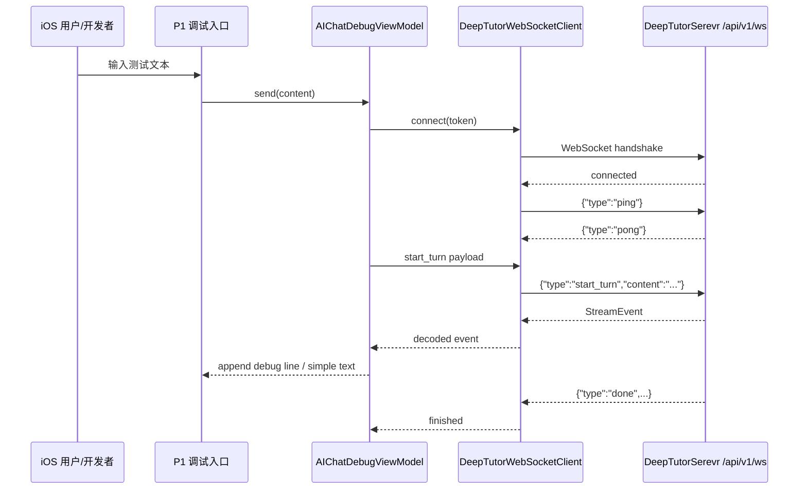
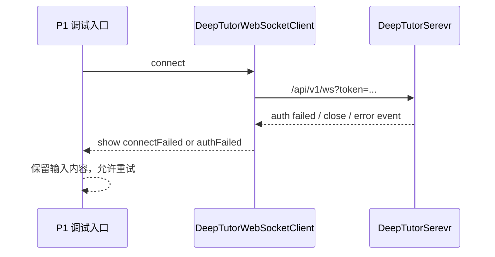
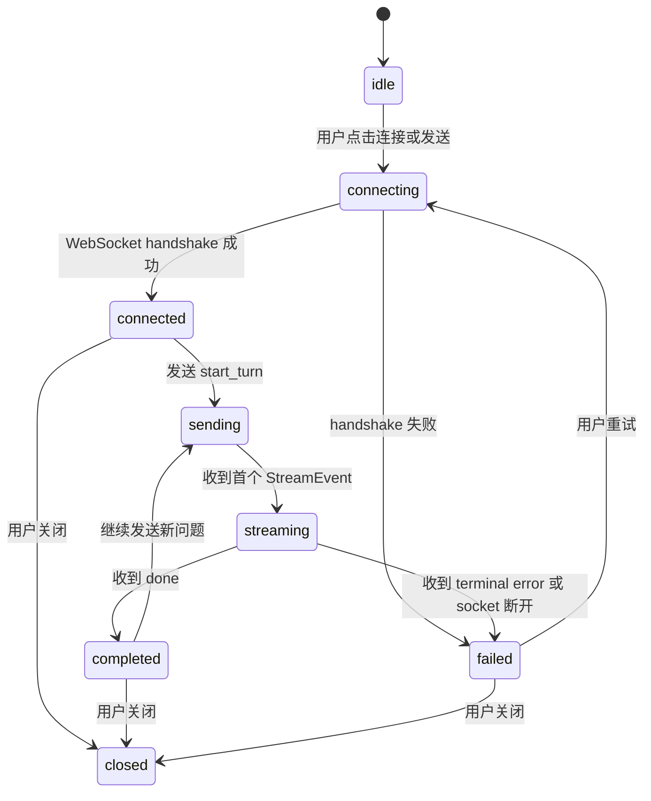

# P1 iOS 最小连通

> 本文档只补充 P1 阶段的 iOS 最小连通方案，不实现任何 Swift、Python、TypeScript 或配置代码。

## 1. 阶段定位

P1 的目标是让 SupportClient iOS 端以最小工程改动接入 DeepTutorSerevr 的统一 WebSocket，并完成一次“发送用户文本、接收服务端流式事件、显示调试结果”的闭环。

P1 不是正式 AI 对话产品入口，也不是完整聊天 UI 阶段。P1 只证明以下链路可行：

```text
SupportClient iOS
    ↓
读取当前登录态或开发调试 token
    ↓
连接 DeepTutorSerevr /api/v1/ws
    ↓
发送 start_turn
    ↓
接收 StreamEvent / pong / error
    ↓
在 iOS 调试视图或日志中可观察
```

P1 的关键价值：

- 提前暴露移动端 WebSocket、鉴权、URL、ATS、网络状态、JSON 兼容性问题。
- 让后续 P2 SwiftUI 页面入口不用再同时解决底层连通风险。
- 为 P3 事件完整渲染提供真实事件样本。
- 为 P4 正式账号隔离和 AI Bridge Token 打基础。

## 2. P1 结论

| 项目 | P1 冻结结论 |
| --- | --- |
| 实现范围 | 只做 iOS 最小 WebSocket 连通、最小发送、最小事件接收 |
| UI 范围 | 允许使用开发期调试入口或隐藏入口，不做正式产品化聊天 UI |
| 后端入口 | DeepTutorSerevr `/api/v1/ws` |
| 消息类型 | `start_turn`、`ping`，可选 `cancel_turn` |
| 接收类型 | `pong`、`session`、`session_meta`、`content`、`thinking`、`result`、`error`、`done` 等原始事件 |
| 会话历史 | P1 不做会话列表和历史恢复 |
| 账号隔离 | P1 只读取当前用户上下文；正式隔离放到 P4 |
| 鉴权 | P1 允许开发 token 或 DeepTutorSerevr 本地 auth disabled，必须明确标记不可生产 |
| 本地缓存 | P1 不缓存完整消息，只允许保存本次调试的 `session_id`、`turn_id`、`last_seq` 到内存 |
| 后续对齐 | P1 只冻结 iOS 对 DeepTutorSerevr 的协议消费形态，不要求其他端同步改动 |

## 3. 上游依据

| 来源 | 路径 | 对 P1 的约束 |
| --- | --- | --- |
| P0 方案冻结 | `/Users/hua/Documents/project/DeepTutor/SupportClient/总领文档/AI 对话/P0 方案与协议冻结/P0 方案与协议冻结.md` | P1 必须沿用服务边界、WebSocket 入口、消息类型和事件模型 |
| P0 技术细节 | `/Users/hua/Documents/project/DeepTutor/SupportClient/总领文档/AI 对话/P0 方案与协议冻结/技术细节文档.md` | P1 应新增 DeepTutorSerevr 独立 baseURL，不污染 SparkService `apiBaseURL` |
| DeepTutorSerevr WS 后端 | `/Users/hua/Documents/project/DeepTutor/DeepTutorSerevr/deeptutor/api/routers/unified_ws.py` | 服务端支持 `start_turn`、`ping`、订阅、恢复、取消、重新生成、用户回复 |
| DeepTutorSerevr StreamEvent | `/Users/hua/Documents/project/DeepTutor/DeepTutorSerevr/deeptutor/core/stream.py` | iOS 事件 DTO 必须以后端事件枚举为准 |
| DeepTutor Web 参考 | `/Users/hua/Documents/project/DeepTutor/DeepTutorSerevr/web/lib/unified-ws.ts` | 可参考心跳、重连、消息 DTO、事件消费方式 |
| iOS 环境配置 | `/Users/hua/Documents/project/DeepTutor/SupportClient/SupportClient/Projects/App/Sources/App/SupportAppEnvironment.swift` | P1 需要新增或预留 DeepTutorSerevr 地址配置 |
| iOS 原网络门面 | `/Users/hua/Documents/project/DeepTutor/SupportClient/SupportClient/Core/Networking/SupportBackend.swift` | DeepTutor WebSocket 不应塞进 SparkService 原业务 HTTP API 门面 |
| iOS 会话认证文档 | `/Users/hua/Documents/project/DeepTutor/SupportClient/总领文档/会话与认证/会话与认证需求.md` | iOS 登录态仍归原会话系统，不新增第二套登录 |

## 4. P1 不做范围

P1 明确不做：

| 不做项 | 原因 | 后续阶段 |
| --- | --- | --- |
| 正式聊天 UI | P1 只验证底层链路，避免 UI 与协议问题互相干扰 | P2 |
| Markdown 完整渲染 | P1 只展示原始事件或简单文本 | P3 |
| 工具调用可视化 | 工具事件需要完整事件矩阵 | P3 |
| 来源引用卡片 | sources 需要统一渲染规范 | P3 |
| 会话列表 | 需要 HTTP sessions API、分页和账号隔离 | P4/P5 |
| 历史恢复 | 需要 resume store 和 `last_seq` 持久化 | P4 |
| AI Bridge Token 正式闭环 | 需要 SparkService 与 DeepTutorSerevr 双端确认 | P4 |
| 附件、图片、文件 | 需要 OSS 与 DeepTutor 附件归属冻结 | P5 |
| 其他客户端对齐实现 | P1 是 iOS 技术探针，当前阶段不展开其他客户端 | P6/P7 |

## 5. P1 最小用户故事

### 5.1 开发者连通故事

作为 iOS 开发者，我希望在 SupportClient 内打开一个开发期 AI 对话调试入口，输入一句文本后可以看到 DeepTutorSerevr 返回事件，从而确认 iOS 到 AI 服务的 WebSocket 链路可用。

验收结果：

- 能看到连接中、已连接、发送中、接收中、完成、失败状态。
- 能看到本轮 `session_id`、`turn_id`、`seq`。
- 能看到至少一段服务端返回的 `content` 或 `result`。
- 失败时能看到原始错误摘要，不吞掉错误。

### 5.2 产品风险发现故事

作为产品和架构负责人，我希望 P1 能在正式 UI 前暴露环境地址、鉴权、跨服务用户映射、ATS、局域网设备调试等问题，从而决定 P2/P4 是否需要先补服务端能力。

验收结果：

- 文档记录 P1 使用的鉴权方式。
- 文档记录 P1 使用的 DeepTutorSerevr 地址。
- 文档记录 iOS 真机、模拟器各自连通情况。
- 文档记录需要进入 P4 的正式鉴权缺口。

## 6. 目标链路

### 6.1 最小连接链路



### 6.2 最小失败链路



## 7. iOS 项目架构与模块边界

P1 必须按 P0 的分层设计落地，避免把 WebSocket、JSON、状态机全塞进一个 SwiftUI View。当前工程已经出现 `AIChat` 四层目录，P1 的工作重点应从“创建目录”调整为“核验真实接入、补齐最小连通、记录缺口”。

目标职责如下：

| 层 | P1 职责 | P1 可简化项 |
| --- | --- | --- |
| Presentation | 调试入口、输入框、发送按钮、连接状态、原始事件列表 | 不做正式消息气泡 |
| Application | 管理连接状态、发送动作、接收事件、错误转 UI 状态 | 不做完整 event reducer |
| Domain | 定义最小 `AIStreamEvent`、`AIChatConnectionState`、`AIChatDebugMessage` | 不做完整 session/message 领域模型 |
| Infrastructure | WebSocket 建连、发送 JSON、接收 JSON、ping/pong、关闭连接 | 不做持久化恢复 |

### 7.1 当前已发现的真实目录结构

代码事实路径：

```text
/Users/hua/Documents/project/DeepTutor/SupportClient/SupportClient/Projects/Features/AIChat/
├── Application/
│   ├── AIChatEventReducer.swift
│   ├── AIChatUseCases.swift
│   └── AIChatViewModel.swift
├── Domain/
│   ├── AIChatAttachment.swift
│   ├── AIChatError.swift
│   ├── AIChatMessage.swift
│   ├── AIChatProtocolModels.swift
│   ├── AIChatSession.swift
│   ├── AIChatState.swift
│   ├── AIChatTurn.swift
│   └── AIStreamEvent.swift
├── Infrastructure/
│   ├── AIBridgeTokenAPI.swift
│   ├── AIChatDTOs.swift
│   ├── AIChatEventDecoder.swift
│   ├── AIChatRepository.swift
│   ├── AIChatResumeStore.swift
│   ├── AIChatWebSocketClient.swift
│   ├── AIChatWebSocketConnection.swift
│   └── DeepTutorSessionAPI.swift
└── Presentation/
    ├── AIAskUserCard.swift
    ├── AIChatComposer.swift
    ├── AIChatEmptyStateView.swift
    ├── AIChatEntryView.swift
    ├── AIChatMessageBubble.swift
    ├── AIChatMessageList.swift
    ├── AIChatRootView.swift
    ├── AIChatSessionListView.swift
    ├── AISourceReferencesView.swift
    └── AIToolTraceCard.swift
```

当前判断：

| 模块 | 当前状态 | P1 处理方式 |
| --- | --- | --- |
| `Domain` | 已有完整命名骨架，包含事件、会话、消息、状态、错误 | P1 核验字段是否覆盖 `/api/v1/ws` 最小事件 |
| `Application` | 已有 ViewModel、UseCase、Reducer | P1 核验发送一轮消息、连接状态、错误状态是否闭环 |
| `Infrastructure` | 已有 Bridge Token、WebSocket、DTO、Session API、ResumeStore | P1 核验 WebSocket 最小连通，正式会话历史能力可暂缓 |
| `Presentation` | 已有聊天入口和基础组件 | P1 允许作为调试/早期入口，但验收重点仍是连通，不要求完整视觉 |

### 7.2 P1 目标文件结构

P1 不再建议另建一套 `Debug` 目录，而是在当前 `AIChat` 目录中以最小风险完成连通核验：

```text
SupportClient/SupportClient/Projects/Features/AIChat/
├── Domain/
│   ├── AIStreamEvent.swift
│   ├── AIChatConnectionState.swift
│   ├── AIChatProtocolModels.swift
│   └── AIChatError.swift
├── Application/
│   ├── AIChatViewModel.swift
│   ├── AIChatUseCases.swift
│   └── AIChatEventReducer.swift
├── Infrastructure/
│   ├── AIBridgeTokenAPI.swift
│   ├── AIChatDTOs.swift
│   ├── AIChatEventDecoder.swift
│   ├── AIChatRepository.swift
│   ├── DeepTutorWebSocketClient.swift
│   └── AIChatWebSocketConnection.swift
└── Presentation/
    ├── AIChatEntryView.swift
    ├── AIChatRootView.swift
    ├── AIChatComposer.swift
    └── AIChatMessageList.swift
```

说明：

- P1 当前不要求新增 Swift 文件；如发现现有类缺字段，应在原分层内补齐。
- `Presentation` 可以先承载调试体验，但不能把 WebSocket 消息拼接逻辑写进 View。
- P2 继续使用 `AIChatEntryView` 和 `AIChatRootView` 做正式聊天入口优化。
- P3 在 `AIChatEventReducer` 与展示组件中补完整事件渲染。

### 7.3 App 级装配关系

当前 App 已有 AIChat 装配入口：

| 装配点 | 路径 | 作用 |
| --- | --- | --- |
| 环境地址 | `/Users/hua/Documents/project/DeepTutor/SupportClient/SupportClient/Projects/App/Sources/App/SupportAppEnvironment.swift` | 已出现 `deepTutorBaseURL`、`deepTutorWebSocketBaseURL`、`deepTutorWebSocketURL(token:)` |
| Assembly | `/Users/hua/Documents/project/DeepTutor/SupportClient/SupportClient/Projects/App/Sources/App/Architecture/AIChatAssembly.swift` | 装配 `AIBridgeTokenAPI`、`AIChatRepository`、`AIChatViewModel` |
| AppContainer | `/Users/hua/Documents/project/DeepTutor/SupportClient/SupportClient/Projects/App/Sources/App/AppContainer.swift` | 创建 `AIChatAssemblyProduct`，账号切换时调用 `disconnectAll()` |
| AppCoordinatorView | `/Users/hua/Documents/project/DeepTutor/SupportClient/SupportClient/Projects/App/Sources/App/AppCoordinatorView.swift` | 已有 `AIChatEntryView` Tab 入口 |
| StorageRegistry | `/Users/hua/Documents/project/DeepTutor/SupportClient/SupportClient/Projects/App/Sources/App/Architecture/StorageRegistry.swift` | 已接入 `AIChatResumeStore` 清理登记 |

P1 架构链路应固定为：

```text
AIChatEntryView / AIChatRootView
    ↓
AIChatViewModel
    ↓
StartAIChatTurnUseCase / CancelAIChatTurnUseCase
    ↓
AIChatRepository
    ↓
AIChatWebSocketClient
    ↓
AIChatWebSocketConnection
    ↓
URLSessionWebSocketTask
    ↓
DeepTutorSerevr /api/v1/ws
```

鉴权链路应固定为：

```text
AIChatRepository.connect()
    ↓
AIBridgeTokenAPI.issueToken(deviceID:)
    ↓
SparkService /api/v1/ai/chat/token/
    ↓
返回 ai_chat_token 或 DeepTutor 地址 override
    ↓
SupportAppEnvironment.deepTutorWebSocketURL(token:)
    ↓
DeepTutorSerevr /api/v1/ws?token=<redacted>
```

P1 允许开发期 fallback：

```text
AIBridgeTokenAPI.issueToken 失败
    ↓
#if DEBUG
读取 SupportBackend AuthTokenProvider 当前 access token
    ↓
作为 DeepTutorSerevr 调试 query token
```

该 fallback 只能用于本地联调，不能被写成正式生产鉴权结论。

## 8. P1 数据模型落地方案

P1 的数据模型只要求覆盖“连接、发送、接收、展示、错误”闭环。完整会话列表、历史恢复、工具卡片、来源卡片可以保留现有模型，但不作为 P1 必须验收。

### 8.1 发送模型

当前 iOS 发送模型位于：

```text
/Users/hua/Documents/project/DeepTutor/SupportClient/SupportClient/Projects/Features/AIChat/Domain/AIChatProtocolModels.swift
```

`AIStartTurnPayload` 字段映射：

| Swift 字段 | JSON 字段 | 类型 | P1 要求 | 说明 |
| --- | --- | --- | --- | --- |
| `type` | `type` | string | 必须 | 固定 `start_turn` |
| `content` | `content` | string | 必须 | 用户输入，trim 后不能为空 |
| `sessionID` | `session_id` | string/null | 必须 | 新会话为 `nil` |
| `capability` | `capability` | string/null | 建议 | P1 默认 `chat` 或后端默认 |
| `tools` | `tools` | string array/null | 建议 | P1 默认空数组或 nil，但应与后端兼容 |
| `knowledgeBases` | `knowledge_bases` | string array/null | 建议 | P1 默认空数组或 nil，不接具体知识库 |
| `language` | `language` | string | 必须 | 默认 `zh` |
| `config` | `config` | object/null | 建议 | 当前可传 `client=ios`、`ui_schema_version=1` |
| `persona` | `persona` | string/null | 非必须 | 后续阶段再接 |
| `llmSelection` | `llm_selection` | object/null | 非必须 | 后续从 AI 设置映射 |

P1 最小发送策略：

```text
content 为空 → 不发送，UI 提示请输入内容
未连接 → connect 成功后再发送
streaming 中 → 禁止重复 start_turn
发送失败 → 保留输入内容，显示错误
发送成功 → 本地先追加 user message 或调试事件
```

### 8.2 WebSocket outgoing message

当前 outgoing message 位于：

```text
/Users/hua/Documents/project/DeepTutor/SupportClient/SupportClient/Projects/Features/AIChat/Infrastructure/AIChatWebSocketConnection.swift
```

已覆盖消息：

| Swift case | JSON type | P1 是否需要 | 说明 |
| --- | --- | --- | --- |
| `.ping` | `ping` | 必须 | 连接活性验证 |
| `.startTurn` | `start_turn` | 必须 | 发起最小文本 turn |
| `.cancelTurn` | `cancel_turn` | 可选 | 停止当前生成 |
| `.resumeFrom` | `resume_from` | 不必须 | P4 恢复阶段重点 |
| `.regenerate` | `regenerate` | 不必须 | P5 体验能力 |
| `.submitUserReply` | `submit_user_reply` | 不必须 | P3 等待用户输入卡片 |
| `.userInput` | `user_input` | 不必须 | P3/P4 细化 |
| `.checkActiveTurn` | `check_active_turn` | 不必须 | P4 恢复阶段重点 |

### 8.3 接收模型

当前事件模型位于：

```text
/Users/hua/Documents/project/DeepTutor/SupportClient/SupportClient/Projects/Features/AIChat/Domain/AIStreamEvent.swift
```

`AIStreamEvent` 字段映射：

| Swift 字段 | JSON 字段 | 类型 | P1 用途 |
| --- | --- | --- | --- |
| `type` | `type` | enum | 区分 `pong`、`content`、`error`、`done` |
| `source` | `source` | string | 调试展示 |
| `stage` | `stage` | string | 调试展示 |
| `content` | `content` | string | 拼接 assistant 输出 |
| `metadata` | `metadata` | `[String: JSONValue]` | P1 只保留，不强渲染 |
| `sessionID` | `session_id` | string/null | 保存当前会话 |
| `turnID` | `turn_id` | string/null | 保存当前 turn |
| `seq` | `seq` | int/null | 去重与 lastSeq |
| `timestamp` | `timestamp` | number | 调试排序 |

当前 `AIStreamEventType` 已覆盖 P1 和后续事件：

```text
stage_start / stage_end / thinking / observation / content
tool_call / tool_result / progress / sources / result / error
session / session_meta / done / wait_for_input / pong / active_turn_info
```

P1 验收重点：

- `pong` 不渲染为聊天消息。
- `content` 可以连续追加。
- `error` 进入失败状态。
- `done` 结束本轮。
- 未知事件或 metadata 变化不导致崩溃。

### 8.4 状态模型

当前状态模型位于：

```text
/Users/hua/Documents/project/DeepTutor/SupportClient/SupportClient/Projects/Features/AIChat/Domain/AIChatState.swift
```

P1 需要最少覆盖：

| 状态 | 来源 | 进入条件 | 退出条件 |
| --- | --- | --- | --- |
| `idle` | ViewModel 初始态 | 页面创建或主动断开 | connect |
| `connecting` | Repository connectionHandler | 调用 `connect()` | connected 或 failed |
| `ready` | WebSocket delegate | 握手成功 | send / disconnect |
| `streaming` | start turn + event reducer | 发送消息或收到首包 | done / error / cancel |
| `failed` | errorHandler | 连接失败、发送失败、服务端 error | 用户重试 |

P1 不强制完成：

- 多 session 状态。
- active turn 恢复。
- AskUser 表单状态。
- 工具 trace 展开状态。
- 来源引用交互状态。

### 8.5 错误模型

当前错误模型位于：

```text
/Users/hua/Documents/project/DeepTutor/SupportClient/SupportClient/Projects/Features/AIChat/Domain/AIChatError.swift
```

P1 错误分层：

| 错误类型 | 示例 | UI 行为 | 是否触发 SparkService 登出 |
| --- | --- | --- | --- |
| 环境错误 | DeepTutor URL 非法 | 显示配置错误 | 否 |
| 鉴权错误 | bridge token 获取失败 | 显示 AI 服务鉴权失败 | 否 |
| 连接错误 | WebSocket handshake 失败 | 显示连接失败，可重试 | 否 |
| 发送错误 | socket not connected | 保留输入，可重试 | 否 |
| 解码错误 | malformed JSON | 显示协议解析失败 | 否 |
| 服务端错误 | StreamEvent `error` | 显示服务端错误摘要 | 否 |

## 9. P1 关键技术落地方案

### 9.1 WebSocket Runtime

当前 WebSocket client 位于：

```text
/Users/hua/Documents/project/DeepTutor/SupportClient/SupportClient/Projects/Features/AIChat/Infrastructure/AIChatWebSocketClient.swift
```

P1 落地要求：

| 能力 | 目标行为 | 验收方式 |
| --- | --- | --- |
| 建连 | 使用 `URLSessionWebSocketTask` 连接 DeepTutorSerevr | UI 显示 connected / ready |
| 发送 | outgoing message 编码为 JSON text frame | 服务端收到 `ping`、`start_turn` |
| 接收 | receive loop 持续读取 `.string` frame | 原始事件列表有输出 |
| 心跳 | 发送业务 JSON `ping`，收到 `pong` 更新时间 | 30 秒以上连接不被误判死亡 |
| 关闭 | 页面退出或账号切换时关闭 socket | 日志显示关闭，不重连 |
| 重连 | P1 可保留现有实现，但不作为验收重点 | 断网恢复可记录为观察项 |

P1 对 Web 端迁移的取舍：

| Web 能力 | iOS P1 处理 |
| --- | --- |
| 30s heartbeat | 可参考，但 P1 手工 `ping` 必须先通 |
| 45s dead detection | 可保留为工程能力，P1 不强制调参 |
| auto reconnect | 可存在，但 P1 不以恢复成功为完成标准 |
| `resume_from` | DTO 可存在，P1 不强制验收 |
| 事件过滤 `pong` | 必须实现，避免心跳显示成消息 |

### 9.2 Bridge Token

当前 Bridge Token client 位于：

```text
/Users/hua/Documents/project/DeepTutor/SupportClient/SupportClient/Projects/Features/AIChat/Infrastructure/AIBridgeTokenAPI.swift
```

当前目标接口：

```text
POST /api/v1/ai/chat/token/
```

请求字段：

| JSON 字段 | Swift 来源 | 说明 |
| --- | --- | --- |
| `client` | 固定 `ios` | 标记客户端类型 |
| `device_id` | `DeviceCache.trustedDeviceID` | 设备标识，可为空 |
| `app_bundle` | `Bundle.main.bundleIdentifier` | App Bundle |
| `purpose` | `deeptutor_ai_chat` | token 用途 |

响应字段：

| DTO 字段 | 用途 |
| --- | --- |
| `token` | 连接 DeepTutorSerevr 的 query token |
| `expires_at` | token 过期时间 |
| `deeptutor_http_base_url` | 可选覆盖 HTTP API 地址 |
| `deeptutor_ws_url` | 可选覆盖 WebSocket 地址 |

P1 判断：

- 如果 SparkService 尚未提供 `/api/v1/ai/chat/token/`，P1 允许 Debug fallback。
- fallback 只能用于本地联调，正式验收必须进入 P4 处理。
- `AIChatWebSocketConnection.sanitizedURLDescription()` 必须遮蔽 token。

### 9.3 环境配置

当前环境配置已出现：

```text
deepTutorBaseURL
deepTutorWebSocketBaseURL
deepTutorWebSocketURL(token:)
```

P1 需要核验：

| 环境 | 当前建议 | P1 验收 |
| --- | --- | --- |
| debug | `http/ws://127.0.0.1:3782` | Simulator 可用 |
| debug 真机 | `ws://<Mac局域网IP>:3782` | 需要手动覆盖或配置项 |
| staging | `https/wss://真实域名` | P1 可记录待确认 |
| production | `https/wss://真实域名` | P1 不上线，不做生产验收 |

### 9.4 Event Decoder

当前 decoder 位于：

```text
/Users/hua/Documents/project/DeepTutor/SupportClient/SupportClient/Projects/Features/AIChat/Infrastructure/AIChatEventDecoder.swift
```

P1 解码原则：

- 先宽松解析 `type`。
- `ping`/`pong` 作为非用户可见事件。
- `session_id`、`turn_id`、`seq` 如果存在就更新 runtime。
- `metadata` 保留为 JSONValue，不在 P1 做业务强依赖。
- malformed JSON 转换为 `AIChatError` 或调试错误，不 crash。

### 9.5 ViewModel 与 UI

当前 ViewModel 位于：

```text
/Users/hua/Documents/project/DeepTutor/SupportClient/SupportClient/Projects/Features/AIChat/Application/AIChatViewModel.swift
```

P1 ViewModel 落地要求：

| 行为 | 要求 |
| --- | --- |
| `onAppear` | 可连接或准备恢复，但 P1 不强制自动发消息 |
| `sendMessage` | trim 输入、构造 `AIStartTurnPayload`、调用 Start UseCase |
| `handle(event:)` | 调用 reducer，更新 `lastSeq`、`sessionID`、`turnID` |
| `cancelStreaming` | 可选，发送 `cancel_turn` |
| `disconnectAndClear` | 主动断开，不清 SparkService 登录态 |
| `resolveLLMSelection` | P1 可返回 nil，不阻塞连通 |

当前 UI 入口位于：

```text
/Users/hua/Documents/project/DeepTutor/SupportClient/SupportClient/Projects/Features/AIChat/Presentation/AIChatEntryView.swift
/Users/hua/Documents/project/DeepTutor/SupportClient/SupportClient/Projects/Features/AIChat/Presentation/AIChatRootView.swift
```

P1 UI 允许状态：

- 可以是正式 Tab 中的早期入口。
- 可以保留调试信息。
- 不要求完整视觉产品化。
- 必须让失败可见、可重试。

## 10. P1 文件级补齐清单

| 文件 | 当前职责 | P1 必查点 |
| --- | --- | --- |
| `SupportAppEnvironment.swift` | DeepTutor 地址 | debug 地址、ws/wss、token query 拼接、URL 编码 |
| `AIChatAssembly.swift` | AIChat 装配 | repository、ViewModel、账号级缓存、disconnectAll |
| `AppContainer.swift` | App 组合根 | 账号切换时 AIChat 断开和缓存清理 |
| `AppCoordinatorView.swift` | 页面入口 | AIChat Tab 是否符合当前产品阶段 |
| `AIChatProtocolModels.swift` | start_turn/answer DTO | JSON 字段名和 P0 协议一致 |
| `AIStreamEvent.swift` | StreamEvent 领域模型 | 是否包含后端 `wait_for_input`、`pong`、`active_turn_info` |
| `AIChatWebSocketConnection.swift` | outgoing JSON 与 URLSession task | token 脱敏、JSON 编码、消息 type |
| `AIChatWebSocketClient.swift` | 连接、心跳、接收、重连 | receive loop、ping、pong 过滤、断线状态 |
| `AIChatEventDecoder.swift` | DTO 到领域模型 | unknown/malformed JSON 不 crash |
| `AIChatRepository.swift` | token、WS、session API 门面 | bridge token fallback、错误隔离、sessionAPI 初始化 |
| `AIChatViewModel.swift` | UI 状态 orchestration | 发送、状态、错误、lastSeq、输入保护 |
| `AIChatRootView.swift` | 页面容器 | 连接状态、错误横幅、输入与消息列表 |

P1 建议按上表逐个打勾，不要只看“能编译”。

## 11. 当前代码事实与 P1 差距

| 项目 | 当前代码事实 | P1 结论 |
| --- | --- | --- |
| AIChat 目录 | 四层文件已存在 | 不需要再创建基础目录 |
| App 入口 | `AppCoordinatorView` 已有 AI 对话 Tab | P1 可用，但正式入口体验归 P2 |
| 环境地址 | `SupportAppEnvironment` 已有 DeepTutor 地址 | 需核验真机和生产域名 |
| Bridge Token | 已有 `AIBridgeTokenAPI` 指向 `/api/v1/ai/chat/token/` | 需确认 SparkService 是否已实现该接口 |
| WebSocket | 已有 `AIChatWebSocketClient` 和 `AIChatWebSocketConnection` | 需实际跑通 `/api/v1/ws` |
| Event DTO | 已覆盖 `wait_for_input`、`pong`、`active_turn_info` | P1 满足枚举覆盖 |
| Session API | 已有 `DeepTutorSessionAPI` | P1 不强制验收，会话历史后置 |
| ResumeStore | 已有 `AIChatResumeStore` | P1 可保留，恢复能力后置到 P4 |

P1 最关键差距不是文件是否存在，而是真实运行链路是否通过：

```text
SparkService token / fallback token
    ↓
DeepTutorSerevr 鉴权
    ↓
WebSocket handshake
    ↓
ping/pong
    ↓
start_turn
    ↓
content/result/done
```

## 12. 环境与地址配置

### 8.1 服务地址原则

P1 必须给 DeepTutorSerevr 单独配置地址，不复用 SparkService 的 `apiBaseURL`。

| 地址 | 职责 | 示例 |
| --- | --- | --- |
| `apiBaseURL` | SparkService 原业务 HTTP API | `https://spark.example.com` |
| `deepTutorBaseURL` | DeepTutorSerevr HTTP API | `http://127.0.0.1:3782` |
| `deepTutorWebSocketBaseURL` | DeepTutorSerevr WebSocket | `ws://127.0.0.1:3782` |
| `deepTutorWebSocketURL(token:)` | 生成最终 `/api/v1/ws?token=` | `ws://127.0.0.1:3782/api/v1/ws?token=...` |

### 8.2 本地调试地址差异

| 运行环境 | `localhost` 含义 | 推荐 DeepTutorSerevr 地址 |
| --- | --- | --- |
| iOS Simulator | Mac 本机 | `ws://127.0.0.1:3782/api/v1/ws` |
| iOS 真机 | 手机本机，不是 Mac | `ws://<Mac局域网IP>:3782/api/v1/ws` |
| TestFlight / 生产 | 远端服务 | `wss://<正式域名>/api/v1/ws` |

P1 注意：

- 如果真机调试，需要 DeepTutorSerevr 监听局域网可访问地址，而不是只绑定 `127.0.0.1`。
- 如果使用明文 `ws://` 或 `http://`，iOS 需要开发期 ATS 例外；正式环境必须使用 `wss://`。
- P1 文档和调试 UI 必须标记当前连接环境，避免误把本地 token 或本地地址带入生产。

## 13. P1 鉴权策略

### 9.1 当前后端事实

DeepTutorSerevr 当前 WebSocket 鉴权读取：

```text
ws.query_params["token"]
ws.cookies["dt_token"]
```

iOS 没有浏览器 cookie 上下文，因此 P1 推荐优先使用 query token 完成连通验证。

### 9.2 P1 允许方式

| 方式 | 是否允许 | 使用场景 | 进入生产 |
| --- | --- | --- | --- |
| DeepTutorSerevr auth disabled | 允许 | 本地最小连通 | 不允许 |
| DeepTutorSerevr 原生调试 token | 允许 | 本地或内网验证 | 不允许直接作为正式方案 |
| SparkService access token 直接传给 DeepTutorSerevr | 谨慎允许 | 仅当 DeepTutorSerevr 已支持校验该 token | 需 P4 重新确认 |
| AI Bridge Token | P1 可预留 | 正式方向 | P4 完成后允许 |

### 9.3 P1 安全底线

- 不把 token 打印到普通日志。
- 不把 token 写入 Markdown、截图、调试面板。
- 不把 token 存入普通 UserDefaults。
- 调试入口不得在 Release 构建默认暴露。
- 401、鉴权失败、连接失败必须显示为 AI 对话服务连接失败，不触发 SparkService 登出。

## 14. 最小客户端消息

### 10.1 `ping`

用途：确认 socket 存活。

```json
{
  "type": "ping"
}
```

P1 验收：

- 服务端返回 `{ "type": "pong" }`。
- iOS 收到 `pong` 后更新连接最近活跃时间。
- `pong` 不作为用户可见 AI 消息渲染。

### 10.2 `start_turn`

用途：发起一轮最小文本对话。

```json
{
  "type": "start_turn",
  "content": "你好，帮我介绍一下这个知识库。",
  "capability": "chat",
  "tools": [],
  "knowledge_bases": [],
  "session_id": null,
  "language": "zh",
  "config": {}
}
```

字段冻结：

| 字段 | P1 是否发送 | 值 |
| --- | --- | --- |
| `type` | 是 | `start_turn` |
| `content` | 是 | 用户输入文本，去除首尾空格后不能为空 |
| `capability` | 是 | 默认 `chat`；如后端本地配置不同，记录实际值 |
| `tools` | 是 | 空数组 |
| `knowledge_bases` | 是 | 空数组；知识库接入后续阶段处理 |
| `session_id` | 是 | 首轮为 `null`；P1 可选继续使用服务端返回 session |
| `language` | 是 | 默认 `zh` |
| `config` | 是 | 空对象 |

### 10.3 `cancel_turn`

P1 可选，不作为必须验收项。

```json
{
  "type": "cancel_turn",
  "turn_id": "turn_xxx"
}
```

P1 如果实现停止按钮：

- 只需要让当前 turn 停止。
- 不需要做重新生成。
- 不需要删除已经收到的内容。
- 如果服务端返回 `Turn not found`，显示“当前生成已结束或不可取消”。

## 15. 最小服务端事件消费

P1 不要求完整事件渲染，只要求能安全解码、记录、展示关键字段。

### 11.1 通用字段

| 字段 | 类型 | P1 用途 |
| --- | --- | --- |
| `type` | string | 决定调试展示和状态 |
| `content` | string/null | 展示文本内容 |
| `session_id` | string/null | 记录当前会话 |
| `turn_id` | string/null | 记录当前 turn |
| `seq` | number/null | 记录事件顺序 |
| `stage` | string/null | 调试展示 |
| `source` | string/null | 调试展示 |
| `metadata` | object/null | 调试展示，P1 不做强类型消费 |

### 11.2 P1 必须识别的事件

| 事件 | P1 行为 |
| --- | --- |
| `pong` | 更新 socket 活跃时间，不显示为消息 |
| `session` | 保存或显示 `session_id` |
| `session_meta` | 调试展示，可不参与 UI |
| `thinking` | 展示为调试事件或“思考中” |
| `content` | 拼接到当前 assistant 文本 |
| `result` | 可作为最终结果或摘要展示 |
| `error` | 进入错误状态，显示错误摘要 |
| `done` | 本轮完成，发送按钮恢复可用 |

### 11.3 P1 必须兼容但可不完整渲染的事件

| 事件 | P1 行为 |
| --- | --- |
| `stage_start` | 原始事件列表展示 |
| `stage_end` | 原始事件列表展示 |
| `observation` | 原始事件列表展示 |
| `tool_call` | 原始事件列表展示 |
| `tool_result` | 原始事件列表展示 |
| `progress` | 原始事件列表展示 |
| `sources` | 原始事件列表展示 |
| `wait_for_input` | 展示“服务端等待用户输入”，不做完整表单交互 |
| `active_turn_info` | P1 可记录，不要求恢复 |

### 11.4 未知事件策略

P1 必须允许未知 `type` 通过解码，不应崩溃。

建议策略：

```text
known event type → 进入对应调试状态
unknown event type → 作为 raw event 展示，记录 type，不中断连接
malformed json → 显示 decode error，保留 socket 状态，必要时关闭重连
```

## 16. P1 状态机

P1 使用轻量连接状态机，不引入完整聊天会话状态。



状态定义：

| 状态 | 含义 | UI 表现 |
| --- | --- | --- |
| `idle` | 尚未连接 | 显示输入框和连接说明 |
| `connecting` | 正在握手 | 发送按钮禁用，显示连接中 |
| `connected` | socket 已连接 | 可发送 |
| `sending` | 已发送 `start_turn`，等待首包 | 输入框禁用或显示发送中 |
| `streaming` | 正在接收事件 | 显示生成中，可选停止 |
| `completed` | 本轮结束 | 可继续发送 |
| `failed` | 连接或生成失败 | 显示错误和重试 |
| `closed` | 主动关闭连接 | 显示已断开 |

P1 禁止：

- socket 失败后直接让 App 登出。
- 解码失败导致整个 App crash。
- 用户输入发送失败后清空输入。
- `done` 前重复发送多条 `start_turn`，除非后端明确允许并发 turn。

## 17. P1 调试 UI 方案

P1 可以采用一个开发期调试页面，不必进入正式 Tab。

### 13.1 页面草图

```text
┌──────────────────────────────────────┐
│ AI 对话连通测试                       │
│ DeepTutor: ws://127.0.0.1:3782        │
│ 状态: connected / streaming           │
├──────────────────────────────────────┤
│ 输入                                  │
│ ┌──────────────────────────────────┐ │
│ │ 你好，介绍一下你能做什么          │ │
│ └──────────────────────────────────┘ │
│ [发送 start_turn]  [Ping]  [关闭]     │
├──────────────────────────────────────┤
│ 当前会话                              │
│ session_id: xxx                       │
│ turn_id: xxx                          │
│ last_seq: 12                          │
├──────────────────────────────────────┤
│ 简单输出                              │
│ 你好，我可以帮助你...                 │
├──────────────────────────────────────┤
│ 原始事件                              │
│ #1 session                            │
│ #2 thinking                           │
│ #3 content: 你好...                   │
│ #4 done                               │
└──────────────────────────────────────┘
```

### 13.2 页面行为

| 操作 | 行为 |
| --- | --- |
| 打开页面 | 默认不自动发送消息，可自动连接或等待用户点击 |
| 点击 Ping | 发送 `{ "type": "ping" }` |
| 点击发送 | 如未连接先连接，连接成功后发送 `start_turn` |
| 接收 content | 追加到简单输出区域 |
| 接收 error | 显示错误摘要，按钮恢复 |
| 接收 done | 标记本轮完成，按钮恢复 |
| 点击关闭 | 主动关闭 socket，保留当前调试文本 |

### 13.3 调试页面进入方式

P1 推荐以下任一方式：

| 方式 | 推荐度 | 说明 |
| --- | --- | --- |
| Debug 构建下隐藏入口 | 高 | 不影响正式用户路径 |
| Settings 内开发者入口 | 中 | 适合手动测试，但必须 Release 隐藏 |
| Home 内临时按钮 | 低 | 容易污染产品入口，P2 前应移除或替换 |

P1 不建议新增正式底部 Tab。正式入口归 P2。

## 18. iOS 技术实现建议

本文档不实现代码，但 P1 实现时建议遵循以下技术选择。

### 14.1 WebSocket

推荐使用：

```text
URLSessionWebSocketTask
```

原因：

- iOS 原生支持，依赖少。
- 能满足 P1 文本 JSON frame 的最小连通。
- 后续可包装成稳定的 `DeepTutorWebSocketClient`，供 iOS 正式入口继续复用。

P1 最小能力：

| 能力 | 是否必须 |
| --- | --- |
| connect | 是 |
| send JSON text | 是 |
| receive loop | 是 |
| close | 是 |
| ping message | 是，使用业务 JSON ping |
| automatic reconnect | 否，P4 再做 |
| resume_from | 否，P4 再做 |
| backoff | 否，P4 再做 |

### 14.2 JSON 解码

P1 推荐双层解码：

```text
Raw JSON dictionary
    ↓
读取 type/session_id/turn_id/seq/content
    ↓
保留 raw payload 用于调试
```

原因：

- DeepTutorSerevr 事件 metadata 结构可能因 tool/capability 变化。
- P1 不应因为某个 metadata 字段不符合预期导致连通失败。
- P3 再对高价值事件做强类型化。

### 14.3 并发与线程

P1 建议：

- WebSocket receive loop 放在异步任务中。
- UI 状态更新回主线程或 `@MainActor` ViewModel。
- 页面消失时关闭 socket 或取消 receive task。
- 发送按钮防重复点击。

### 14.4 日志

P1 应记录：

- 连接状态变化。
- 事件 type、seq、session_id、turn_id。
- 错误类型和摘要。

P1 不应记录：

- token 完整值。
- 用户敏感输入全文，如果后续进入生产日志。
- DeepTutorSerevr 返回的完整隐私内容。

## 19. 与 SparkService 的关系

P1 不改 SparkService 原登录链路。

| 项目 | P1 行为 |
| --- | --- |
| 登录 | 沿用 SupportClient 现有登录 |
| access token | 可用于判断当前是否登录，但不默认直接发给 DeepTutorSerevr |
| refresh token | AIChat 不读取、不持有、不刷新 |
| 会话失效 | SparkService 401 仍由原网络模块处理；AIChat WS 失败只显示 AI 服务失败 |
| AI 设置 | P1 不读取 Provider、模型、API Key |
| AI Bridge Token | P1 只预留概念，不要求打通 |

如果 P1 使用临时 DeepTutor token：

- 必须在调试配置中标记来源。
- 不得写入正式配置。
- 不得影响 SparkService 登录状态。

## 20. P1 验收清单

### 16.1 环境验收

| 编号 | 验收项 | 通过标准 |
| --- | --- | --- |
| P1-E1 | DeepTutorSerevr 地址可配置 | iOS 能区分 SparkService 与 DeepTutorSerevr 地址 |
| P1-E2 | 模拟器可连接 | Simulator 可连接本机 DeepTutorSerevr |
| P1-E3 | 真机策略明确 | 文档记录真机使用 Mac 局域网 IP 或远端域名 |
| P1-E4 | ATS 策略明确 | 本地 `ws://` 仅限 Debug，生产使用 `wss://` |

### 16.2 协议验收

| 编号 | 验收项 | 通过标准 |
| --- | --- | --- |
| P1-P1 | WebSocket 握手 | 能成功连接 `/api/v1/ws` |
| P1-P2 | Ping/Pong | 发送 `ping` 后收到 `pong` |
| P1-P3 | Start Turn | 能发送最小 `start_turn` payload |
| P1-P4 | 事件接收 | 能接收并展示至少一种 StreamEvent |
| P1-P5 | 文本输出 | 能从 `content` 或 `result` 中看到 AI 返回文本 |
| P1-P6 | 完成状态 | 收到 `done` 后恢复可发送状态 |
| P1-P7 | 错误状态 | 收到 `error` 或连接失败后显示错误，不崩溃 |

### 16.3 安全验收

| 编号 | 验收项 | 通过标准 |
| --- | --- | --- |
| P1-S1 | token 不落日志 | 日志不包含完整 token |
| P1-S2 | 调试入口不进生产 | Release 构建默认不可见 |
| P1-S3 | AI WS 失败不触发登出 | DeepTutor 连接失败不会清空 SparkService 登录态 |
| P1-S4 | 开发鉴权有标识 | UI 或文档明确标记当前是开发鉴权 |

### 16.4 文档验收

| 编号 | 验收项 | 通过标准 |
| --- | --- | --- |
| P1-D1 | 记录实际测试地址 | 写明本轮连接的 DeepTutorSerevr 地址 |
| P1-D2 | 记录实际 token 策略 | 写明 auth disabled、调试 token 或其他方式 |
| P1-D3 | 记录成功事件样本 | 保留脱敏后的事件 type 顺序 |
| P1-D4 | 记录阻塞问题 | 鉴权、ATS、端口、CORS/WS、服务启动问题均记录 |

## 21. P1 手工测试脚本

P1 实现后建议按以下步骤验收。

### 17.1 服务端准备

```text
1. 启动 DeepTutorSerevr。
2. 确认浏览器或命令行可访问 http://127.0.0.1:3782/home。
3. 确认 WebSocket endpoint 为 /api/v1/ws。
4. 确认当前鉴权方式：auth disabled、cookie、query token 或临时 token。
```

### 17.2 iOS Simulator 测试

```text
1. 运行 SupportClient Debug 构建。
2. 打开 P1 AI 对话连通测试入口。
3. 检查 DeepTutor 地址显示为 ws://127.0.0.1:3782/api/v1/ws。
4. 点击 Ping。
5. 确认收到 pong。
6. 输入“你好，请用一句话介绍你自己”。
7. 点击发送。
8. 确认收到 content/result/done 或明确 error。
9. 记录 session_id、turn_id、last_seq。
```

### 17.3 iOS 真机测试

```text
1. 确认 Mac 和 iPhone 在同一局域网。
2. 确认 DeepTutorSerevr 监听局域网可访问地址。
3. 将 DeepTutor 地址改为 ws://<Mac局域网IP>:3782/api/v1/ws。
4. 重复 Simulator 测试。
5. 如果失败，优先检查防火墙、服务绑定地址、ATS、端口占用。
```

## 22. 事件样本记录模板

P1 完成后建议在本文件或单独验收记录中追加脱敏样本。

```text
测试日期：
iOS 运行环境：
DeepTutorSerevr 地址：
鉴权方式：
输入文本：

事件顺序：
1. pong
2. session / session_meta
3. thinking
4. content
5. content
6. result
7. done

session_id：
turn_id：
last_seq：

问题：
结论：
```

注意：

- 不记录 token。
- 不记录用户隐私文本。
- 不记录完整大段 AI 输出，只记录事件类型和必要摘要。

## 23. P1 风险与处理

| 风险 | 表现 | 处理方式 | 后续阶段 |
| --- | --- | --- | --- |
| DeepTutorSerevr auth 与 SparkService 未打通 | iOS 无法使用当前登录态连接 AI 服务 | P1 使用开发鉴权，P4 做 AI Bridge Token | P4 |
| 本地服务地址不可达 | Simulator 可连、真机不可连 | 使用 Mac 局域网 IP，检查服务绑定和防火墙 | P1 |
| ATS 阻止明文连接 | iOS 连接失败 | Debug 加开发例外，生产切 `wss://` | P1/P4 |
| 事件 metadata 结构变化 | 解码失败 | P1 使用宽松 raw event；P3 再强类型化 | P3 |
| Web 端类型缺少后端事件 | `wait_for_input` 等事件漏处理 | iOS DTO 以后端 `StreamEventType` 为准 | P3 |
| 并发 turn 被后端拒绝 | 连续发送返回错误 | P1 UI 禁止 streaming 中重复发送 | P1 |
| AI 服务失败误触发登出 | 用户被退出登录 | AIChat 错误与 SparkService auth 错误隔离 | P1/P4 |
| 调试入口泄露到生产 | 用户看到半成品页面 | Release 构建隐藏或 feature flag 控制 | P1/P2 |

## 24. P1 产物

P1 完成后应形成以下产物。

| 产物 | 类型 | 是否必须 |
| --- | --- | --- |
| DeepTutorSerevr 地址配置方案 | iOS 环境配置 | 必须 |
| 最小 WebSocket client | iOS Infrastructure | 必须 |
| 最小 `start_turn` DTO | iOS DTO | 必须 |
| 最小 event 解码 | iOS DTO/Decoder | 必须 |
| P1 调试入口 | SwiftUI Debug UI | 必须 |
| Ping/Pong 验证 | 手工验收 | 必须 |
| 一轮文本对话验证 | 手工验收 | 必须 |
| 脱敏事件样本 | 文档记录 | 建议 |
| 正式鉴权缺口记录 | 文档记录 | 必须 |

## 25. 对 P2 的交接

P1 完成后，P2 可以基于以下已验证事实进入 SwiftUI 基础聊天入口：

- DeepTutorSerevr WebSocket 地址可用。
- iOS 能成功建立 WebSocket。
- iOS 能发送 `start_turn`。
- iOS 能接收基础 StreamEvent。
- iOS 已有最小连接状态机。
- AIChat 错误不会影响 SparkService 登录态。

P2 不应重复解决底层连通，而应聚焦：

- 正式聊天入口放在哪里。
- SwiftUI 页面结构。
- 消息列表与输入栏。
- 空态、加载态、错误态。
- 最小可用的用户体验。

## 26. P1 完成定义

P1 可标记完成，需要同时满足：

- iOS Debug 环境可以连接 DeepTutorSerevr `/api/v1/ws`。
- `ping` 能收到 `pong`。
- 最小 `start_turn` 能发送成功。
- 至少收到一组服务端事件，且能展示事件类型。
- 如服务端正常生成，能看到 `content`、`result` 或最终 `done`。
- 连接失败、鉴权失败、解码失败都有可见错误，不导致 App crash。
- AIChat 连接失败不清空 SparkService 登录态。
- 调试 token 或 auth disabled 明确标记为开发期方案。
- P1 验收记录中不包含 token、密钥或用户隐私内容。

P1 完成后才能进入 P2 SwiftUI 基础聊天入口。
