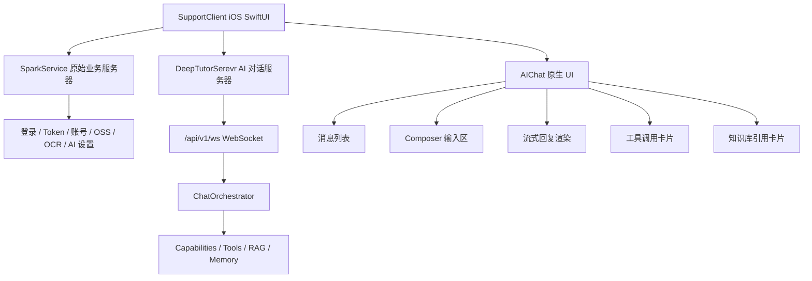
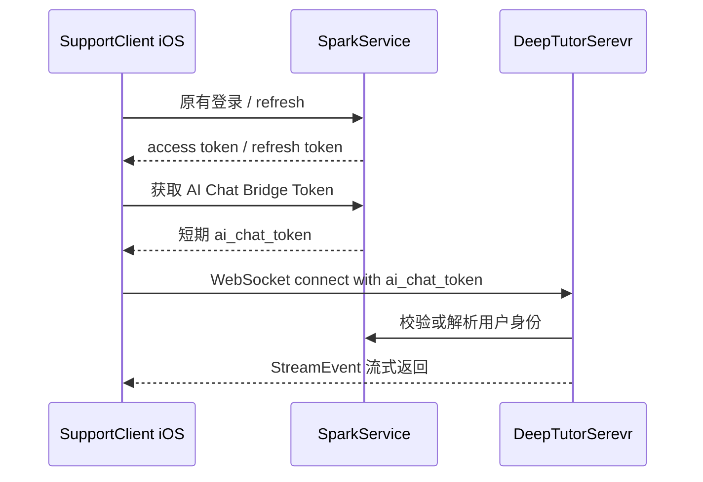

# SupportClient｜多客户端 AI 对话统一接入总领方案

## 1. 文档定位

本文档用于定义 `SupportClient` 新增 AI 对话能力的总体方案。当前阶段先实现 iOS 原生 SwiftUI 对话入口，后续 Android 和 Web 复用同一套后端对话协议、事件流和状态机。

本方案只定义架构、模块边界和实施顺序，不代表当前代码已完成实现。

## 2. 总体结论

推荐采用“统一后端协议，三端分别原生实现 UI”的方案。

| 客户端 | UI 技术 | 对话协议 | 后端职责 |
| --- | --- | --- | --- |
| iOS | SwiftUI | DeepTutorSerevr WebSocket 协议 | 原生消息列表、输入框、流式渲染和工具卡片 |
| Android | Jetpack Compose | DeepTutorSerevr WebSocket 协议 | 后续按同一状态机实现 |
| Web | Next.js / React | DeepTutorSerevr WebSocket 协议 | 保留现有 Web 对话体验并作为协议参考 |

核心原则：

- `SparkService` 仍是登录、账号、Token、原业务和后台管理的唯一事实源。
- `DeepTutorSerevr` 只承担 AI 对话运行时、Capability 编排、工具调用、RAG、知识库和流式事件输出。
- iOS 新增 `AIChat` 功能模块，不替换现有 `AI 设置`、认证、OSS、OCR 或原业务网络模块。
- 三端可以有平台化 UI 差异，但协议字段、事件类型、错误语义和状态机必须一致。

## 3. 服务边界

### 3.1 SparkService 保持原职责

`/Users/hua/Documents/project/DeepTutor/SparkService`

继续负责：

- 登录、注册、游客设备账号、Apple 登录和手机号验证码登录。
- access token、refresh token、401 刷新、登出和账号切换。
- 账号资料、登录方式绑定、注销和用户状态。
- OSS STS、文件登记、上传、下载、OCR 和原有业务接口。
- AI 设置、Provider、模型、API Key、试用期和后台管理配置，如果当前 SupportClient 已经接入该链路，则继续保持。

### 3.2 DeepTutorSerevr 新增对话职责

`/Users/hua/Documents/project/DeepTutor/DeepTutorSerevr`

负责：

- AI 对话 WebSocket 入口。
- `ChatOrchestrator` 对话编排。
- `chat`、`deep_solve`、`deep_research`、`visualize`、`mastery_path` 等 Capability。
- 工具调用、RAG、Knowledge Base、Memory 和流式事件。
- 对话 session、turn、event 的运行时输出。

### 3.3 客户端访问关系



## 4. iOS 目标模块框架

建议在 `SupportClient` 内新增独立功能模块：

```text
SupportClient/SupportClient/Projects/Features/AIChat/
├── Presentation/
│   ├── AIChatView.swift
│   ├── AIChatMessageListView.swift
│   ├── AIChatComposerView.swift
│   ├── AIStreamingMessageView.swift
│   ├── AIToolEventCardView.swift
│   └── AIKnowledgeSourceCardView.swift
├── Application/
│   ├── StartAIChatTurnUseCase.swift
│   ├── CancelAIChatTurnUseCase.swift
│   ├── ResumeAIChatTurnUseCase.swift
│   └── RegenerateAIChatTurnUseCase.swift
├── Domain/
│   ├── AIChatMessage.swift
│   ├── AIChatSession.swift
│   ├── AIChatTurn.swift
│   ├── AIChatState.swift
│   ├── AIStreamEvent.swift
│   └── AIChatRepository.swift
├── Infrastructure/
│   ├── DeepTutorChatRepository.swift
│   ├── DeepTutorChatClient.swift
│   ├── DeepTutorWebSocketTransport.swift
│   └── AIChatEventReducer.swift
└── Contract/
    ├── StartTurnMessageDTO.swift
    ├── StreamEventDTO.swift
    ├── DeepTutorCapabilityDTO.swift
    └── DeepTutorChatErrorDTO.swift
```

分层职责：

| 层 | 职责 | 禁止事项 |
| --- | --- | --- |
| Presentation | SwiftUI 页面、消息渲染、输入框、操作按钮、错误和空态 | 直接创建 WebSocket 或拼接后端协议 |
| Application | 发送、停止、恢复、重新生成等用户动作编排 | 保存 token 或处理底层重连细节 |
| Domain | 对话消息、session、turn、状态机和 repository 协议 | 依赖 SwiftUI、URLSession 或服务端 DTO |
| Infrastructure | DeepTutorSerevr WebSocket、DTO 解码、重连、事件 reducer | 处理 SparkService 登录业务 |
| Contract | 与 DeepTutorSerevr 对齐的网络 DTO | 混入 UI 状态和本地展示字段 |

## 5. 对话协议

iOS 不重新定义私有协议，应对齐 DeepTutorSerevr 当前 Web 使用的统一 WebSocket 协议。

客户端发送：

| 消息类型 | 用途 |
| --- | --- |
| `start_turn` / `message` | 发起一轮用户输入 |
| `subscribe_turn` | 订阅指定 turn 的事件 |
| `subscribe_session` | 订阅指定 session |
| `resume_from` | 断线后从指定 seq 恢复 |
| `cancel_turn` | 停止当前生成 |
| `regenerate` | 重新生成上一轮 |
| `submit_user_reply` | 回答 `ask_user` 暂停问题 |

服务端事件：

| 事件类型 | iOS 展示策略 |
| --- | --- |
| `session` | 绑定或更新当前 session / turn |
| `stage_start` / `stage_end` | 更新阶段状态，可折叠展示 |
| `thinking` | 显示思考状态卡片 |
| `content` | 追加助手流式文本 |
| `tool_call` | 创建工具调用卡片 |
| `tool_result` | 更新工具结果卡片 |
| `progress` | 显示任务进度 |
| `sources` | 显示知识库或网页来源 |
| `result` | 固化最终结果 |
| `error` | 显示错误与重试入口 |
| `done` | 结束本轮流式状态 |

## 6. iOS 状态机

建议将事件流归约为一套客户端状态机，三端共用同一概念：

```text
idle
  ↓
connecting
  ↓
sending
  ↓
streaming
  ├── toolRunning
  ├── waitingForUser
  ├── failed
  ├── cancelled
  └── completed
```

状态规则：

- `content` 到达后进入或保持 `streaming`。
- `tool_call` 后进入 `toolRunning`，但消息仍属于同一 turn。
- `ask_user` 类事件进入 `waitingForUser`，Composer 切换为回答模式。
- `error` 进入 `failed`，保留已收到内容并提供重试。
- `done` 进入 `completed`，关闭 loading 和停止按钮。
- 用户主动停止发送 `cancel_turn`，本地进入 `cancelled`，并等待服务端确认或超时收口。

## 7. 鉴权衔接

本项目不建议为 DeepTutorSerevr 做第二套登录。账号真相仍归 `SparkService`。

推荐方案：



优先级：

| 方案 | 说明 | 结论 |
| --- | --- | --- |
| SparkService 签发短期 AI Bridge Token | iOS 用原登录态换取短期对话 token | 推荐 |
| DeepTutorSerevr 直接校验 Spark access token | 实现较快，但服务耦合更强 | 可作为过渡 |
| DeepTutorSerevr 独立登录 | 两套登录态、登出和账号切换复杂 | 不推荐 |

关键要求：

- iOS 登出或账号切换时必须停止所有 active turn。
- DeepTutorSerevr 的 session 必须能关联 SparkService 用户身份。
- WebSocket 鉴权失败不得清空 SparkService 登录态，只能提示 AI 对话不可用或要求刷新 bridge token。
- SparkService 的 refresh token、设备绑定和会话失效规则不因接入 AI 对话而改变。

## 8. UI 目标效果

iOS 使用 SwiftUI 原生实现，不使用 WebView 套现有 Web 页面。

首版页面建议：

```text
AIChatView
├── Header
│   ├── 会话标题
│   ├── Capability / 模型入口
│   └── 更多操作
├── MessageList
│   ├── UserMessageBubble
│   ├── AssistantMarkdownMessage
│   ├── ThinkingCard
│   ├── ToolCallCard
│   ├── SourceCard
│   └── ErrorRetryCard
└── Composer
    ├── 文本输入
    ├── 附件入口
    ├── 知识库入口
    ├── 发送按钮
    └── 停止生成按钮
```

移动端交互要求：

- Composer 跟随键盘和 safe area。
- 流式回复时默认自动滚动到底部。
- 用户上滑查看历史后暂停自动贴底。
- 停止按钮必须真实发送 `cancel_turn`。
- 重连后使用 `resume_from`，避免重复显示已收到片段。
- 工具调用和来源默认折叠，用户可展开查看细节。
- 错误状态保留上下文，不把半条回复直接丢弃。

## 9. 多端一致性规范

三端必须一致：

- WebSocket 消息类型。
- StreamEvent 字段和事件类型。
- 对话状态机。
- 取消、重试、断线恢复和重新生成语义。
- 工具调用、知识库来源和错误的可见状态。
- session、turn、seq 的消费规则。

三端允许不同：

- 导航形态：Web 可双栏，iOS / Android 以单栏为主。
- 平台控件：iOS 使用 SwiftUI，Android 使用 Compose，Web 使用 React。
- 键盘、safe area、返回手势和附件选择器按平台习惯实现。
- 大屏 iPad / Android Tablet 可升级为双栏。

## 10. 与现有模块关系

| 现有模块 | 与 AI 对话的关系 | 边界 |
| --- | --- | --- |
| 会话与认证 | 提供当前 Spark 用户和 token 状态 | 不迁移到 DeepTutorSerevr 登录 |
| AI 设置 | 保留 Provider、模型、API Key、场景配置等原能力 | 不直接承担聊天消息状态 |
| 基础网络 | 继续服务 SparkService REST API | DeepTutor WebSocket 可独立 Transport，但应复用日志和鉴权边界思想 |
| 文件与 OSS | 继续走 SparkService / OSS 链路 | AI 对话附件如需上传，先确认走 Spark 文件系统还是 DeepTutor 附件系统 |
| OCR | 继续走原 OCR 编排 | OCR 结果可作为对话输入，但不改变 OCR 服务归属 |
| 应用启动链路 | 登录恢复后准备 AI 对话入口可用性 | 不在冷启动阶段强制连接 DeepTutor WebSocket |

## 11. 分阶段实施路线

实施采用“先协议、再连通、再体验、再多端”的顺序推进。每一阶段都必须有可验收产物，未完成上一阶段的验收前，不进入下一阶段的业务扩展。

| 阶段 | 阶段目标 | 完成产物 | 验收口径 | 本阶段不做 |
| --- | --- | --- | --- | --- |
| P0 方案与协议冻结 | 明确 SparkService 与 DeepTutorSerevr 的职责、WebSocket URL、鉴权方式、事件字段和 iOS 模块边界 | `AI 对话协议需求.md`、`AI 对话鉴权桥接需求.md` 草案、Swift DTO 字段表、状态机定义 | 文档能逐字段说明 `start_turn`、`cancel_turn`、`resume_from`、`StreamEvent`；能回答“登录走谁、对话走谁、失败怎么收口” | 不实现 UI，不接真实 WebSocket，不改 SparkService 登录逻辑 |
| P1 iOS 最小连通 | iOS 能以开发配置连接 DeepTutorSerevr，发起一轮最小对话并接收流式内容 | `DeepTutorWebSocketTransport` 设计、最小 `DeepTutorChatClient`、日志与调试开关、开发环境连接说明 | 发送一条文本后可收到 `session`、`content`、`done`；断开、服务不可达、协议解析失败能给出可见错误 | 不做完整聊天 UI，不做工具卡片，不做历史列表，不做附件 |
| P2 SwiftUI 基础聊天入口 | 在 SupportClient 内出现可用的原生 AI 对话入口，完成基础消息收发体验 | `AIChatView`、`AIChatViewModel`、消息列表、Composer、发送、停止、错误重试、空态 | 用户能进入 AI 对话、发送文本、看到用户消息和助手流式回复；停止按钮会发送 `cancel_turn`；键盘不遮挡 Composer | 不接复杂工具展示，不接知识库选择，不做多会话历史 |
| P3 事件完整渲染 | iOS 能正确消费 DeepTutorSerevr 的主要事件类型，与 Web 的 Agent 体验语义对齐 | Thinking 卡片、Tool Call 卡片、Tool Result 卡片、Progress 展示、Sources 引用卡片、Result 固化规则 | `thinking`、`tool_call`、`tool_result`、`progress`、`sources`、`error`、`done` 均有稳定展示；半条回复错误时不丢上下文 | 不做 Android，不做高级视觉动效，不做复杂附件预览 |
| P4 会话、恢复与账号隔离 | AI 对话接入 SparkService 登录态，处理断线恢复、账号切换、登出清理和历史归属 | Bridge Token 或 Token 校验方案落地说明、session/turn 绑定规则、`resume_from` 消费规则、账号切换清理清单 | 登出会停止 active turn 并断开 WebSocket；账号切换后不复用旧消息、旧 session、旧连接；断线重连不会重复显示已收到内容 | 不改变 SparkService 原认证接口语义，不引入 DeepTutor 独立登录 |
| P5 iOS 产品化体验 | iOS 对话从“可用”提升到“可交付”，补齐常见用户路径和边界状态 | 会话标题、重新生成、消息复制、Markdown/代码块基础渲染、弱网提示、空态和错误态、基础埋点与脱敏日志 | 常规使用路径不需要开发开关；弱网、鉴权失败、服务端错误、用户取消都有明确提示；日志不包含 token、正文敏感字段或完整请求体 | 不做跨端重构，不扩展新后端能力 |
| P6 多端一致性基线 | 将 iOS 落地经验沉淀成 Android 和 Web 可复用规范 | `AI 对话多端一致性矩阵.md`、三端组件映射、状态机对照、事件渲染规范、移动端差异清单 | Android Compose 可以按矩阵进入设计；Web 能确认现有行为与新规范的差异；三端对同一事件类型没有语义分叉 | 不立即实现 Android 代码，不重写 Web UI |
| P7 Android 与 Web 后续对齐 | 在 iOS 稳定后，启动 Android 原生 UI，并回收 Web 侧协议/展示漂移 | Android Compose 技术方案、Web 差异整改清单、三端验收用例 | Android、iOS、Web 共用同一协议和状态机；差异只存在于平台交互和布局 | 不把 iOS 代码逐行翻译到 Android，不用 WebView 替代原生实现 |

### 11.1 阶段目标说明

P0 的目标是把事情讲清楚。这个阶段完成后，团队应能明确：`SparkService` 继续保存登录和原始业务状态，`DeepTutorSerevr` 只承接 AI 对话；iOS 需要哪些 DTO、状态和错误处理；哪些字段仍待后端确认。

P1 的目标是证明链路可达。这个阶段只追求最小闭环：能连、能发、能收、能失败。UI 可以很朴素，但日志、错误和协议解析要足够清楚，方便后续排查。

P2 的目标是让用户能真正使用。这个阶段完成后，App 内应有独立 SwiftUI 对话入口，能完成基础一问一答、停止生成和错误重试。

P3 的目标是把 DeepTutor 的 Agent 能力呈现出来。只显示纯文本不够，工具调用、思考过程、进度和来源都要有一致的用户可见表达。

P4 的目标是把账号边界关牢。AI 对话不能形成第二套登录，也不能在账号切换后残留旧连接、旧消息或旧运行中任务。

P5 的目标是把 iOS 做到可交付。这个阶段关注用户体验、边界状态、日志脱敏和常用操作，避免只停留在技术演示。

P6 的目标是沉淀多端标准。iOS 先跑通以后，要把协议、状态、组件和验收用例抽成 Android / Web 可复用的基线。

P7 的目标是启动后续端。Android 和 Web 的对齐应基于 P6 的矩阵推进，避免各端按自己的理解重新解释事件流。

### 11.2 阶段完成定义

每一阶段完成时至少要满足：

- 有对应文档或设计说明，记录已确认项和待确认项。
- 有明确验收结果，能说明通过、部分通过或未通过。
- 有风险清单更新，新增问题必须能追踪到责任方和关闭条件。
- 不把下一阶段能力混入当前阶段验收，避免“看起来都做了，但每项都没闭环”。

## 12. 验收标准

基础验收：

- SparkService 登录、登出、refresh、账号切换保持原行为。
- 未登录用户不能进入需要账号身份的 AI 对话。
- DeepTutorSerevr 不要求用户在 iOS 内进行第二套登录。
- iOS 能成功发起一轮对话并流式显示回复。
- 断线重连后不会重复展示已接收内容。
- 停止生成后 UI 和服务端 turn 状态能收口。
- 账号切换后旧账号的对话任务、消息缓存和 WebSocket 连接被清理。

体验验收：

- Composer 不被键盘遮挡。
- 流式文本追加平滑，不闪烁、不重排。
- 工具调用、来源、错误和进度都有稳定展示样式。
- 弱网、服务器断开、鉴权失败都有明确用户可见状态。
- iOS、Android、Web 对同一事件类型的展示语义一致。

## 13. 风险与待确认项

| 编号 | 风险/待确认项 | 影响 | 建议关闭条件 |
| --- | --- | --- | --- |
| R1 | SparkService 与 DeepTutorSerevr 的用户身份映射方式未定 | 鉴权、对话归属、历史隔离 | 明确 bridge token 或 token introspection 方案 |
| R2 | DeepTutorSerevr WebSocket 在移动端的鉴权参数传递方式未定 | iOS 连接实现 | 明确 header、query 或首帧鉴权格式 |
| R3 | 对话历史由 DeepTutorSerevr 保存还是 iOS 本地镜像未定 | 历史列表、离线展示 | 明确 session list 和 message history API |
| R4 | 附件上传归属未定 | 图片、PDF、OCR 结果进入对话 | 明确走 SparkService 文件系统还是 DeepTutor 附件系统 |
| R5 | AI 设置与 DeepTutor 模型选择关系未定 | Provider、模型、Capability 选择 | 明确 SparkService AI 设置是否映射到 DeepTutor llm_selection |
| R6 | 多端工具卡片和来源卡片规范未定 | 三端体验漂移 | 建立 StreamEvent 渲染规范 |

## 14. 后续文档建议

建议在本目录下继续补充：

- `AI 对话协议需求.md`：逐字段定义 iOS DTO、WebSocket 消息和 StreamEvent。
- `AI 对话 SwiftUI UI 需求.md`：定义消息、Composer、工具卡片、来源卡片和移动端交互。
- `AI 对话鉴权桥接需求.md`：定义 SparkService 与 DeepTutorSerevr 的身份关系。
- `AI 对话多端一致性矩阵.md`：维护 iOS、Android、Web 的功能和状态对齐。
