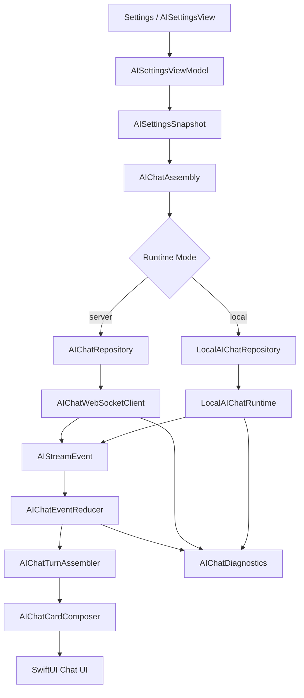
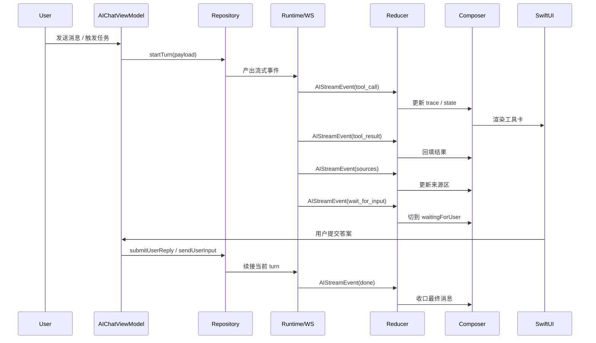

# SupportClient｜AI 对话双后端切换 P3 复杂事件与产品化

## 1. 对标范围与结论

P3 解决的不是“还能不能聊”，而是“复杂事件、诊断链路、错误收口、灰度控制是否具备产品化能力”。

这一阶段要覆盖的核心能力是：

1. `wait_for_input`
2. `tool_call` / `tool_result`
3. `sources`
4. 更完整的错误映射、重试、诊断
5. 灰度开关与可回滚控制

### 1.1 本阶段的真实目标

P3 要做的是把 AI 对话从“最小闭环”升级成“可观察、可诊断、可解释、可控回滚”的产品级能力：

- 事件流要能表达工具调用、等待用户输入、来源引用和最终结果。
- UI 要能把这些事件稳定渲染成卡片、时间线、来源区、错误区。
- 错误要能被分类、映射、重试、提示和记录。
- 运行模式不只要能切换，还要能被灰度控制和快速回退。

### 1.2 这份文档对 P0 / P1 / P2 的偏差勘误

P3 需要把前面几份文档里“已经存在”和“尚未完成”的边界再收紧一次：

- 不是“`wait_for_input`、`tool_call`、`tool_result`、`sources` 都还没开始”，而是这些事件类型在 [AIStreamEvent.swift](/Users/hua/Documents/project/DeepTutor/SupportClient/SupportClient/Projects/Features/AIChat/Domain/AIStreamEvent.swift) 和 [AIChatEventReducer.swift](/Users/hua/Documents/project/DeepTutor/SupportClient/SupportClient/Projects/Features/AIChat/Application/AIChatEventReducer.swift) 里已经冻结并接入了消息归约与渲染链路。
- 不是“复杂事件还完全没有 UI 落点”，而是 [AIChatTurnAssembler.swift](/Users/hua/Documents/project/DeepTutor/SupportClient/SupportClient/Projects/Features/AIChat/Application/AIChatTurnAssembler.swift) 和 [AIChatCardComposer.swift](/Users/hua/Documents/project/DeepTutor/SupportClient/SupportClient/Projects/Features/AIChat/Application/AIChatCardComposer.swift) 已经能把工具轨迹、来源引用和等待输入事件整理成产品卡片。
- 不是“错误、重试、诊断都未定义”，而是 [AIChatError.swift](/Users/hua/Documents/project/DeepTutor/SupportClient/SupportClient/Projects/Features/AIChat/Domain/AIChatError.swift)、[AIChatDiagnostics.swift](/Users/hua/Documents/project/DeepTutor/SupportClient/SupportClient/Projects/Features/AIChat/Application/AIChatDiagnostics.swift) 和 [AIChatWebSocketClient.swift](/Users/hua/Documents/project/DeepTutor/SupportClient/SupportClient/Projects/Features/AIChat/Infrastructure/AIChatWebSocketClient.swift) 已经有了基础实现。
- 不是“灰度开关已经具备”，而是目前只存在账号级运行模式切换，没有独立的灰度/实验开关体系。

因此，P3 的准确定位是：

> 让当前已经存在的事件协议、状态机、卡片编排、错误与诊断能力，在 `server` / `local` 两条链路上都变成一致、可回退、可观察、可扩展的产品级实现。

### 1.3 当前代码事实

| 文件 | 当前事实 | 对 P3 的影响 |
| --- | --- | --- |
| [AIStreamEvent.swift](/Users/hua/Documents/project/DeepTutor/SupportClient/SupportClient/Projects/Features/AIChat/Domain/AIStreamEvent.swift) | 已定义 `wait_for_input`、`tool_call`、`tool_result`、`sources`、`result`、`error`、`done` 等事件类型 | P3 不需要再发明新事件名，只要补齐来源和消费方 |
| [AIChatEventReducer.swift](/Users/hua/Documents/project/DeepTutor/SupportClient/SupportClient/Projects/Features/AIChat/Application/AIChatEventReducer.swift) | 已能把复杂事件归约为 `AIChatState`、`traceGroups`、`sourceReferences`、`pendingAskUserCard` | P3 重点是补齐 local emit 与语义一致性 |
| [AIChatTurnAssembler.swift](/Users/hua/Documents/project/DeepTutor/SupportClient/SupportClient/Projects/Features/AIChat/Application/AIChatTurnAssembler.swift) | 可从历史 turn events 重建工具轨迹、来源引用、等待输入状态 | P3 可以把“恢复”和“历史重放”视为产品级行为的一部分 |
| [AIChatCardComposer.swift](/Users/hua/Documents/project/DeepTutor/SupportClient/SupportClient/Projects/Features/AIChat/Application/AIChatCardComposer.swift) | 已把复杂状态映射为 answer、sources、recoveryBanner、askUser 等卡片 | P3 的 UI 对齐重点是卡片顺序与显隐条件 |
| [AIChatDiagnostics.swift](/Users/hua/Documents/project/DeepTutor/SupportClient/SupportClient/Projects/Features/AIChat/Application/AIChatDiagnostics.swift) | 已具备 token、WebSocket、状态迁移、恢复等诊断日志 | P3 可以在此基础上补充本地运行模式和复杂事件日志 |
| [AIChatWebSocketClient.swift](/Users/hua/Documents/project/DeepTutor/SupportClient/SupportClient/Projects/Features/AIChat/Infrastructure/AIChatWebSocketClient.swift) | 已有连接、心跳、断线重连、最大重试上限 | P3 不需要再发明重连框架，只需补齐产品化提示与异常映射 |
| [AIChatError.swift](/Users/hua/Documents/project/DeepTutor/SupportClient/SupportClient/Projects/Features/AIChat/Domain/AIChatError.swift) | 已有 `maxReconnectExceeded` 等错误码 | P3 应把错误码、用户文案和恢复动作对齐 |
| [LocalAIChatRuntime.swift](/Users/hua/Documents/project/DeepTutor/SupportClient/SupportClient/Projects/Features/AIChat/Infrastructure/LocalAIChatRuntime.swift) | 当前只会发 `session`、`thinking`、`content`、`done`、`error` | P3 的主要缺口之一就是让 local 也能表达工具、来源和等待输入 |
| [LocalAIChatStreamAdapter.swift](/Users/hua/Documents/project/DeepTutor/SupportClient/SupportClient/Projects/Features/AIChat/Infrastructure/LocalAIChatStreamAdapter.swift) | 目前只封装了基础流式事件 | P3 要补齐复杂事件适配层 |

## 2. iOS 端目录设计

P3 继续沿用现有目录，不再新增顶层业务模块。

```text
SupportClient/SupportClient/Projects/
├── Features/
│   └── AIChat/
│       ├── Application/
│       │   ├── AIChatEventReducer.swift
│       │   ├── AIChatTurnAssembler.swift
│       │   ├── AIChatCardComposer.swift
│       │   ├── AIChatDiagnostics.swift
│       │   └── AIChatViewModel.swift
│       ├── Domain/
│       │   ├── AIStreamEvent.swift
│       │   ├── AIChatError.swift
│       │   ├── AIToolTraceDescriptor.swift
│       │   ├── AIChatCardModels.swift
│       │   └── AIChatState.swift
│       └── Infrastructure/
│           ├── AIChatWebSocketClient.swift
│           ├── LocalAIChatRuntime.swift
│           ├── LocalAIChatStreamAdapter.swift
│           └── AIChatRoutingRepository.swift
```

### 2.1 目录职责边界

| 目录 | P3 职责 | 不应承担的职责 |
| --- | --- | --- |
| `AIChat/Domain` | 冻结事件、错误、卡片、状态语义 | 直接发网络请求 |
| `AIChat/Application` | 把复杂事件归约成可渲染状态 | 自己拼装协议帧 |
| `AIChat/Infrastructure` | 把 server/local 事件流稳定送达 | 直接决定 UI 布局 |
| `AIChat/Presentation` | 渲染卡片与交互入口 | 解析后端协议 |

## 3. 分层职责与请求链路

### 3.1 Web 对标的核心原则

对标 Web 时，P3 不能只看“有没有响应”，还要看：

- 事件是否具备语义分类。
- 卡片是否能按语义聚合。
- 恢复后是否能还原中间态。
- 错误是否有可执行恢复动作。
- 复杂能力是否能被日志和诊断看见。

### 3.2 `server` 模式链路

```text
AIChatRepository
  -> WebSocket / session REST
  -> AIStreamEvent
  -> AIChatEventReducer
  -> AIChatTurnAssembler
  -> AIChatCardComposer
  -> AIChatViewModel
  -> SwiftUI 卡片与消息列表
```

### 3.3 `local` 模式链路

```text
LocalAIChatRepository
  -> LocalAIChatRuntime
  -> LocalAIChatStreamAdapter
  -> AIStreamEvent
  -> AIChatEventReducer
  -> AIChatTurnAssembler
  -> AIChatCardComposer
  -> AIChatViewModel
  -> SwiftUI 卡片与消息列表
```

### 3.4 P3 的核心判断

P3 不是把事件“只传过去”，而是要确保：

- `server` 和 `local` 进入同一套 reducer。
- `wait_for_input`、`tool_call`、`tool_result`、`sources` 在两条链路里都能形成一致的产品效果。
- 错误与恢复可以被统一理解，而不是每条链路各说各话。

## 4. 核心关键技术与实现方案

### 4.1 事件矩阵冻结

#### 4.1.1 事件语义表

| 事件 | 语义 | UI 结果 | local 当前状态 | server 当前状态 |
| --- | --- | --- | --- | --- |
| `wait_for_input` | 模型暂停，等待用户补充输入 | 显示 ask-user 卡片、冻结当前 turn | 未由 runtime emit，reducer 已支持 | 已可消费 |
| `tool_call` | 发起工具调用 | 显示工具轨迹开始 | 未由 runtime emit，reducer 已支持 | 已可消费 |
| `tool_result` | 工具调用返回 | 更新工具轨迹结果 | 未由 runtime emit，reducer 已支持 | 已可消费 |
| `sources` | 来源引用 | 显示来源区 | 未由 runtime emit，reducer 已支持 | 已可消费 |
| `result` | 结果摘要/阶段结果 | 可作为时间线条目 | 可消费但不常见 | 可消费 |
| `error` | 失败或异常 | 错误卡、恢复提示、日志 | 已有基础 error emit | 已可消费 |

#### 4.1.2 目前的偏差

- `AIChatEventReducer` 已经支持复杂事件，但 `LocalAIChatStreamAdapter` 还没有把这些事件真正发出来。
- `AIChatTurnAssembler` 和 `AIChatCardComposer` 已经准备好了渲染位，但 local 事件源还没填满。
- 所以 P3 的重点是“local 产出对齐”，不是“重新设计 reducer”。

### 4.2 `wait_for_input`

#### 4.2.1 当前实现状态

- 事件名已经冻结在 [AIStreamEvent.swift](/Users/hua/Documents/project/DeepTutor/SupportClient/SupportClient/Projects/Features/AIChat/Domain/AIStreamEvent.swift)。
- [AIChatEventReducer.swift](/Users/hua/Documents/project/DeepTutor/SupportClient/SupportClient/Projects/Features/AIChat/Application/AIChatEventReducer.swift) 已经能把该事件变成 `waitingForUser`。
- [AIChatCardComposer.swift](/Users/hua/Documents/project/DeepTutor/SupportClient/SupportClient/Projects/Features/AIChat/Application/AIChatCardComposer.swift) 也已经能在等待输入态下决定卡片展示。

#### 4.2.2 P3 要补齐的语义

- 模型明确停在“等待用户输入”的状态时，必须能冻结当前 turn。
- 用户输入后，要能把回答作为一个新的续接动作送回同一 turn 语义。
- 恢复时必须知道该 turn 正在等待输入，不能误判成普通完成态。

#### 4.2.3 local 模式的缺口

当前 local runtime 只会持续吐 content，不会主动发 `wait_for_input`。
这意味着：

- local 还不能表达“问答中断”。
- local 还不能验证 ask-user 卡片的完整产品体验。
- local 的复杂交互仍是 P3 的明确补齐目标。

### 4.3 `tool_call` / `tool_result`

#### 4.3.1 当前实现状态

相关数据流已经在 UI 链路里存在：

- `AIChatEventReducer` 会把 `tool_call` 聚合成 `traceGroups`。
- `AIChatTurnAssembler` 会把历史事件重放成工具轨迹。
- `AIChatCardComposer` 会在合适时机渲染工具相关卡片。

#### 4.3.2 产品语义

工具调用不只是“打印一行日志”，而是要形成一个完整生命周期：

1. 发起调用。
2. 等待执行。
3. 返回结果。
4. 标记成功或失败。
5. 在历史中可重放、可诊断、可折叠查看。

#### 4.3.3 local 模式的缺口

当前 local runtime 没有工具规划层，也没有 tool result 的产出逻辑。
因此 P3 要明确两件事：

- 如果本地模型暂不支持工具，就要明确降级为“无工具能力”的可解释模式。
- 如果本地模型支持工具，就要把 tool call / result 统一翻译成同样的 `AIStreamEvent` 结构。

### 4.4 `sources`

#### 4.4.1 当前实现状态

- [AIStreamEvent.swift](/Users/hua/Documents/project/DeepTutor/SupportClient/SupportClient/Projects/Features/AIChat/Domain/AIStreamEvent.swift) 已冻结 `sources`。
- [AIChatEventReducer.swift](/Users/hua/Documents/project/DeepTutor/SupportClient/SupportClient/Projects/Features/AIChat/Application/AIChatEventReducer.swift) 会把来源记录进 `sourceReferences`。
- [AIChatCardComposer.swift](/Users/hua/Documents/project/DeepTutor/SupportClient/SupportClient/Projects/Features/AIChat/Application/AIChatCardComposer.swift) 会根据来源数量决定是否展示来源卡。

#### 4.4.2 产品语义

sources 的产品目标不是“多一个区块”，而是：

- 让回答可追溯。
- 让引用可折叠。
- 让恢复后仍能看到当时的来源语境。
- 让错误、结果和来源之间有清晰边界。

#### 4.4.3 local 模式的缺口

local runtime 还没有来源生成能力。
因此本阶段不能假装本地已经具备检索与引用链路，只能明确：

- sources 语义已冻结。
- local 的 sources emit 仍待接入。
- 如果未来 local 只做纯生成而不做检索，UI 也必须优雅降级为空来源态。

### 4.5 错误映射

#### 4.5.1 当前实现状态

[AIChatError.swift](/Users/hua/Documents/project/DeepTutor/SupportClient/SupportClient/Projects/Features/AIChat/Domain/AIChatError.swift) 已经有基础错误枚举和用户文案：

- `notSignedIn`
- `tokenUnavailable`
- `deepTutorAuthRequired`
- `connectionFailed`
- `sessionLoadFailed`
- `terminalTurn`
- `maxReconnectExceeded`

#### 4.5.2 P3 要形成的错误分层

| 错误层 | 典型来源 | 用户该看到什么 | 是否可重试 |
| --- | --- | --- | --- |
| 鉴权错误 | token、登录态、权限 | 重新登录 / 重新连接 | 是 |
| 网络错误 | 连接失败、断线、超时 | 重试 / 切换网络 | 是 |
| 协议错误 | 事件解析失败、字段缺失 | 收敛到降级提示 | 视情况而定 |
| 会话错误 | session 不存在、加载失败 | 回到列表或新会话 | 是 |
| 运行时错误 | 本地 runtime 失败、模型不可用 | 提示本地模式不可用 | 视情况而定 |
| 终止态错误 | 当前轮已结束、不可重复提交 | 改走新 turn | 否 |

#### 4.5.3 需要统一的文案边界

P3 不只要有错误码，还要保证：

- 同一类错误在 server/local 下尽量同文案。
- 不同可恢复动作有不同按钮，而不是一刀切“重试”。
- 诊断日志里的 code 必须能回溯到用户文案。

### 4.6 重试与恢复

#### 4.6.1 当前实现状态

- [AIChatWebSocketClient.swift](/Users/hua/Documents/project/DeepTutor/SupportClient/SupportClient/Projects/Features/AIChat/Infrastructure/AIChatWebSocketClient.swift) 已有指数退避式重连。
- 最大重试上限和断线回调已经存在。
- [AIChatCardComposer.swift](/Users/hua/Documents/project/DeepTutor/SupportClient/SupportClient/Projects/Features/AIChat/Application/AIChatCardComposer.swift) 已有 `recoveryBanner` 的卡片位。

#### 4.6.2 P3 要落地的重试策略

| 场景 | 建议策略 | 产品表现 |
| --- | --- | --- |
| WS 临时断线 | 自动重连 | 顶部恢复横幅、状态变为 reconnecting |
| 达到重连上限 | 停止自动重连 | 显示明确失败卡，提供重新进入或重试 |
| token 过期 | 先刷新再重连 | 对用户尽量透明 |
| 本地 runtime 失败 | 允许降级或重发 | 说明 local 模式当前不可用 |
| 解析异常 | 停止当前 turn 并记录 | 显示可理解的错误态 |

#### 4.6.3 local 模式的恢复语义

local 模式没有 WS，但也要有恢复语义：

- 运行任务被取消后，当前 turn 不能残留半成品状态。
- 恢复时应从本地缓存和 resume snapshot 还原当前 turn。
- 如果 local runtime 失败，要允许重新发起新 turn，而不是把页面卡死。

### 4.7 诊断与可观测性

#### 4.7.1 当前实现状态

[AIChatDiagnostics.swift](/Users/hua/Documents/project/DeepTutor/SupportClient/SupportClient/Projects/Features/AIChat/Application/AIChatDiagnostics.swift) 已经可以记录：

- token resolve
- token refresh
- WS connect / send / recv / disconnect / reconnect
- state change
- recovery summary

同时 [AIChatDebugViewModel.swift](/Users/hua/Documents/project/DeepTutor/SupportClient/SupportClient/Projects/Features/AIChat/Application/AIChatDebugViewModel.swift) 已把部分诊断暴露到调试页。

#### 4.7.2 P3 的产品化要求

P3 需要把诊断从“调试可见”提升为“产品可定位”：

- 每个 turn 需要有稳定的 trace id。
- 每条关键事件都应能回到 session / turn / seq。
- 本地模式也需要和 server 一样有事件日志。
- 复杂事件必须能在日志里分辨是工具调用、来源引用还是问答中断。

#### 4.7.3 建议的诊断维度

| 维度 | 说明 |
| --- | --- |
| `ai_trace_id` | 整次对话的统一追踪标识 |
| `session_id` | 会话级别定位 |
| `turn_id` | 单轮定位 |
| `seq` | 流式序号 |
| `runtime_mode` | `server` / `local` |
| `event_type` | `tool_call`、`sources` 等 |
| `error_code` | 用户可回溯的错误码 |

### 4.8 灰度开关

#### 4.8.1 当前实现状态

当前工程里没有独立的“灰度开关”系统。

现在只有：

- 账号级运行模式切换。
- 运行时仓储路由。
- 设置页可见的人工切换入口。

#### 4.8.2 P3 要补的不是“继续加一个 Toggle”

如果后续要做灰度，不能把它写成另一个和用户选择混在一起的普通开关。
更合理的做法是把灰度与运行模式分离：

- 用户选择决定 `server` / `local`。
- 产品灰度决定这条能力是否对某些账号、版本、环境开放。
- 回滚策略应优先切回 `server`，而不是让用户侧状态不可控。

#### 4.8.3 建议的落位方向

如果未来要补灰度位，优先级建议是：

1. 运行模式仍然保留在 `AISettingsSnapshot`。
2. 灰度位单独放到设置快照或远端配置层。
3. 装配层同时读取“用户选择”和“产品开放策略”。

P3 文档在此先冻结结论：**当前没有现成灰度开关，不能误写成已实现。**

## 5. 接口契约与数据模型

### 5.1 复杂事件最小协议

P3 不要求重新定义整套协议，但要保证下面这些语义在事件层可表达：

```swift
enum AIStreamEventType: String, Codable, Sendable {
    case thinking
    case observation
    case content
    case toolCall = "tool_call"
    case toolResult = "tool_result"
    case progress
    case sources
    case result
    case error
    case session
    case done
    case waitForInput = "wait_for_input"
}
```

### 5.2 产品卡片语义

| 卡片 / 区块 | 触发条件 | 目的 |
| --- | --- | --- |
| answer | 有最终文本或持续输出 | 展示主回答 |
| loading | 生成中且无最终文本 | 告知当前仍在流式输出 |
| sources | 有来源引用 | 展示引用来源 |
| askUser | `wait_for_input` | 收集用户补充输入 |
| recoveryBanner | 正在重连 | 告知网络恢复中 |
| tool trace | `tool_call` / `tool_result` | 展示工具生命周期 |

### 5.3 错误映射最小表

| 诊断码 | 建议文案 | 建议动作 |
| --- | --- | --- |
| `not_signed_in` | 请先登录后再使用 AI 对话 | 去登录 |
| `connection_failed` | AI 对话服务连接失败，请检查网络后重试 | 重试 |
| `auth_failed` | AI 对话登录已过期，请重新连接 DeepTutor | 重新连接 |
| `session_load_failed` | 会话加载失败，请稍后重试 | 重试 / 返回列表 |
| `terminal_turn` | 本轮对话已结束 | 开始新一轮 |
| `max_reconnect_exceeded` | 连接已断开，请重新进入对话 | 重新进入 |

## 6. P3 期望的最终形态

P3 完成后，iOS 端应当达到以下状态：

- `server` 和 `local` 两条链路都能稳定输出统一事件结构。
- 复杂事件能被 reducer、assembler、composer、debug view 同时理解。
- 本地模式不再只是“能聊”，而是能表达工具、来源、等待输入、错误和恢复。
- 错误、重试和诊断可以支撑线上定位。
- 运行模式可切换，但灰度与用户选择不会互相污染。

## 7. 验收标准

- `wait_for_input` 能正确落到 ask-user 卡片，并能在恢复后重建。
- `tool_call` / `tool_result` 能正确形成工具轨迹，并在历史中可见。
- `sources` 能正确形成来源区块，并在恢复后保留。
- 本地模式至少能稳定发出与复杂事件兼容的标准 `AIStreamEvent`。
- `server` 断线时能重连，达到上限时能进入可理解失败态。
- 诊断日志能定位到 session / turn / seq / runtime mode。
- 当前没有独立灰度开关这一事实必须在后续实现中继续保持诚实，不得误写成已完成。

## 8. 风险与约束

### 8.1 主要风险

- local 运行时如果长期只做 content 流，会让复杂事件语义永远停留在 server。
- 错误映射如果只追求“提示一句话”，会丢失恢复路径。
- 灰度开关若和用户模式混在一起，会导致回滚不可控。

### 8.2 约束

- 不能为了 P3 牺牲 `server` 的现有稳定链路。
- 不能把 `local` 的复杂事件硬编码成 UI 特判。
- 不能把灰度控制伪装成普通设置项。

## 9. 参考文件

- [P0 方案与协议冻结.md](/Users/hua/Documents/project/DeepTutor/SupportClient/总领文档/AI%20对话双后端切换/P0%20方案与协议冻结.md)
- [P1 最小双链路连通.md](/Users/hua/Documents/project/DeepTutor/SupportClient/总领文档/AI%20对话双后端切换/P1%20最小双链路连通.md)
- [P2 会话语义补齐.md](/Users/hua/Documents/project/DeepTutor/SupportClient/总领文档/AI%20对话双后端切换/P2%20会话语义补齐.md)
- [AIStreamEvent.swift](/Users/hua/Documents/project/DeepTutor/SupportClient/SupportClient/Projects/Features/AIChat/Domain/AIStreamEvent.swift)
- [AIChatEventReducer.swift](/Users/hua/Documents/project/DeepTutor/SupportClient/SupportClient/Projects/Features/AIChat/Application/AIChatEventReducer.swift)
- [AIChatTurnAssembler.swift](/Users/hua/Documents/project/DeepTutor/SupportClient/SupportClient/Projects/Features/AIChat/Application/AIChatTurnAssembler.swift)
- [AIChatCardComposer.swift](/Users/hua/Documents/project/DeepTutor/SupportClient/SupportClient/Projects/Features/AIChat/Application/AIChatCardComposer.swift)
- [AIChatDiagnostics.swift](/Users/hua/Documents/project/DeepTutor/SupportClient/SupportClient/Projects/Features/AIChat/Application/AIChatDiagnostics.swift)
- [AIChatWebSocketClient.swift](/Users/hua/Documents/project/DeepTutor/SupportClient/SupportClient/Projects/Features/AIChat/Infrastructure/AIChatWebSocketClient.swift)
- [AIChatError.swift](/Users/hua/Documents/project/DeepTutor/SupportClient/SupportClient/Projects/Features/AIChat/Domain/AIChatError.swift)
- [LocalAIChatRuntime.swift](/Users/hua/Documents/project/DeepTutor/SupportClient/SupportClient/Projects/Features/AIChat/Infrastructure/LocalAIChatRuntime.swift)
- [LocalAIChatStreamAdapter.swift](/Users/hua/Documents/project/DeepTutor/SupportClient/SupportClient/Projects/Features/AIChat/Infrastructure/LocalAIChatStreamAdapter.swift)

## 10. 与 DeepTutorSerevr 的一致性对齐

P3 不能按“iOS 自己看起来能用”来定义完成，必须按 DeepTutorSerevr 的事件语义、状态机和产品展示来对齐。

### 10.1 Web 侧的真实行为

从 DeepTutorSerevr 的前端实现可以归纳出四条原则：

1. **事件顺序优先于静态内容**
   - `tool_call` 先出现，再有 `tool_result`。
   - `wait_for_input` 不是文本补丁，而是 turn 的真实中断点。
   - `sources` 不应该混进 assistant 正文，而是独立展示。

2. **语义优先于原始帧**
   - Web 侧会根据 `event.type`、`stage`、`metadata` 和 `call_kind` 共同判断当前处于什么阶段。
   - 例如工具调用阶段，不是单纯显示“正在调用工具”，而是根据 round、stage、call kind 决定顶部状态和时间线归属。

3. **恢复优先于单次流**
   - 即使某轮中途断线，Web 侧也会把历史事件重放出来，尽量恢复工具轨迹、来源和待答状态。

4. **局部失败不应摧毁整轮**
   - 单个 `tool_result` 失败、部分 `sources` 缺失、问答补充未完成，都不应该让整页崩掉。

### 10.2 iOS 对齐策略

P3 的 Swift 实现应该遵循同样的规则：

- **Reducer 只做语义归约，不做业务决策。**
- **Assembler 只负责把历史事件重放成可渲染结构。**
- **Composer 只负责决定卡片顺序与显隐。**
- **Runtime 只负责产出标准事件，不直接操心 UI。**
- **ViewModel 只调度会话和状态，不解析协议。**

### 10.3 一致性对齐表

| Web 语义 | iOS 对齐方式 | 备注 |
| --- | --- | --- |
| `tool_call` / `tool_result` 进入 trace 面板 | `AIToolTraceGroup` + `AIToolTraceCard` | iOS 也必须保留 call/result 分离 |
| `wait_for_input` 进入 AskUser 卡 | `AIAskUserCard` + `AIAskUserInteractionController` | 不允许退化成纯文本提示 |
| `sources` 独立展示 | `AISourceReferencesView` | 不允许拼进正文，避免污染主回答 |
| 断线恢复横幅 | `recoveryBanner` | 需要自动重连态与失败态区分 |
| 错误卡 inline retry | `AIChatErrorCard` + 错误码 | 尽量保留可重试动作 |

## 11. 推荐的 Swift 架构总方案

### 11.1 总体架构



### 11.2 最优设计原则

推荐的 Swift 方案不是“把 Web 逻辑搬一遍”，而是：

- 用一个 `AIChatRepositoryProtocol` 统一 server/local。
- 用 `AIChatRoutingRepository` 做模式路由。
- 用 `LocalAIChatRuntime` 做 OpenAI-compatible SSE + stub fallback 双路径。
- 用 `AIChatEventReducer` 统一事件归约。
- 用 `AIChatTurnAssembler` 重放历史 turn。
- 用 `AIChatCardComposer` 统一 UI 卡片。

这样做的好处是：

- `server` 现有代码几乎不动。
- `local` 只补执行器与事件适配。
- `P3` 复杂事件可以先落协议、再补 runtime，不会把 UI 绑定死。

### 11.3 为什么这是“最好的 Swift 方案”

因为它符合 Swift/iOS 的几个现实约束：

- `actor` / `Task` 适合管理流式与取消。
- `ObservableObject` 适合 ViewModel。
- `Sendable` 适合事件和跨线程数据。
- `enum` + reducer 适合表达流式状态机。
- `SwiftUI` 适合卡片化渲染。

换句话说：

- **网络与流式属于 actor。**
- **状态与交互属于 ViewModel。**
- **事件和业务语义属于 Domain/Application。**
- **UI 只看结果，不看后端。**

## 12. 业务流程

### 12.1 复杂 turn 的标准流程



### 12.2 wait_for_input 的业务流

1. runtime 发现信息不足或需要确认。
2. 发出 `wait_for_input`。
3. reducer 把 turn 置为 `waitingForUser`。
4. composer 渲染 AskUser 卡。
5. 用户在卡片里选择答案或输入文本。
6. ViewModel 调用 `submitUserReply` 或 `sendUserInput`。
7. runtime 将答案送回同一 turn 语义。
8. done 后收口最终 assistant 消息。

### 12.3 tool_call / tool_result 的业务流

1. runtime 决定调用工具。
2. 发出 `tool_call`，卡片进入 pending。
3. 工具执行完成后发出 `tool_result`。
4. reducer 回填 `traceGroups`。
5. composer 展示工具展开/收起状态。
6. 若工具链中断，error 卡要有局部恢复能力，而不是全页失败。

### 12.4 sources 的业务流

1. runtime 收集来源。
2. 发出 `sources`。
3. reducer 写入 `sourceReferences`。
4. composer 决定是否展示来源卡。
5. 历史重放时，turn assembler 重新构建来源视图。

### 12.5 错误与重试业务流

1. runtime 或 transport 产生错误。
2. diagnostics 记录错误码、session、turn、seq。
3. reducer 决定是否终止、是否进入恢复态。
4. composer 渲染错误卡或恢复横幅。
5. 用户执行 retry / reconnect / return / new turn。

## 13. 核心代码示例

下面的代码示例按“可直接落地到 Swift 项目”的粒度来写，优先满足 iOS 端最优结构。

### 13.1 运行模式统一入口

```swift
enum AIChatRuntimeMode: String, Codable, Sendable {
    case server
    case local
}

protocol AIChatRepositoryProtocol: Sendable {
    var runtimeMode: AIChatRuntimeMode { get }
    var eventHandler: (@Sendable (AIStreamEvent) async -> Void)? { get set }
    var connectionHandler: (@Sendable (AIChatConnectionState) async -> Void)? { get set }
    var errorHandler: (@Sendable (AIChatError) async -> Void)? { get set }

    func activate(accountID: Int64)
    func connect() async throws
    func disconnect()
    func startTurn(_ payload: AIStartTurnPayload) async throws
    func cancelActiveTurn() async throws

    func regenerate(sessionID: String) async throws
    func submitUserReply(turnID: String, answers: [AIAskUserAnswer], text: String?) async throws
    func sendUserInput(turnID: String, text: String) async throws

    func listSessions(limit: Int, offset: Int) async throws -> [AIChatSession]
    func loadSession(id: String) async throws -> (AIChatSession, [AIChatMessage])
    func renameSession(id: String, title: String) async throws -> AIChatSession
    func deleteSession(id: String) async throws
}
```

### 13.2 最优的本地流式适配器

```swift
struct LocalAIChatStreamAdapter: Sendable {
    private var seq: Int = 0

    mutating func makeEvent(
        type: AIStreamEventType,
        rawEventType: String,
        sessionID: String?,
        turnID: String?,
        content: String = "",
        metadata: [String: JSONValue] = [:],
        done: Bool = false,
        errorPayload: AIStreamEventError? = nil
    ) -> AIStreamEvent {
        seq += 1
        return AIStreamEvent(
            eventID: "local-event-\(turnID ?? "turn")-\(seq)",
            type: type,
            rawEventType: rawEventType,
            source: "local_chat",
            stage: "chat",
            content: content,
            metadata: metadata,
            sessionID: sessionID,
            turnID: turnID,
            seq: seq,
            timestamp: Date().timeIntervalSince1970,
            transport: .localCache,
            done: done,
            errorPayload: errorPayload
        )
    }
}
```

### 13.3 local runtime 的推荐实现

```swift
final class LocalAIChatRuntime: @unchecked Sendable {
    private let aiConfigCenter: AIConfigCenter
    private let streamClient: LocalAIChatStreamClient

    init(aiConfigCenter: AIConfigCenter, streamClient: LocalAIChatStreamClient = .init()) {
        self.aiConfigCenter = aiConfigCenter
        self.streamClient = streamClient
    }

    func runTurn(
        accountID: Int64,
        sessionID: String,
        turnID: String,
        userInput: String,
        history: [AIChatMessage],
        emit: @Sendable (AIStreamEvent) async -> Void
    ) async -> LocalAIChatRunResult {
        var adapter = LocalAIChatStreamAdapter()

        await emit(adapter.makeEvent(
            type: .session,
            rawEventType: "session",
            sessionID: sessionID,
            turnID: turnID,
            metadata: ["runtime_mode": .string("local")]
        ))
        await emit(adapter.makeEvent(
            type: .thinking,
            rawEventType: "thinking",
            sessionID: sessionID,
            turnID: turnID,
            content: "正在生成回复"
        ))

        do {
            let resolved = try await aiConfigCenter.resolve(for: .chat)
            if resolved.endpoint.scheme != "local" {
                return await streamOpenAICompatible(
                    config: resolved,
                    history: history,
                    userInput: userInput,
                    sessionID: sessionID,
                    turnID: turnID,
                    adapter: &adapter,
                    emit: emit
                )
            }
        } catch {
            // 解析失败走 stub，不让 local 直接失效。
        }

        return await streamStub(
            userInput: userInput,
            sessionID: sessionID,
            turnID: turnID,
            adapter: &adapter,
            emit: emit
        )
    }
}
```

### 13.4 wait_for_input 的 Swift 事件翻译

```swift
extension LocalAIChatStreamAdapter {
    mutating func makeWaitForInputEvent(
        sessionID: String,
        turnID: String,
        intro: String,
        questions: [AIAskUserQuestion]
    ) -> AIStreamEvent {
        let payload: [String: JSONValue] = [
            "intro": .string(intro),
            "questions": .array(questions.map { question in
                .object([
                    "id": .string(question.id),
                    "prompt": .string(question.prompt),
                    "header": question.header.map(JSONValue.string) ?? .null,
                    "multi_select": .bool(question.multiSelect),
                    "allow_free_text": .bool(question.allowsCustomInput),
                    "placeholder": question.placeholder.map(JSONValue.string) ?? .null,
                ])
            })
        ]

        return makeEvent(
            type: .waitForInput,
            rawEventType: "wait_for_input",
            sessionID: sessionID,
            turnID: turnID,
            metadata: payload
        )
    }
}
```

### 13.5 tool_call / tool_result 的 Swift 事件翻译

```swift
extension LocalAIChatStreamAdapter {
    mutating func makeToolCallEvent(
        sessionID: String,
        turnID: String,
        callID: String,
        toolName: String,
        argsSummary: String
    ) -> AIStreamEvent {
        makeEvent(
            type: .toolCall,
            rawEventType: "tool_call",
            sessionID: sessionID,
            turnID: turnID,
            content: argsSummary,
            metadata: [
                "call_id": .string(callID),
                "tool_name": .string(toolName)
            ]
        )
    }

    mutating func makeToolResultEvent(
        sessionID: String,
        turnID: String,
        callID: String,
        toolName: String,
        resultSummary: String,
        failed: Bool = false
    ) -> AIStreamEvent {
        makeEvent(
            type: .toolResult,
            rawEventType: "tool_result",
            sessionID: sessionID,
            turnID: turnID,
            content: resultSummary,
            metadata: [
                "call_id": .string(callID),
                "tool_name": .string(toolName),
                "failed": .bool(failed)
            ]
        )
    }
}
```

### 13.6 sources 的 Swift 事件翻译

```swift
extension LocalAIChatStreamAdapter {
    mutating func makeSourcesEvent(
        sessionID: String,
        turnID: String,
        references: [AISourceReference]
    ) -> AIStreamEvent {
        let sources: [JSONValue] = references.map { reference in
            .object([
                "title": .string(reference.title),
                "url": reference.url.map { .string($0.absoluteString) } ?? .null,
                "snippet": .string(reference.snippet)
            ])
        }

        return makeEvent(
            type: .sources,
            rawEventType: "sources",
            sessionID: sessionID,
            turnID: turnID,
            metadata: ["sources": .array(sources)]
        )
    }
}
```

### 13.7 错误映射器

```swift
struct AIChatErrorMapper {
    static func map(_ error: Error) -> AIChatError {
        if let chatError = error as? AIChatError {
            return chatError
        }
        if error is CancellationError {
            return .terminalTurn("本轮对话已结束。")
        }
        return .connectionFailed(error.localizedDescription)
    }

    static func userAction(for error: AIChatError) -> String {
        switch error {
        case .authFailed, .deepTutorAuthRequired:
            return "reconnect"
        case .sessionLoadFailed:
            return "retry"
        case .maxReconnectExceeded:
            return "reenter"
        case .terminalTurn:
            return "new_turn"
        default:
            return "retry"
        }
    }
}
```

### 13.8 重试策略

```swift
struct AIChatRetryPolicy {
    let maxAttempts: Int
    let baseDelay: Duration

    func delay(for attempt: Int) -> Duration {
        let multiplier = Double(1 << min(attempt, 5))
        let seconds = min(Double(baseDelay.components.seconds) * multiplier, 8.0)
        return .seconds(seconds)
    }
}
```

### 13.9 诊断注入点

```swift
final class AIChatDiagnosticsBridge {
    private let diagnostics: AIChatDiagnostics

    init(diagnostics: AIChatDiagnostics) {
        self.diagnostics = diagnostics
    }

    func recordEvent(_ event: AIStreamEvent, runtimeMode: AIChatRuntimeMode) {
        // 统一记录 session / turn / seq / type / mode
        diagnostics.logWSRecvEvent(event)
    }
}
```

## 14. 本地运行模式的最佳实践

### 14.1 先保证三条线一致

1. 事件线一致：`AIStreamEvent` 语义统一。
2. 状态线一致：`AIChatEventReducer` 统一归约。
3. UI 线一致：`AIChatCardComposer` 统一渲染。

### 14.2 local 不要做的事

- 不要在 ViewModel 里手搓事件结构。
- 不要在 UI 层解析 `metadata`。
- 不要让 local 跟 server 走不同的状态机。
- 不要把灰度开关跟运行模式开关绑在一起。

### 14.3 local 最优落地顺序

1. 先补 `wait_for_input` 的事件 emit。
2. 再补 `tool_call` / `tool_result` 的 trace emit。
3. 再补 `sources` 的来源 emit。
4. 再做错误映射细化。
5. 最后把灰度控制独立出去。

## 15. P3 的最终实施建议

如果这阶段只允许选择一个最优实现路径，建议按下面这个顺序推进：

1. **先锁协议**
   - 把 `wait_for_input`、`tool_call`、`tool_result`、`sources` 的 metadata 结构冻结。

2. **再补 runtime**
   - 让 `LocalAIChatRuntime` 真的发这些事件，而不是只发 content。

3. **然后补 UI**
   - 让 AskUser、tool trace、sources、error、recoveryBanner 都能稳定渲染。

4. **最后补产品化**
   - 统一错误码、重试、日志、灰度与回滚。

这条路线最贴近 DeepTutorSerevr 的真实结构，也最适合 Swift/iOS 端以最小风险推进。
