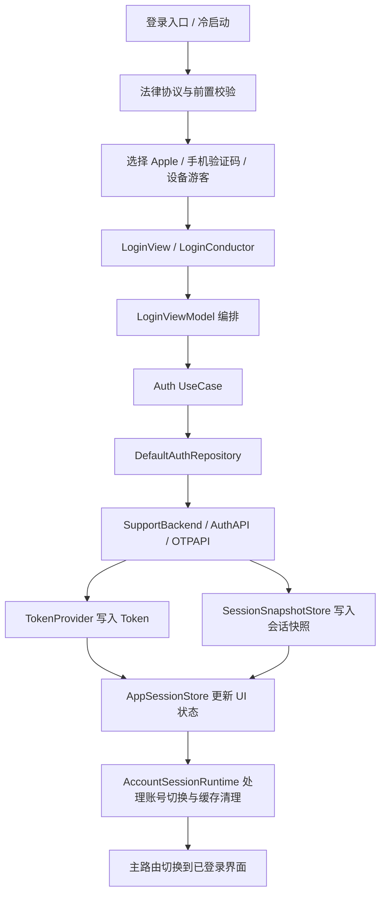

# 会话与认证需求

## 一、模块目标

会话与认证模块负责把“用户是谁”变成整个应用的前置状态。它承担登录、会话恢复、Token 刷新、退出登录、设备游客账号、手机号验证码登录和 Apple 登录等能力，并向主路由、账号管理、AI 设置和文件等下游模块提供稳定的 `UserSession`。

当前项目中的真实边界是：

- 本模块负责认证入口、会话状态、Token 生命周期和本地会话快照。
- 本模块负责登录入口的法律协议门控、并发防抖和账号切换前后的状态收口。
- 本模块不负责账号资料编辑、身份绑定、注销申请和业务数据迁移，这些由账号管理模块承接。
- 本模块不负责网络层基础设施的通用重试、ETag、日志和请求门控，这些由 `Projects/Core/Networking/` 承接。

当前实现范围内，主登录路径已经覆盖 Apple 登录、手机号验证码登录和设备游客账号登录；冷启动时会先恢复本地快照，再校验远端当前会话。底层网络还保留了密码登录、邮箱 OTP 和账号身份验证接口，但这些不是当前登录页的主流程。

## 二、会话与认证模块结构

```text
SupportClient/SupportClient/
├── Projects/App/Sources/
│   ├── SupportClientApp.swift
│   └── ContentView.swift
├── Projects/App/Sources/App/
│   ├── AppContainer.swift
│   ├── AppSessionStore.swift
│   └── Architecture/
│       ├── AccountSessionRuntime.swift
│       └── SignedInSessionPreparationRegistry.swift
├── Projects/Features/Auth/
│   ├── Domain/
│   │   └── AuthRepository.swift
│   ├── Application/
│   │   ├── RequestPhoneOTPUseCase.swift
│   │   ├── RestoreSessionUseCase.swift
│   │   ├── SignInWithAppleUseCase.swift
│   │   ├── SignInWithDeviceUseCase.swift
│   │   ├── SignInWithPhoneOTPUseCase.swift
│   │   └── SignOutUseCase.swift
│   ├── Infrastructure/
│   │   ├── DefaultAuthRepository.swift
│   │   └── SessionSnapshotStore.swift
│   └── Presentation/
│       ├── LoginConductor.swift
│       ├── LoginView.swift
│       ├── LoginViewModel.swift
│       ├── VerificationCodeField.swift
│       ├── AuthUserFacingErrorMapper.swift
│       └── LoginLegalAgreementNote.swift
├── Projects/Core/Domain/Entities/
│   └── UserSession.swift
├── Projects/Core/Networking/
│   ├── AuthTokenProvider.swift
│   ├── SupportNetworkEngine.swift
│   ├── SupportBackendConfiguration.swift
│   └── API/
│       ├── Auth/
│       │   └── AuthAPI.swift
│       ├── OTPAPI.swift
│       └── Account/
│           ├── AccountIdentityAPI.swift
│           └── DeactivationAPI.swift
├── Projects/Foundation/Security/
│   └── SparkKeychain.swift
└── SupportClientTests/
    ├── Networking/
    │   ├── SupportAuthSessionPersistenceTests.swift
    │   ├── SupportAuthSessionInvalidationTests.swift
    │   └── SupportNetworkEngineAuthTests.swift
    └── OSS/
        └── OSSCredentialsBucketNameDecodeTests.swift
```

结构含义：

- `Projects/Features/Auth/` 是认证业务主实现，按 Application、Domain、Infrastructure、Presentation 分层。
- `Projects/Core/Networking/` 提供认证所依赖的 API 门面、Token 管理和请求编排。
- `Projects/App/Sources/App/` 负责组合根、全局会话状态和账号切换运行时。
- `Projects/Foundation/Security/` 保存安装级设备标识和设备密钥。
- `SupportClientTests/Networking/` 覆盖 Token 刷新、会话恢复、失效通知和登出清理等关键行为。
- `LoginView.swift` 负责登录首页、Apple/手机号/游客入口和法律协议门控。
- `LoginConductor.swift` 负责手机号登录子流程与验证码页跳转。

## 三、登录与会话

### 需求说明

登录与会话是用户进入主应用的入口。用户可以通过 Apple、手机号验证码或设备游客账号登录，成功后应用应得到一个完整的 `UserSession`，并切换到已登录状态。

当前登录页由 `LoginView.swift` 触发，`LoginViewModel.swift` 负责把输入、授权结果和用例调用串成一次完整登录事务。
`LoginView` 还负责法律协议确认，未确认时 Apple、手机号和设备游客入口都只会弹出协议提示，不会真正发起认证。

### 基础要求与业务规则

- 同一时刻只允许一个登录动作在执行，避免重复提交。
- 登录前需要通过本地法律协议确认，否则 Apple、手机号和设备游客入口都不应真正发起认证。
- 登录成功后必须同时满足三件事：写入 Token、写入会话快照、更新 `AppSessionStore.state`。
- 如果当前已是已登录态，发起新的登录前应先通知 `AccountSessionRuntime` 进入账号切换流程，避免账户级缓存错配。
- Apple 登录必须先生成 nonce，并把 nonce 的 SHA-256 值写入授权请求。
- 手机号登录在进入验证码页之前会先进行手机号归一化，减少国家码输入差异。
- 登录成功后，`LoginViewModel` 会根据是否替换了已有账号决定是否触发设备/账号升级提示。

### 验收标准

- Apple 登录成功后，`AppSessionStore.state` 变为 `.signedIn`，并且本地快照可读取。
- 手机号验证码登录成功后，`UserSession.signInMethod` 为 `.phone`，并保存到快照。
- 设备游客账号登录成功后，`UserSession.isDeviceAccount == true`。
- 用户取消 Apple 授权时，不应清空现有会话，也不应留下半完成状态。
- 重复点击登录按钮不会触发并发的多次登录请求。
- 未勾选法律协议时，点击任何登录入口都只会弹出协议提示，不会真正调用认证接口。

### 技术细节与设计代码位置

- 入口页面：`Projects/Features/Auth/Presentation/LoginView.swift`
- 编排层：`Projects/Features/Auth/Presentation/LoginViewModel.swift`
- 手机号子流程：`Projects/Features/Auth/Presentation/LoginConductor.swift`
- 用例层：`Projects/Features/Auth/Application/SignInWithAppleUseCase.swift`、`SignInWithDeviceUseCase.swift`、`SignInWithPhoneOTPUseCase.swift`
- 领域抽象：`Projects/Features/Auth/Domain/AuthRepository.swift`
- 仓储实现：`Projects/Features/Auth/Infrastructure/DefaultAuthRepository.swift`
- 状态更新：`Projects/App/Sources/App/AppSessionStore.swift`
- 账号切换协调：`Projects/App/Sources/App/Architecture/AccountSessionRuntime.swift`
- 关键数据模型：`Projects/Core/Domain/Entities/UserSession.swift`
- 用户态错误映射：`Projects/Features/Auth/Presentation/AuthUserFacingErrorMapper.swift`

当前实现里，`LoginViewModel.commitAuthenticatedSession` 会在认证成功后调用 `sessionStore.setAuthenticated(session)`，再通知账号切换协调器完成提交；这意味着“登录成功”不仅是接口返回成功，还必须完成会话状态收口。
`LoginView` 的登录按钮入口只负责触发 `LoginViewModel`，所有认证调用都集中在 ViewModel 和 UseCase 层，页面本身不直接碰 API。

## 四、会话恢复与退出

### 需求说明

会话恢复负责冷启动时把用户尽可能快速带回上次的账号状态。退出登录负责清理本地 Token、会话快照和账号级缓存，确保下次启动不会误认成已登录。
退出链路同时存在两种责任划分：认证仓储负责服务端登出和本地清理，`AppSessionStore` 负责把 UI 状态切回 `.signedOut`；鉴权失效或会话破坏时，恢复链路也会直接清理本地状态。

### 基础要求与业务规则

- 冷启动只应执行一次恢复流程，避免重复刷新和多次状态切换。
- 恢复优先使用本地 `SessionSnapshotStore` 和 Keychain 中的 Token。
- 如果 Token 刷新只是暂时不可用，应保留快照并允许后续重试。
- 如果 Token 明确失效，必须清理 Token、快照和设备级认证状态。
- 退出登录应优先调用服务端登出接口；即使服务端失败，也必须继续清理本地状态。
- 恢复时如果服务端能返回当前会话，应以服务端数据合并本地快照，但保留本地 `signedInAt`，避免把“本地首次签入时间”冲掉。
- 恢复时如果快照存在但 Keychain 缺少 Token，应视为会话不完整，直接回到未登录。

### 验收标准

- 冷启动时若本地有快照且 Token 有效，应恢复为 `.signedIn`，并从服务端合并最新 `UserSession`。
- 冷启动时若刷新失败属于暂时性网络问题，应保留本地会话而不是直接踢回登录页。
- 冷启动时若刷新失败属于明确失效，应清空 Token 和快照，进入 `.signedOut`。
- 点击退出登录后，快照和 Token 都应被清除，UI 回到未登录状态。
- 服务端登出失败时，仍要完成本地清理和 UI 退出。

### 技术细节与设计代码位置

- 恢复用例：`Projects/Features/Auth/Application/RestoreSessionUseCase.swift`
- 恢复逻辑：`Projects/Features/Auth/Infrastructure/DefaultAuthRepository.swift`
- 快照存储：`Projects/Features/Auth/Infrastructure/SessionSnapshotStore.swift`
- 会话状态：`Projects/App/Sources/App/AppSessionStore.swift`
- Token 管理：`Projects/Core/Networking/AuthTokenProvider.swift`
- 服务端当前会话接口：`Projects/Core/Networking/API/Auth/AuthAPI.swift`
- 退出用例：`Projects/Features/Auth/Application/SignOutUseCase.swift`

恢复链路的实际逻辑是：

1. `AppSessionStore.restoreIfNeeded()` 只进入一次。
2. `DefaultAuthRepository.restoreSession()` 先读快照。
3. 再触发 `AuthTokenProvider.authorizationHeaderValue()`，必要时刷新 Token。
4. 再调用 `SupportAuthAPI.fetchCurrentSession()` 拉远端最新状态。
5. 成功后合并远端数据并回写快照。

退出链路的实际逻辑是：

1. `DefaultAuthRepository.signOut()` 尝试调用服务端登出。
2. 无论服务端是否成功，都清理 Keychain Token、`SessionSnapshotStore` 和设备级认证缓存。
3. `AppSessionStore.signOut()` 负责把 UI 状态切为 `.signedOut`。
4. `AccountSessionRuntime.activateGuest()` 会在未登录运行时清理账号级缓存和主路由状态，避免旧账号数据残留。

## 五、设备游客账号

### 需求说明

设备游客账号是当前产品里的“游客模式”主实现。它不是纯本地假游客，而是使用安装级设备标识和设备密钥调用服务端设备登录接口，换取真实的 `UserSession` 和 Token。
设备游客账号既是登录入口，也是后续“升级为正式账号”的起点，因此必须和正式账号共享同一套会话收口逻辑。

### 基础要求与业务规则

- 设备 ID 必须是安装级持久化标识，不能退化为临时内存 UUID。
- 设备密钥必须持久化保存；如果无法写入 Keychain，必须拒绝进入假登录态。
- 设备账号登录后，`UserSession.isDeviceAccount` 必须为真。
- 设备账号在界面上仍可显示为“游客模式”，但业务上已经是已认证会话。
- 如果当前设备上已有其他正式账号，发起设备登录前应先走账号切换准备，避免缓存错位。
- 后端返回的 `accountResolution` 需要保留下来，便于识别本次是新建、复用、重建还是升级账号。
- 设备账号恢复和再次登录都应使用同一个安装级设备凭证，不应为每次登录生成新的身份。

### 验收标准

- 点击游客模式后，应进入真实设备账号登录，不再跳到独立的本地游客页面。
- 设备账号首次登录成功后，后续冷启动能依靠同一设备 ID 恢复同一账号。
- 设备密钥无法持久化时，登录必须失败，不得留下半成品 session。
- 设备账号登录与 Apple/手机号登录一样，需要完成 Token、快照和状态更新。
- 设备账号升级到正式账号时，账号切换流程要先收口旧账号，再提交新 session。

### 技术细节与设计代码位置

- 入口按钮：`Projects/Features/Auth/Presentation/LoginView.swift`
- 用例：`Projects/Features/Auth/Application/SignInWithDeviceUseCase.swift`
- 仓储：`Projects/Features/Auth/Infrastructure/DefaultAuthRepository.swift`
- 设备凭证：`Projects/Foundation/Security/SparkKeychain.swift`
- 设备登录接口：`Projects/Core/Networking/API/Auth/AuthAPI.swift`
- 设备登录结果：`Projects/Core/Domain/Entities/UserSession.swift`

当前实现里，设备游客账号使用 `SupportKeychain.getOrCreatePersistentDeviceID()` 和 `SupportKeychain.getOrCreateDeviceSecret()` 作为身份凭证，再调用 `/api/v1/auth/device/login/`。服务端返回的 `accountResolution` 会告诉客户端这次是新建、复用、重建还是升级。
`AuthFeatureError.deviceCredentialUnavailable` 是设备游客账号最重要的本地失败信号之一，表示 Keychain 或设备凭证已经不足以支撑真实游客会话。

## 六、验证码登录

### 需求说明

验证码登录负责手机号 OTP 的“发码 - 验码 - 登录”闭环。当前登录页暴露的是手机号验证码登录；邮箱 OTP 相关接口保留在底层账号管理场景中，但不是当前登录入口。

### 基础要求与业务规则

- 发码前必须完成手机号输入校验。
- 发码成功后要返回 `otpID` 和过期时长，供 UI 显示倒计时和后续验码。
- 验码成功后必须同时更新 Token、快照和 `UserSession`。
- 重发验证码应复用同一业务链路，但 UI 文案要区分“发送成功”和“重发成功”。
- 当前登录页的验证码登录仅支持手机号，不应把账号绑定场景混进主登录链路。
- 发码接口需要携带 `bundleId` 和安装级 `deviceId`，确保后端能识别同一设备的请求轨迹。
- 验证码登录接口需要 `otpId`、手机号、验证码，以及安装级设备凭证；如果设备密钥不可用，不应降级为纯本地登录。
- 发送验证码的页面状态和倒计时是本地交互态，不应被持久化成 session。

### 验收标准

- 输入手机号后可以成功申请验证码，并拿到 `otpID`。
- 输入正确验证码后能完成登录并进入已登录状态。
- 输入错误验证码时只提示错误，不应污染现有 session。
- 验码过程中的重复提交必须被阻断。
- 重发验证码后，页面应显示新的倒计时语义，但不影响之前未完成的登录快照。

### 技术细节与设计代码位置

- 手机号输入与验证码页：`Projects/Features/Auth/Presentation/LoginView.swift`
- 验证码输入控件：`Projects/Features/Auth/Presentation/VerificationCodeField.swift`
- 手机号子页与验证码跳转：`Projects/Features/Auth/Presentation/LoginConductor.swift`
- 发送验证码用例：`Projects/Features/Auth/Application/RequestPhoneOTPUseCase.swift`
- 验证码登录用例：`Projects/Features/Auth/Application/SignInWithPhoneOTPUseCase.swift`
- 仓储：`Projects/Features/Auth/Infrastructure/DefaultAuthRepository.swift`
- OTP API：`Projects/Core/Networking/API/Auth/OTPAPI.swift`
- 会话返回模型：`Projects/Core/Domain/Entities/UserSession.swift`

当前 UI 侧还负责手机号归一化和国家码自动识别。`PhoneLoginView` 里会把国际手机号整理成服务端可接受格式，再调用 `viewModel.sendOTP(phoneNumber:)`。验证码重发倒计时目前由页面内状态维护，未单独持久化。
`SupportOTPAPI.requestPhoneOTP(..., scene: "login")` 是当前登录页的默认发码场景；`scene` 只在账号注销、身份绑定或换绑等已登录场景下才会切换到 `identity_bind` / `identity_change`。

## 七、Apple 登录

### 需求说明

Apple 登录是当前主登录方式之一。它负责接收 Apple 授权结果、提取 identity token、authorization code 和用户资料，再与后端认证接口交互，生成完整 session。
Apple 登录与手机号、设备游客账号共享同一套会话收口逻辑，因此它成功后必须落到相同的 `UserSession`、Token 和快照存储路径。

### 基础要求与业务规则

- 必须从 Apple 授权结果中提取有效的 `identityToken`，缺失时应视为错误。
- 必须生成并保存 nonce，防止重放。
- Apple 登录可携带邮箱和姓名，但它们可能为空，客户端要支持兜底。
- 用户取消 Apple 授权不应被当作业务错误。
- 成功后的会话更新逻辑必须与手机号、设备账号一致。
- 授权请求应同时请求 `.fullName` 和 `.email`，但不能把它们当作必填字段。
- 如果 Apple 回调的 credential 不是 `ASAuthorizationAppleIDCredential`，应直接视为无效凭证。
- `nonce` 仅在当前一次授权交互周期内有效，不应跨页面复用。

### 验收标准

- Apple 登录成功后，Token、快照和 `AppSessionStore.state` 同步更新。
- 取消 Apple 登录时，不弹错误态，不清理现有会话。
- 缺少 `identityToken` 或 Apple 凭证类型不对时，必须失败并给出明确错误。
- Apple 登录成功后，`UserSession.signInMethod` 应为 `.apple`，除非服务端明确返回其他类型。
- Apple 登录回调只要被用户取消，就应按正常退出处理，而不是走失败提示。

### 技术细节与设计代码位置

- Apple 授权按钮：`Projects/Features/Auth/Presentation/LoginView.swift`
- Apple 授权准备：`Projects/Features/Auth/Presentation/LoginViewModel.swift`
- Apple 登录用例：`Projects/Features/Auth/Application/SignInWithAppleUseCase.swift`
- 仓储：`Projects/Features/Auth/Infrastructure/DefaultAuthRepository.swift`
- 登录 API：`Projects/Core/Networking/API/Auth/AuthAPI.swift`
- Keychain 设备信息：`Projects/Foundation/Security/SparkKeychain.swift`

当前实现使用 `ASAuthorizationAppleIDRequest` 生成 nonce 并写入请求，再在授权回调中构造 `AppleSignInPayload`。随后由 `DefaultAuthRepository.signInWithApple(payload:)` 读取安装级设备 ID、设备密钥和 bundle ID，把它们一起提交给后端。
如果 `userIdentifier` 为空，仓储会拒绝继续，因为后端需要它区分 Apple 账号的稳定身份；如果 `authorizationCode` 缺失，当前实现仍可继续，但会把它当作可选字段上报。

## 八、整体业务流程



### 成功路径

- 登录成功后，后端返回 Token 和账号上下文。
- 仓储把 Token 写入 Keychain，并把 `UserSession` 写入 `SessionSnapshotStore`。
- `AppSessionStore` 切到 `.signedIn`。
- `AccountSessionRuntime` 按账号是否变化决定是否清缓存、重建路由图和清理会话级 ViewModel。

### 失败、重试和恢复

- 短暂网络失败时，验证码发送、Apple 登录和设备登录都可以重试，但不应自动重复提交。
- Token 刷新临时不可用时，应保留本地 session，避免把用户误踢回登录页。
- Token 刷新明确失败时，应执行清理并进入登录页。
- 服务端登出失败不影响本地清理结果。

### 取消、并发和幂等

- Apple 授权取消要作为正常用户行为处理。
- `LoginViewModel` 用 `isLoading` 阻止并发登录。
- `AuthTokenProvider` 对刷新任务做去重，同一时刻只允许一个刷新请求。
- `AppSessionStore.restoreIfNeeded()` 只执行一次，避免重复恢复。

## 九、状态模型

| 状态 | 进入条件 | 用户可见结果 | 退出条件 |
| --- | --- | --- | --- |
| `loading` | App 冷启动，`AppSessionStore` 尚未恢复会话 | 先显示启动态或协调器等待 | 恢复完成后转入 `signedIn` 或 `signedOut` |
| `signedOut` | 没有可用 session，或会话被明确清理 | 登录页可用，主内容不可访问 | 登录成功后转入 `signedIn` |
| `signedIn(UserSession)` | 登录成功或恢复成功 | 主应用可用，账号级功能解锁 | 退出登录、Token 明确失效、账号切换完成 |
| `LoginViewModel.isLoading == true` | 正在执行 Apple/手机号/设备登录 | 按钮禁用、显示加载中 | 请求结束或取消 |
| `AccountSessionRuntime.isAccountSwitchInProgress == true` | 当前登录会替换已有账号 | 账号级缓存进入过渡态 | `endAccountSwitch(commit:)` 后恢复 |
| `OTP 待验证` | 已成功发码，等待用户输入验证码 | 验证码页与倒计时可见 | 验证成功、取消或过期 |

补充说明：

- `AppSessionStore.state` 是 UI 视角的会话权威状态。
- `UserSession.isDeviceAccount` 区分“设备游客账号”和正式账号。
- `LoginView` 内部还有法律协议确认态，但它是页面局部状态，不是全局 session 状态。
- `LoginConductor` 内部的 `otpId` 和倒计时也是页面局部状态，不会进入全局快照。

## 十、数据与持久化

| 数据 | 所有者 | 存储位置 | 生命周期 | 清理时机 |
| --- | --- | --- | --- | --- |
| `AuthTokens` | `AuthTokenProvider` | Keychain，service=`SupportClient.Auth` | 直到登出、刷新失败或手动清理 | 登出、失效、覆盖保存 |
| `UserSession` | `SessionSnapshotStore` | `UserDefaults`，key=`support.session.snapshot.v1` | 直到登录更新、登出或失效清理 | 登出、明确失效、重新登录覆盖 |
| 安装级设备 ID | `SparkKeychain` | Keychain，account=`device_unique_id` | 安装生命周期 | 极端情况可由系统清理 |
| 设备登录密钥 | `SparkKeychain` | Keychain，account=`device_login_secret` | 安装生命周期 | 登出不删除，除非明确重置 |
| `lastLoggedInAccountID` | `DeviceCache` | 设备缓存 | 本地缓存周期 | 账号切换或清理认证状态时更新 |
| `nonce`、验证码、授权回调数据 | `LoginViewModel` / 页面状态 | 内存 | 当前交互周期 | 请求完成、取消或页面销毁 |
| 初次法律协议确认态 | `LoginView` | `AppStorage("auth.login.initial_legal_prompt_accepted")` | 本地持久化 | 用户主动取消或清理应用数据 |

关键约束：

- Token 和 `UserSession` 不能混存在同一快照里。
- `SessionSnapshotStore` 只保存会话元数据，不保存 access token 或 refresh token。
- `UserSession` 的 `signedInAt` 表示 session 进入本地快照的时间，不等同于服务端最后活跃时间。
- 设备 ID 和设备密钥属于认证秘密，不能放进 `UserDefaults` 或普通业务快照里。

## 十一、错误模型

| 错误类别 | 触发条件 | 是否重试 | 用户反馈 | 清理动作 |
| --- | --- | --- | --- | --- |
| 缺少快照 | `SessionSnapshotStore.load()` 返回 nil | 否 | 回到登录页 | 不清理额外状态 |
| Token 缺失 | Keychain 无 refresh token | 否 | 回到登录页 | 清空快照和 Token |
| 刷新暂不可用 | 网络抖动、服务暂时故障 | 可重试 | 提示稍后重试，保留当前会话 | 不清理本地 session |
| 刷新明确失败 | refresh token 无效、响应非法 | 否 | 回到登录页 | 清空 Token、快照和设备认证状态 |
| 401 / token_not_valid / device_session_replaced | 服务端判定鉴权失效 | 否 | 退出到登录页 | 清理本地会话 |
| Apple 凭证缺失 | identity token 为空或凭证类型错误 | 否 | 显示登录失败 | 不改动现有 session |
| Apple 用户取消 | 用户主动取消授权 | 否 | 不提示业务错误 | 不改动现有 session |
| 设备凭证不可用 | Keychain 写入失败或读取失败 | 否 | 显示设备账号不可用 | 不生成假 session |
| OTP 请求失败 | 发送验证码接口失败 | 可重试 | 提示网络或业务错误 | 保留输入和页面状态 |
| OTP 校验失败 | 验码错误、过期或服务端拒绝 | 可重试 | 保留在验证码页 | 不写入 session |

错误分类来源：

- `AuthTokenProviderError` 负责 Token 刷新错误分类。
- `SupportNetworkError` 负责网络和 HTTP 错误分类。
- `AuthUserFacingErrorMapper` 负责把底层错误翻译成用户可读文案。
- `SupportAuthSessionInvalidation` 负责判断哪些错误必须触发会话失效。
- `AuthViewModelError` 负责把 Apple 凭证缺失、凭证类型错误和设备凭证不可用这些本地错误翻译为可读文案。

## 十二、与其他模块的接口边界

### 本模块负责

- 认证入口和登录流程编排。
- 会话恢复、Token 刷新和退出清理。
- 设备游客账号的登录与恢复。
- 手机号验证码登录和 Apple 登录。
- 向外提供稳定的 `UserSession` 和登录状态。

### 本模块不负责

- 账号身份绑定、换绑、注销申请和资料编辑。
- AI 设置、文件上传、OCR、通知和主框架 UI 的业务实现。
- 网络重试策略、ETag、请求门控和请求 ID 生成。
- 账号级存储的实际清理策略由 `AccountSessionRuntime` 和 `StorageRegistry` 承接，本模块只在登录/退出过程中触发它们。

### 上游调用方

- `SupportClientApp` 通过 `AppContainer` 启动整个认证组合根。
- `LoginView` 和 `LoginViewModel` 直接调用认证用例。
- `AppLifecycleCoordinator` 在启动阶段触发会话恢复。
- `AccountManagementViewModel` 复用账号验证能力和已登录 session。
- `SignInWithDeviceUseCase`、`SignInWithAppleUseCase`、`SignInWithPhoneOTPUseCase` 只负责业务编排，不直接操作 UI。

### 下游依赖

- `SupportBackend`、`SupportAuthAPI`、`SupportOTPAPI`。
- `AuthTokenProvider`、`SessionSnapshotStore`、`SparkKeychain`。
- `AppSessionStore`、`AccountSessionRuntime`、`DeviceCache`。
- `NotificationClient` 用于登录成功、失败和取消反馈。
- `SupportAuthSessionInvalidation` 用于把明确失效的响应统一收口成登出动作。

### 输入和输出契约

- 登录入口的输入：Apple 授权结果、手机号、验证码、设备凭证。
- 输出：`UserSession`、`PhoneOTPRequestContext`、已更新的 `AppSessionStore.state`。
- 错误：以 `Error` 传播，但用户态必须转成可读文案。
- 退出输出：全局状态进入 `.signedOut`，Token 和快照清理完成。
- 账号切换过程中，本模块只关心“是否提交新 session”，不承担路由图和存储预热的具体实现。

## 十三、关键代码对应关系

| 能力 | 入口 / 编排层 | 领域模型 | Repository / Gateway | 基础设施 / 平台 | 测试 |
| --- | --- | --- | --- | --- | --- |
| 登录与会话 | `Projects/Features/Auth/Presentation/LoginView.swift`、`LoginViewModel.swift`、`LoginConductor.swift` | `Projects/Core/Domain/Entities/UserSession.swift` | `Projects/Features/Auth/Domain/AuthRepository.swift`、`DefaultAuthRepository.swift` | `AppSessionStore.swift`、`AccountSessionRuntime.swift`、`AuthTokenProvider.swift` | `SupportAuthSessionPersistenceTests.swift` |
| 会话恢复与退出 | `RestoreSessionUseCase.swift`、`SignOutUseCase.swift` | `UserSession.swift` | `DefaultAuthRepository.swift`、`AuthAPI.swift` | `SessionSnapshotStore.swift`、`AppSessionStore.swift` | `SupportAuthSessionPersistenceTests.swift` |
| 设备游客账号 | `LoginView.swift`、`LoginViewModel.swift` | `UserSession.swift`、`AccountResolution` | `SignInWithDeviceUseCase.swift`、`DefaultAuthRepository.swift` | `SparkKeychain.swift`、`AuthAPI.swift` | `SupportAuthSessionPersistenceTests.swift` |
| 验证码登录 | `LoginView.swift`、`VerificationCodeField.swift` | `PhoneOTPRequestContext`、`UserSession.swift` | `RequestPhoneOTPUseCase.swift`、`SignInWithPhoneOTPUseCase.swift`、`DefaultAuthRepository.swift` | `OTPAPI.swift`、`SparkKeychain.swift` | `SupportAuthSessionPersistenceTests.swift`、`SupportNetworkEngineAuthTests.swift` |
| Apple 登录 | `LoginView.swift`、`LoginViewModel.swift` | `AppleSignInPayload`、`UserSession.swift` | `SignInWithAppleUseCase.swift`、`DefaultAuthRepository.swift` | `AuthAPI.swift`、`SparkKeychain.swift` | `SupportAuthSessionPersistenceTests.swift` |

补充测试对应关系：

- `SupportAuthSessionInvalidationTests.swift` 验证 401、`token_not_valid` 和 `device_session_replaced` 的失效规则。
- `SupportNetworkEngineAuthTests.swift` 验证 401 刷新、并发去重和临时刷新失败的保留策略。
- `OSSCredentialsBucketNameDecodeTests.swift` 里顺带验证了 `UserSession` 的序列化兼容性，说明会话模型不会误写 Token 字段。

## 十四、测试策略

### 已有测试

- 401 触发会话失效通知并清理 Token。
- 并发请求命中同一个 Token 刷新任务时只刷新一次。
- 刷新暂时失败时不清除本地 Token。
- 冷启动恢复时，快照存在但 Keychain 缺失会被判定为未登录。
- 冷启动恢复时，Token 可用并且服务端当前会话成功时，会把远端会话合并到本地快照。
- 退出登录会清空快照和 Token，即使服务端登出失败也一样。
- Apple、设备、手机号登录成功后都会写入 session 快照，并可从快照反查到一致的 `accountID`。

### 当前测试缺口

- `LoginViewModel` 的 UI 级单测仍然缺失，特别是 Apple 取消、重复点击、设备账号升级和验证码重发。
- `LoginView` 的法律协议门控、手机号自动归一化和倒计时逻辑缺少专门测试。
- `SessionSnapshotStore` 的损坏数据回退、字段兼容和并发写入缺少直接测试。
- `AccountSessionRuntime` 的账号切换清理路径缺少针对性验证。

### 建议补充测试

- Apple 授权取消不改变 session 的测试。
- 设备账号登录成功后 `isDeviceAccount == true` 的测试。
- 手机号 OTP 请求和验证的 happy path 测试。
- 登录中重复点击只触发一次请求的测试。
- `SessionSnapshotStore` 读到损坏 JSON 时的回退测试。
- 账号切换时清理会话级缓存的测试。
- `LoginView` 未同意协议时不进入真实登录流程的测试。

## 十五、当前实现、缺口与演进

### 当前实现

- 已实现 Apple 登录、手机号验证码登录和设备游客账号登录。
- 已实现冷启动恢复、Token 刷新和退出登录的本地清理。
- 已实现账户切换前后的运行时清理与主路由重建。
- 已有网络层对 401、刷新去重和失败分类的支持。
- 已有登录页法律协议门控和手机号页自动国家码识别。

### 当前缺口

- 登录页没有暴露密码登录和邮箱 OTP 的主入口，虽然底层 API 已存在。
- OTP 重发倒计时和部分页面交互只在本地状态中维护，没有统一的状态机。
- 会话恢复、登录和账号切换之间仍以多个对象协作，调试时需要同时看 `LoginViewModel`、`AppSessionStore` 和 `AccountSessionRuntime`。
- 当前缺少针对登录 UI 的直接自动化测试。
- Apple 登录的用户取消、凭证缺失、设备账号升级和协议门控，仍缺少更细粒度的交互测试。

### 建议演进

1. 如果后续要增加邮箱登录或密码登录，建议先统一认证入口状态机，再决定是否扩展登录页。
2. 如果设备游客账号还要支持更复杂的“升级为正式账号”路径，建议把账号切换流程继续收敛到独立的认证协调器。
3. 如果登录失败、恢复失败和失效通知越来越多，建议把用户态错误映射和诊断日志拆成独立的认证错误服务。
4. 如果产品继续扩大，会话快照和设备凭证应继续保持“会话元数据”和“认证秘密”分离，不要合并存储。
5. 如果后续要支持多语言协议和多入口登录，建议把 `LoginView` 的局部状态机拆成更明确的交互 coordinator。

## 十六、整体验收标准

- [ ] Apple、手机号验证码和设备游客账号都能进入同一套 `UserSession` 生命周期。
- [ ] 冷启动只恢复一次，并能正确处理快照、Token 和远端当前会话。
- [ ] 退出登录无论服务端结果如何，都能清理本地 Token 和会话快照。
- [ ] Token 刷新失败能区分“暂时失败”和“明确失效”。
- [ ] 设备游客账号使用真实设备凭证，不是本地假游客。
- [ ] 登录成功后会同时更新快照、Token 和 `AppSessionStore.state`。
- [ ] 并发登录、重复刷新和重复恢复有去重或幂等保护。
- [ ] 关键错误都有可读文案，并且不会留下半完成 session。
- [ ] 账号切换时不会把旧账号缓存带入新账号。
- [ ] 关键行为至少有恢复、失效、刷新和登出测试覆盖。
