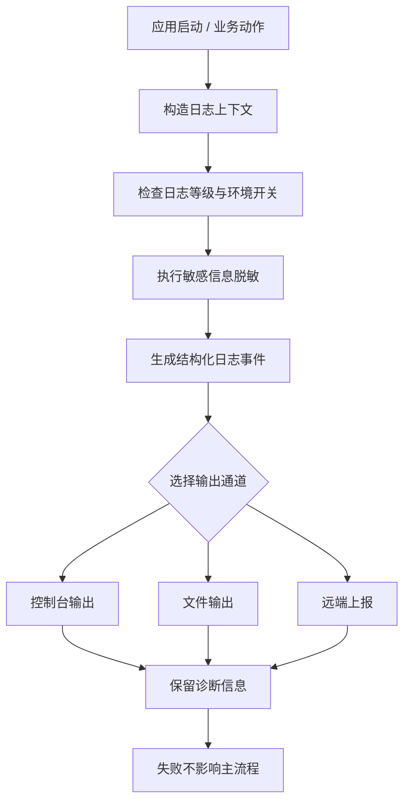

# 日志系统需求

## 一、模块目标

日志系统用于为 `SupportClientAndroid` 提供统一、可诊断、可脱敏的运行时观测能力，覆盖应用启动、网络请求、认证切换、后台初始化、页面交互和异常排查等场景。

结合当前仓库事实，Android 子工程只有基础启动壳和 Compose 示例页面，尚未看到独立的日志基础设施代码、统一 `Logger` 抽象或第三方日志依赖。因此，本模块既是现阶段的能力补齐说明，也是后续落地日志架构的权威约束。

日志系统需要满足以下目标：

- 统一输出格式，避免各处直接散落 `Log`、`println` 或临时调试语句。
- 区分调试、信息、警告、错误等等级，并可按构建类型或环境开关控制。
- 为网络请求、认证、启动链路和关键业务操作提供可关联的诊断上下文。
- 对 Token、密钥、手机号、Cookie、请求体敏感字段等内容进行脱敏。
- 允许日志作为诊断工具存在，但不影响主流程、页面响应或启动成功率。
- 当前工程未实现的部分要明确标记为缺口，避免把需求文档误写成已完成实现。

## 二、日志系统模块结构

建议将日志系统设计为“核心抽象 + 上下文 + 脱敏 + 输出通道”的小型基础模块，而不是把打印逻辑散落到各个 Feature 中。

```text
Logging/
├── Logger
│   ├── LogLevel
│   ├── LogCategory
│   ├── LogEvent
│   └── LoggerProtocol
├── Context/
│   ├── LogContext
│   ├── RequestContext
│   ├── SessionContext
│   └── DeviceContext
├── Sanitization/
│   ├── LogSanitizer
│   ├── SensitiveKeySet
│   └── RedactionPolicy
├── Sinks/
│   ├── ConsoleSink
│   ├── FileSink
│   └── RemoteSink
├── Routing/
│   ├── LogRouter
│   └── LogFilter
└── Diagnostics/
    ├── StartupLogger
    ├── NetworkLogger
    └── CrashContextBuilder
```

### 模块职责边界

| 子模块 | 职责 | 不负责的内容 |
| --- | --- | --- |
| `Logger` | 统一日志 API、等级判断、输出编排 | 业务规则、页面状态、网络请求执行 |
| `Context` | 拼接请求、会话、设备和启动上下文 | 敏感数据落盘、界面展示 |
| `Sanitization` | 屏蔽敏感字段、裁剪长文本、统一脱敏规则 | 判断业务成功与失败 |
| `Sinks` | 将日志写入控制台、文件或远端平台 | 解析业务参数 |
| `Routing` | 决定哪些日志输出、哪些丢弃 | 生成业务逻辑 |
| `Diagnostics` | 组装启动、网络、崩溃排查信息 | 替代错误处理和重试机制 |

### 当前实现现状

当前仓库中没有独立的 `Logging/` 代码目录，也没有看到 `Logger`、`Timber`、`Crashlytics` 或类似依赖配置。现阶段可确认的 Android 代码入口只有 `MainActivity` 和模板 Compose UI，因此日志系统在代码层面仍是待落地能力。

## 三、功能模块

### 3.1 日志基础设施

#### 需求说明

日志基础设施负责定义所有模块共用的日志入口、日志等级和统一输出协议。

#### 基础要求与业务规则

- 统一定义 `debug`、`info`、`warn`、`error` 等等级。
- 日志调用方只能依赖协议，不直接依赖具体输出实现。
- 日志系统应支持模块名或分类标签，例如 `app`、`launch`、`network`、`auth`、`storage`、`ui`。
- 调试构建可以输出更详细的诊断信息，发布构建默认收敛噪声。
- 任何日志失败都不能阻塞主流程。

#### 验收标准

- 任意业务模块都能通过同一入口输出日志。
- 不同等级日志可以被独立过滤。
- 切换构建类型后，日志噪声和详细度可控。
- 现有代码中不再新增散落的临时打印点。

#### 技术细节与设计代码位置

- 当前代码中尚无统一日志入口。
- 当前可确认的相关文件只有应用入口 `SupportClientAndroid/app/src/main/java/cn/zhaodk/SupportClient/MainActivity.kt`，它没有执行日志初始化。
- 构建配置位于 `SupportClientAndroid/app/build.gradle.kts`，当前未引入专门日志依赖。
- 建议后续将统一入口放入类似 `SupportClientAndroid/app/src/main/java/cn/zhaodk/SupportClient/logging/` 的位置，但这属于设计落点，不是当前已存在代码。

### 3.2 日志上下文与诊断信息

#### 需求说明

日志需要携带最小必要上下文，让排查者知道“谁、在什么阶段、针对什么请求、发生了什么”。

#### 基础要求与业务规则

- 启动日志至少应包含应用版本、构建类型、页面或流程阶段。
- 网络日志应包含 `requestId`、接口名、状态码、耗时、重试次数和缓存结果。
- 会话相关日志应携带账号维度的匿名标识，但不得输出明文 token。
- 设备相关日志可以记录设备标识摘要，但不能落出可直接冒用的凭证。
- 上下文对象应尽量短生命周期，避免跨账号污染。

#### 验收标准

- 一条错误日志可以回溯到触发的功能、上下文和阶段。
- 不同账号的诊断上下文不会互相覆盖。
- 请求链路中的关键节点可以通过同一个 `requestId` 串联。

#### 技术细节与设计代码位置

- 当前没有现成的 `LogContext` 实现。
- 当前工程的启动点仍然是 `MainActivity`，尚未看到 `Application` 级别的日志上下文装配。
- 当前测试目录只有模板测试，没有上下文构造相关测试。
- 建议未来把上下文构造放进应用装配层或基础设施层，而不是页面层。

### 3.3 敏感信息脱敏

#### 需求说明

日志系统必须对敏感信息进行脱敏，否则日志本身会成为泄漏面。

#### 基础要求与业务规则

- 默认脱敏 `Authorization`、`Cookie`、`token`、`refresh token`、`API key`、`STS secret`、验证码、手机号、邮箱和身份证类信息。
- 请求体和响应体只允许记录必要摘要，不输出完整原文。
- 文件内容、图片内容和 OCR 原文默认不进入普通日志。
- 脱敏规则要统一，而不是由各业务模块各自实现一遍。
- 如果脱敏无法完成，应优先裁剪字段而不是继续输出明文。

#### 验收标准

- 人工搜索日志不会直接找到 token、密钥或验证码明文。
- 同一字段在不同模块中脱敏结果一致。
- 异常调试信息仍保留足够诊断价值，不至于完全失真。

#### 技术细节与设计代码位置

- 当前没有独立的脱敏器实现。
- 当前应用模板代码也没有日志输出，因此不存在已完成的脱敏链路。
- 日志脱敏应优先在统一 Logger 层完成，而不是在每个 API 或页面里重复处理。

### 3.4 启动、网络与异常诊断日志

#### 需求说明

日志系统的高价值场景不是“到处打印”，而是对启动、网络、认证失效和异常恢复链路做结构化诊断。

#### 基础要求与业务规则

- 启动日志要能区分应用初始化、会话恢复、首屏渲染和功能预热。
- 网络日志要能区分请求发起、重试、缓存命中、401、取消和解码失败。
- 认证日志要能表达登录成功、会话过期、签名失效和退出登录清理。
- 关键失败必须写入错误日志，但页面展示文案应由业务层决定。
- 诊断日志应尽量结构化，避免只有难以检索的自由文本。

#### 验收标准

- 启动失败、网络失败和认证失败能被清晰区分。
- 同一条请求的发起、响应和重试能在日志中串起来。
- 退出登录和账号切换时的清理过程有可追踪记录。

#### 技术细节与设计代码位置

- 当前代码里没有启动链路日志编排，`MainActivity` 只是 Compose 模板入口。
- 当前工程尚未见到网络层实现，因此网络诊断日志也还未落地。
- 这部分能力应与后续的网络模块、会话模块和应用启动链路文档联动，而不是独立漂移实现。

## 四、整体业务流程



### 业务流程说明

1. 应用启动、网络请求或业务动作触发日志事件。
2. 日志系统先拼接上下文，包括模块名、账号信息摘要、请求标识和阶段信息。
3. 统一检查当前环境允许输出的等级，避免发布环境输出过多噪声。
4. 对敏感字段执行脱敏和裁剪。
5. 形成结构化事件后路由到一个或多个输出通道。
6. 任何输出失败都只能影响日志本身，不能反向阻塞主流程。

## 五、状态模型

日志系统不是业务状态机，但它仍然存在配置状态、上下文状态和输出状态。

| 状态类型 | 示例 | 是否持久化 | 说明 |
| --- | --- | --- | --- |
| 全局配置状态 | 当前日志等级、是否允许详细诊断 | 否 | 由构建类型或环境控制 |
| 上下文状态 | requestId、session 摘要、模块名 | 否 | 跟随单次动作生命周期 |
| 输出状态 | 已输出、被过滤、输出失败 | 否 | 只用于内部调度 |
| 脱敏状态 | 已脱敏、裁剪中、无法完整脱敏 | 否 | 防止敏感信息泄漏 |
| 采样状态 | 采样命中、未命中 | 否 | 用于控制高频日志噪声 |

### 当前状态判断

- 当前工程没有独立日志配置状态。
- 当前也没有可见的输出状态管理。
- 若后续新增文件日志或远端日志，需要再引入生命周期、大小和保留策略。

## 六、数据与持久化

### 6.1 数据边界

日志数据默认应视为诊断数据，而不是业务持久化数据。

- 普通控制台日志：不持久化。
- 临时诊断文件：如未来需要，应该限定保留周期和大小上限。
- 崩溃上下文：如未来接入崩溃平台，仅存储必要摘要。
- 敏感请求体和凭证：不应持久化到普通日志文件。

### 6.2 当前实现

- 现有 Android 工程没有日志文件存储实现。
- 现有 `AndroidManifest.xml` 只包含普通应用配置，没有日志后台服务或独立进程配置。
- 现有资源和测试也未体现日志持久化策略。

### 6.3 推荐持久化策略

- 默认优先使用控制台输出，便于开发和本地调试。
- 若未来增加文件日志，应采用滚动和最大容量限制。
- 远端日志仅适合采样、错误和关键诊断，不适合全量埋点替代。

## 七、错误模型

日志系统自身也需要定义错误边界，但这些错误不能扩散成业务故障。

| 错误类型 | 典型原因 | 用户可见性 | 处理方式 |
| --- | --- | --- | --- |
| 输出失败 | 文件不可写、目标不可达 | 不可见 | 降级到控制台或直接丢弃 |
| 脱敏失败 | 结构不符合预期 | 不可见 | 裁剪并记录安全摘要 |
| 上下文缺失 | requestId/session 未初始化 | 不可见 | 输出默认值并保留阶段信息 |
| 采样丢弃 | 命中采样策略 | 不可见 | 正常丢弃，不视为错误 |
| 配置非法 | 日志等级配置异常 | 间接可见 | 回退到默认级别 |

### 错误处理原则

- 日志模块不得抛出会终止主流程的异常。
- 业务错误不应因为日志失败而被改写。
- 日志失败可以记录最小化 fallback 信息，但不能再次泄漏敏感内容。

## 八、与其他模块的接口边界

### 负责什么

- 统一记录启动、网络、认证、页面和系统能力的诊断信息。
- 提供敏感信息脱敏和日志等级控制。
- 为后续网络模块提供 Request ID、耗时和重试的记录入口。

### 不负责什么

- 不负责业务判定。
- 不负责页面文案。
- 不负责网络重试策略。
- 不负责会话恢复流程。
- 不负责文件、OCR、AI 或相机的具体业务实现。

### 上游调用方

- 应用启动链路。
- 网络模块。
- 会话与认证模块。
- 文件与 OSS 模块。
- OCR 和第二相机相关模块。

### 下游依赖

- 控制台或系统输出。
- 未来可能接入的文件、崩溃或远端日志平台。
- 环境配置和构建类型信息。

## 九、关键代码对应关系

### 当前可确认代码位置

| 代码位置 | 当前作用 | 与日志系统关系 |
| --- | --- | --- |
| `SupportClientAndroid/app/src/main/java/cn/zhaodk/SupportClient/MainActivity.kt` | Compose 应用入口 | 当前没有日志初始化逻辑 |
| `SupportClientAndroid/app/src/main/AndroidManifest.xml` | 应用清单与 Activity 配置 | 当前没有日志相关组件声明 |
| `SupportClientAndroid/app/build.gradle.kts` | 模块依赖与构建配置 | 当前未引入专门日志库 |
| `SupportClientAndroid/app/src/test/java/cn/zhaodk/SupportClient/ExampleUnitTest.kt` | 模板单元测试 | 当前没有日志测试覆盖 |
| `SupportClientAndroid/app/src/androidTest/java/cn/zhaodk/SupportClient/ExampleInstrumentedTest.kt` | 模板仪器测试 | 当前没有日志测试覆盖 |

### 建议新增代码位置

| 建议位置 | 预期职责 |
| --- | --- |
| `SupportClientAndroid/app/src/main/java/cn/zhaodk/SupportClient/logging/` | Logger、等级、上下文和脱敏 |
| `SupportClientAndroid/app/src/main/java/cn/zhaodk/SupportClient/diagnostics/` | 启动、网络和错误诊断拼装 |
| `SupportClientAndroid/app/src/test/java/cn/zhaodk/SupportClient/logging/` | 脱敏、等级和过滤测试 |

## 十、测试策略

### 单元测试

- 日志等级过滤测试。
- 敏感字段脱敏测试。
- 长文本裁剪测试。
- requestId / sessionId 传递测试。
- 空上下文和缺失字段的默认值测试。

### 集成测试

- 应用启动时不会因为日志初始化失败而中断。
- 网络请求能带上相同的上下文标识。
- 退出登录或切换账号后，上一个账号的上下文不再继续输出。

### 仪器测试

- 调试构建下日志输出可见。
- 发布构建下噪声级别收敛。
- 关键异常不会因为日志处理导致页面卡死或崩溃。

### 当前测试缺口

- 现有 Android 测试目录还是模板状态，没有日志相关测试。
- 当前也没有专门的日志断言工具或输出捕获机制。

## 十一、当前实现、缺口与演进

### 当前实现

- Android 子工程目前只有最小启动壳，没有独立日志系统。
- 没有统一 Logger 抽象。
- 没有日志脱敏器。
- 没有日志级别配置。
- 没有启动、网络或认证的结构化诊断链路。

### 主要缺口

1. 需要建立统一日志入口，替代分散打印。
2. 需要补齐脱敏策略，避免敏感信息泄漏。
3. 需要把网络、启动和认证关键节点接入同一上下文。
4. 需要补测试，保证日志不会改变业务行为。

### 演进建议

1. 先做最小可用版：统一 Logger + 等级 + 控制台输出 + 脱敏。
2. 再接入启动和网络诊断上下文，形成真正可排查的日志。
3. 最后按需增加文件或远端输出，避免一开始就引入过重基础设施。

## 十二、整体验收标准

- [ ] Android 工程存在统一日志入口，不再依赖散落打印。
- [ ] 日志等级可配置，调试与发布行为不同。
- [ ] Token、API Key、Cookie、手机号和验证码不会以明文出现在日志里。
- [ ] 启动链路、网络链路和认证链路的关键节点可通过日志追踪。
- [ ] 日志失败不会影响应用启动、页面渲染和业务流程。
- [ ] 当前模板测试已补充日志相关单元测试或集成测试。
- [ ] 若未来引入文件或远端日志，有明确的容量、保留和降级策略。

