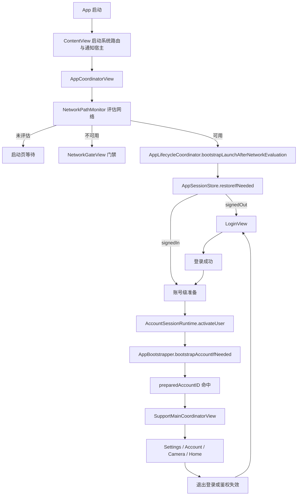

# 路由与页面导航需求

## 一、模块目标

本模块定义 `SupportClient` 的页面进入、退出、切换、弹层和系统事件路由方式，确保 App 启动、登录、主框架 Tab、账号管理、AI 设置、第二相机和通知失效处理都沿着真实状态流转，而不是依赖分散的临时跳转逻辑。

当前实现的核心特征是“状态驱动导航”：

- App 根视图根据会话状态决定展示启动页、登录页或主框架。
- 登录页只负责本地登录流程和局部导航。
- 主框架内使用 `TabView` + 局部 `NavigationStack` + `sheet` / `fullScreenCover` 组合导航。
- 系统级鉴权失效先进入 `RouteCoordinator`，再交给 `AppLifecycleCoordinator` 统一回收会话。

本模块不定义独立的 typed route graph，也不承担网络请求、业务校验或媒体处理本身的实现。

## 二、路由与页面导航模块结构

| 层级 | 当前职责 | 关键代码位置 |
| --- | --- | --- |
| App Shell | 包装通知宿主、启动根协调器、接收 deep link 入口 | `SupportClient/Projects/App/Sources/ContentView.swift` |
| 根会话路由 | 根据会话状态切换启动页、登录页和主框架 | `SupportClient/Projects/App/Sources/App/AppCoordinatorView.swift` |
| 生命周期编排 | 处理冷启动、会话恢复、登录后准备、登出和鉴权失效 | `SupportClient/Projects/App/Sources/App/Architecture/AppLifecycleCoordinator.swift` |
| 系统事件路由 | 接管 `NotificationCenter` 的鉴权失效事件并转交生命周期 | `SupportClient/Projects/App/Sources/App/Architecture/RouteCoordinator.swift` |
| 主框架导航 | 组合首页、第二相机、设置页和账号管理页 | `SupportClient/Projects/App/Sources/App/AppCoordinatorView.swift` |
| 登录局部导航 | 手机号登录、OTP 验证、法律确认、升级登录弹层 | `SupportClient/Projects/Features/Auth/Presentation/LoginView.swift`、`LoginConductor.swift`、`PhoneLoginView.swift` |
| 设置与账号导航 | 设置页进入 AI 设置、账号管理页进入身份绑定与注销流程 | `SupportClient/Projects/Features/Settings/Presentation/SettingsView.swift`、`SupportClient/Projects/Features/AccountManagement/Presentation/AccountManagementView.swift` |
| 第二相机路由 | 全屏相机、拍摄结果预览、编辑器弹层 | `SupportClient/Projects/Features/SecondCamera/Presentation/SecondCameraHomeView.swift` |
| 通知宿主 | 在根视图上层展示 banner / toast / alert，不改变主导航栈 | `SupportClient/Projects/App/Sources/App/Notification/NotificationHostView.swift` |

当前实现不是一个统一的 `Route` 枚举驱动系统，而是“根会话状态 + 局部 path + 局部 sheet/fullScreenCover”的混合导航形态。

## 三、功能模块

### 3.1 应用级路由与会话切换

#### 需求说明

App 冷启动时必须先判断网络路径，再恢复会话；恢复后根据会话状态进入登录页或主框架。若当前账号准备尚未完成，主框架不能提前显示。

#### 基础要求与业务规则

- `AppCoordinatorView` 是根路由入口。
- `AppSessionStore` 只负责会话状态来源，不负责页面渲染。
- `AppLifecycleCoordinator` 负责把 `.loading`、`.signedOut`、`.signedIn` 转成可见页面。
- 网络不可用时先停留在启动页或网络门禁，不执行会话恢复。
- 账号切换后必须清理账号级缓存与会话级 ViewModel。

#### 验收标准

- 冷启动时，网络未评估完成不会误进登录页或主框架。
- 会话恢复成功后，只有在 `preparedAccountID == session.accountID` 时才进入主框架。
- 退出登录或服务端鉴权失效后，页面能回到登录页且账号级缓存被清理。

#### 技术细节与设计代码位置

- `SupportClient/Projects/App/Sources/App/AppCoordinatorView.swift:13-45`：根视图状态分发。
- `SupportClient/Projects/App/Sources/App/Architecture/AppLifecycleCoordinator.swift:52-117`：冷启动、登出、鉴权失效处理。
- `SupportClient/Projects/App/Sources/App/AppSessionStore.swift`：会话状态来源与持久化快照一致性检查。
- `SupportClient/Projects/App/Sources/App/AppBootstrapper.swift`：应用级和账号级引导。

### 3.2 登录与升级登录路由

#### 需求说明

登录页需要支持 Apple 登录、手机号登录、OTP 验证和设备游客账号入口，并在游客账号场景下支持升级到正式账号的弹层式登录。

#### 基础要求与业务规则

- 登录页必须先确认法律协议同意状态，再允许继续登录。
- 手机号登录通过局部 `LoginRoute.phone` 进入 OTP 页面。
- 游客账号点击账户入口时，不直接进入账号管理页，而是先弹出升级登录页。
- 登录失败、取消或重新发送 OTP 都只能影响当前登录局部状态，不能污染主框架路由。

#### 验收标准

- 未同意法律协议时，Apple 登录、手机号登录和游客登录都不会直接提交。
- 手机号登录可以从 `LoginView` 进入 `PhoneLoginView`，再进入 `OTPVerifyView`。
- 游客账号点击设置页的账户入口后，能打开升级登录 `sheet`。

#### 技术细节与设计代码位置

- `SupportClient/Projects/Features/Auth/Presentation/LoginView.swift:5-80`：登录页根导航和法律确认。
- `SupportClient/Projects/Features/Auth/Presentation/LoginView.swift:149-229`：Apple、手机号、游客入口。
- `SupportClient/Projects/Features/Auth/Presentation/LoginConductor.swift`：登录页的兼容导航容器。
- `SupportClient/Projects/Features/Auth/Presentation/LoginView.swift:275-387`：手机号登录路由和法律弹层。
- `SupportClient/Projects/Features/Auth/Presentation/PhoneLoginView.swift:3-220`：手机号输入、OTP 发送与验证页面。

### 3.3 主框架 Tab 与设置页导航

#### 需求说明

登录成功后，主页面以 `TabView` 组织首页、第二相机和设置页。设置页内部继续承载 AI 设置与账号管理入口。

#### 基础要求与业务规则

- 首页、相机、设置三类功能由独立 `NavigationStack` 承载。
- 设置页中的账号入口要区分正式账号与游客账号。
- 正式账号点击账户入口进入账号管理页；游客账号打开升级登录 `sheet`。
- AI 设置进入的是同一个账号作用域下的 `AISettingsViewModel`，不能跨账号复用。

#### 验收标准

- 主框架展示的 tab 数量与当前实现一致，且不会因为某个 tab 的内部导航污染其他 tab。
- 设置页能进入 AI 设置页。
- 正式账号可以从设置页进入账号管理页。

#### 技术细节与设计代码位置

- `SupportClient/Projects/App/Sources/App/AppCoordinatorView.swift:75-153`：`TabView`、`NavigationStack`、`NavigationPath` 和升级登录 `sheet`。
- `SupportClient/Projects/Features/Settings/Presentation/SettingsView.swift:3-56`：设置页账户入口与 AI 设置入口。
- `SupportClient/Projects/App/Sources/App/AppContainer.swift:213-229`：账号作用域的 `AISettingsViewModel` 缓存。

### 3.4 账号管理页与返回路由

#### 需求说明

账号管理页负责展示资料、身份列表、绑定/修改身份、退出登录和注销申请。它是设置页下的二级路由，不是独立顶层页面。

#### 基础要求与业务规则

- 账号管理页进入后要先加载资料和身份列表。
- 身份绑定、变更、注销等流程都要保持在账号管理页内部完成。
- 退出登录后必须回到未登录态。
- 注销和身份变更中的 overlay / alert 不应破坏导航栈。

#### 验收标准

- 从设置页进入账号管理页后，可以正常加载资料和身份列表。
- 退出登录会触发会话清理并回到登录页。
- 身份绑定、修改和注销流程能通过 overlay / alert 完成，不需要额外跳出页面栈。

#### 技术细节与设计代码位置

- `SupportClient/Projects/App/Sources/App/AppCoordinatorView.swift:113-153`：`AccountRoute.management` 和 `NavigationPath` 跳转。
- `SupportClient/Projects/Features/AccountManagement/Presentation/AccountManagementView.swift:4-79`：账号管理页主结构、加载和退出登录。
- `SupportClient/Projects/Features/AccountManagement/Presentation/AccountManagementView.swift:81-220`：资料、身份、退出、危险操作区。
- `SupportClient/Projects/Features/AccountManagement/Application/`：身份与注销相关 UseCase。

### 3.5 第二相机弹层路由与媒体预览

#### 需求说明

第二相机不是在导航栈中层层 push，而是通过 `fullScreenCover` 打开相机，再把拍摄结果回传到首页式预览区。

#### 基础要求与业务规则

- 进入相机前后必须正确处理关闭回调，避免重复 dismiss。
- 拍照、录制和批量媒体捕获结束后，应回到第二相机主页预览，不直接切换全局页面。
- 图片和视频编辑属于相机内部弹层路由，不能影响主 Tab。

#### 验收标准

- 点击第二相机按钮能弹出全屏相机。
- 完成拍摄后，能回到第二相机主页并显示最近结果。
- 编辑器和照片选择器关闭后，不会把用户带离第二相机模块。

#### 技术细节与设计代码位置

- `SupportClient/Projects/Features/SecondCamera/Presentation/SecondCameraHomeView.swift:6-124`：第二相机主页与 `fullScreenCover`。
- `SupportClient/Projects/Features/SecondCamera/CustomCamera/Presentation/Default/CapturedMedia/DefaultCustomCapturedMediaScreen.swift`：相机结果编辑弹层。
- `SupportClient/Projects/Features/SecondCamera/CustomCamera/Presentation/Preview/View+SecondCameraMediaPreview.swift`：公共预览弹层。

### 3.6 系统事件与深链入口

#### 需求说明

系统鉴权失效、深链和通知入口需要先进入 App 级路由入口，再由生命周期协调器决定是否回到登录态。

#### 基础要求与业务规则

- `RouteCoordinator` 只处理系统事件接入，不直接改写页面栈。
- `ContentView` 会启动系统事件路由，并把 `onOpenURL` 交给通知客户端记录。
- 服务端鉴权失效必须走统一登出清理，不允许只改 UI 状态。

#### 验收标准

- 鉴权失效通知到达后，App 能强制回到未登录态。
- 深链进入后不会破坏当前根会话状态。
- 通知 banner / toast / alert 不会把主页面栈切换掉。

#### 技术细节与设计代码位置

- `SupportClient/Projects/App/Sources/App/Architecture/RouteCoordinator.swift:4-45`：系统事件监听与转交。
- `SupportClient/Projects/App/Sources/ContentView.swift`：启动系统路由与 `onOpenURL`。
- `SupportClient/Projects/App/Sources/App/Notification/NotificationHostView.swift`：通知宿主覆盖层。

## 四、整体业务流程

主路由的关键分支是：

1. 先看网络，再恢复会话。
2. 恢复失败进入登录页。
3. 恢复成功后，先完成账号级准备，再进入主框架。
4. 主框架内部由各功能模块自己决定是 push、sheet 还是 fullScreenCover。

## 五、状态模型

| 状态 | 所属层级 | 说明 | 是否持久化 |
| --- | --- | --- | --- |
| `AppSessionState.loading` | 根会话 | 启动中，等待网络评估与会话恢复 | 否 |
| `AppSessionState.signedOut` | 根会话 | 当前没有可用登录态 | 间接由快照和 token 决定 |
| `AppSessionState.signedIn(UserSession)` | 根会话 | 已登录，携带当前账号信息 | 由 `SessionSnapshotStore` / token 持久化 |
| `preparedAccountID` | 根会话 | 已完成账号级准备的账号 ID | 否 |
| `path: [LoginRoute]` | 登录局部 | 手机号登录等局部导航 | 否 |
| `path: NavigationPath` | 设置局部 | 账号管理二级导航 | 否 |
| `showsDeviceAccountUpgradeSheet` | 主框架局部 | 游客账号升级登录弹层 | 否 |
| `isPresentingCamera` | 相机局部 | 第二相机全屏展示状态 | 否 |
| `selectedPreview` | 相机局部 | 最近一次拍照/录制预览 | 否 |
| `hasAcceptedInitialLegalPrompt` | 登录局部 | 首次法律确认是否已接受 | 是，`@AppStorage` |

当前实现中，导航状态大多是瞬时 UI 状态，只有会话快照、token、法律确认结果和少量账号级运行时数据会落盘或跨启动保留。

## 六、数据与持久化

### 当前实现

- 会话持久化由 `SessionSnapshotStore` 和 `AuthTokenProvider` 负责，决定根路由进入登录页还是主框架。
- 法律确认态通过 `@AppStorage("auth.login.initial_legal_prompt_accepted")` 持久化。
- 账号级路由本身不持久化，`NavigationPath`、`sheet` 状态和 `fullScreenCover` 状态都是内存态。
- 账号切换时，`AccountSessionRuntime` 会触发缓存清理，避免旧账号的 UI 状态残留。

### 设计边界

- 路由状态不应该作为业务数据保存到数据库。
- 深链、通知和系统事件应该转为事件输入，而不是持久化导航栈。
- 相机预览和登录局部状态只应保留在当前页面生命周期内。

## 七、错误模型

| 错误/异常 | 触发位置 | 当前表现 | 恢复方式 |
| --- | --- | --- | --- |
| 网络不可用 | 冷启动或恢复前 | 显示 `NetworkGateView` 或停留在启动页 | 等待网络恢复后重新引导 |
| 会话恢复失败 | `AppSessionStore.restoreIfNeeded()` | 回到登录页 | 清理快照后重新登录 |
| 服务端鉴权失效 | `RouteCoordinator` 监听通知 | 强制切回未登录态 | `handleServerAuthInvalidationIfNeeded` 统一清理 |
| 登录取消 / 失败 | `LoginViewModel` 与登录页 | 保留当前登录页状态 | 允许重新发起登录 |
| OTP 发送失败 | `PhoneLoginView` / 登录 ViewModel | 停留在手机号页面 | 重新发送或修改号码 |
| 账号管理操作失败 | `AccountManagementView` | 通过 alert / overlay 提示 | 保持当前页面，允许重试 |
| 第二相机关闭或保存失败 | `SecondCameraHomeView` | 记录日志，不切换根路由 | 返回主页预览或重新进入相机 |

当前没有看到专门的“导航失败恢复”测试用例，因此这些异常是否被完整覆盖，仍需要结合运行与测试进一步确认。

## 八、与其他模块的接口边界

| 模块 | 本模块负责 | 本模块不负责 | 上游调用方 | 下游依赖 |
| --- | --- | --- | --- | --- |
| 应用启动链路 | 决定何时进入登录页或主框架 | token 刷新和业务初始化细节 | `ContentView` / `AppCoordinatorView` | `AppLifecycleCoordinator` / `AppBootstrapper` |
| 会话与认证 | 登录成功后切换根会话 | 页面导航结构本身 | 登录页、设置页、账号页 | `AuthRepository`、`AppSessionStore` |
| 主框架与首页 Tab | 组合首页、相机、设置页 | 账号业务和相机内部实现 | 根会话路由 | `SettingsView`、`SecondCameraHomeView` |
| 账号管理 | 管理账号身份与注销流程 | 顶层 Tab 切换 | `SettingsView` | `AccountManagementViewModel` |
| 第二相机 | 负责相机弹层与预览回流 | 文件与媒体保存底层实现 | `TabView` 中的第二相机 tab | `CustomCameraView`、`CameraMediaSaver` |
| 通知系统 | 在页面上层显示 banner / toast / alert | 决定路由去向 | `ContentView` / 全局 UI | `NotificationStore` / `NotificationClient` |

## 九、关键代码对应关系

| 代码位置 | 角色 | 说明 |
| --- | --- | --- |
| `SupportClient/Projects/App/Sources/ContentView.swift` | App 入口壳 | 启动系统路由、包裹通知宿主、接收 deep link |
| `SupportClient/Projects/App/Sources/App/AppCoordinatorView.swift` | 根路由视图 | 根会话状态分发、主 Tab 组合、升级登录 sheet |
| `SupportClient/Projects/App/Sources/App/Architecture/AppLifecycleCoordinator.swift` | 会话编排器 | 冷启动、登录后准备、签出、鉴权失效 |
| `SupportClient/Projects/App/Sources/App/Architecture/RouteCoordinator.swift` | 系统事件路由 | 监听 `SupportAuthSessionInvalidation` 并转交生命周期 |
| `SupportClient/Projects/App/Sources/App/AppSessionStore.swift` | 会话状态源 | 持久化恢复、签出、UI 会话状态发布 |
| `SupportClient/Projects/App/Sources/App/AppBootstrapper.swift` | 引导器 | 应用级与账号级 prewarm / refresh |
| `SupportClient/Projects/App/Sources/App/AppContainer.swift` | 装配根 | 把路由、会话、通知和功能 ViewModel 连接起来 |
| `SupportClient/Projects/Features/Auth/Presentation/LoginView.swift` | 登录页路由 | 手机号、Apple、游客升级、法律确认 |
| `SupportClient/Projects/Features/Auth/Presentation/LoginConductor.swift` | 登录导航容器 | 登录页局部导航兼容层 |
| `SupportClient/Projects/Features/Auth/Presentation/PhoneLoginView.swift` | 手机号与 OTP | 国家码选择、手机号输入、OTP 验证 |
| `SupportClient/Projects/Features/Settings/Presentation/SettingsView.swift` | 设置页入口 | 账号和 AI 设置入口 |
| `SupportClient/Projects/Features/AccountManagement/Presentation/AccountManagementView.swift` | 账号页 | 账号资料、身份、退出、注销 |
| `SupportClient/Projects/Features/SecondCamera/Presentation/SecondCameraHomeView.swift` | 相机页 | 全屏相机和预览回流 |
| `SupportClient/Projects/App/Sources/App/Notification/NotificationHostView.swift` | 通知宿主 | banner / toast / alert 覆盖层 |

## 十、测试策略

### 当前实现

- 现有测试主要覆盖认证会话持久化与鉴权失效通知，未看到专门的导航流程测试。
- `SupportClientTests/Networking/SupportAuthSessionPersistenceTests.swift`、`SupportClientTests/Networking/SupportAuthSessionInvalidationTests.swift` 可以间接验证根路由切换依赖的会话行为。

### 当前缺口

- 缺少针对 `AppCoordinatorView` 的状态切换测试。
- 缺少针对登录局部导航的 UI / 视图模型测试。
- 缺少针对设置页账号入口、升级登录 `sheet` 和账号管理二级路由的专门测试。
- 缺少针对第二相机 `fullScreenCover` 关闭与回流的自动化验证。

### 建议补充

- 冷启动网络不可用时的门禁测试。
- 登录成功后 `preparedAccountID` 与主框架展示一致性测试。
- 服务端鉴权失效通知触发后的根会话回退测试。
- 游客账号升级路径的 UI 测试。

## 十一、当前实现、缺口与演进

### 当前实现

- 路由主体是状态驱动而非独立路由表。
- 根会话路由、登录路由、设置页二级路由和相机弹层路由各自由所在模块维护。
- 系统事件通过 `RouteCoordinator` 汇入根生命周期。

### 当前缺口

- 没有统一的 typed route graph。
- `ContentView.onOpenURL` 目前只记录通知，未看到完整的 deep link 分发器。
- 路由层与业务层之间仍以视图闭包和局部 `NavigationPath` 为主，缺少统一的事件模型。
- 缺少专门的导航测试和回归用例。

### 建议演进

1. 建立统一的 App 路由事件模型，把 deep link、系统通知和页面跳转输入收敛到一个事件总线。
2. 为登录、设置、账号管理和第二相机补充路由级测试。
3. 如果未来页面继续增多，再评估是否引入更明确的 route graph，但不要在当前规模下提前复杂化。

## 十二、整体验收标准

- 冷启动时能够先完成网络评估，再决定是否恢复会话。
- 登录态、未登录态和账号准备态之间的切换一致，且不会出现根页面错位。
- 登录页能完成 Apple、手机号、OTP 和游客升级相关导航。
- 设置页可以进入 AI 设置和账号管理。
- 账号管理页可以完成身份、退出和注销相关流程。
- 第二相机可以全屏进入并把结果正确回流到预览区。
- 服务端鉴权失效能统一回到登录页，且不会残留旧账号缓存。
- 现有实现中没有依赖虚假的 typed route graph，文档描述与代码事实一致。
