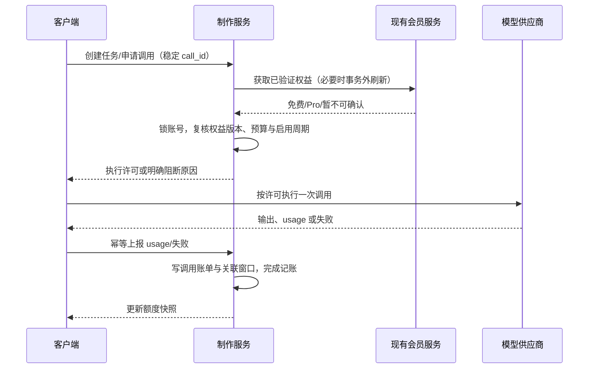

# Pro 会员与 AI 制作额度

日期：2026-11-14  
状态：客户端、服务端与后台已实现，本地 MySQL 已应用结构迁移。发布前需完成真实购买和模型联调。  
关联：[制作额度与奖励通知](./04-制作额度与奖励通知.md) · [需求入口](./初始需求与代理任务入口.md)

## 1. 目标、决策与范围

将 AI 制作额度接入项目现有 Pro 会员体系。免费用户仅受 7 天额度限制；Pro 用户同时受 5 小时和 7 天额度限制。内部按积分计量，客户端只显示剩余百分比、恢复时间和会员等级。

用户已明确：沿用现有 Pro；免费单周期、Pro 双周期；文本与图片分别按模型用量折算积分；调用失败不退款；实际产生过消耗的用户才进入后台用户额度列表；不考虑旧业务数据迁移和旧协议兼容。

本文给出完整推荐实施规则。10 / 30 / 100 积分是建议初始配置，未视为已批准的商业参数。发布前需结合会员售价、模型成本确认。升级到期处理、策略生效方式按下文作为实施基线。

首期不新增会员商品、不调整会员售价、不建立单独 AI 订阅、不提供积分充值或奖励、不按等级限制模型与图片规格。现有 Pro 的其他权益保持原有规则。

## 2. 当前项目依据与差距

| 模块 | 已核对的代码 | 当前情况与所需调整 |
| --- | --- | --- |
| 会员服务 | SparkService/billing/membership.py | 已有 RevenueCat 验证、会员快照、过期及宽限判断；复用其权威判断 |
| 会员接口 | SparkService/billing/urls.py、views.py | 已有 membership 入口，复用购买后刷新链路 |
| 制作计量 | SparkService/ai_production/services.py | WINDOWS 默认双周期，authorize 使用数组位置绑定两个窗口；需改为按等级、按 kind 取窗口 |
| 积分数据 | SparkService/ai_production/models.py | 复用策略、窗口、调用、流水；补等级配置及可空短周期关联 |
| 客户端会话 | UserSession.swift、DefaultAuthRepository.swift | 已有 isPro 和服务端会话刷新；展示可复用，额度授权不能信任客户端布尔值 |
| 客户端额度 | DiaryProductionService.swift、DiaryProductionQuotaView.swift | 需支持单周期与双周期、权益刷新状态 |
| 管理后台 | SparkService/backoffice-web 的 AIProductionView.vue 及额度 API | 需增加分级额度配置、会员筛选及会员状态信息 |

第 13 节记录实现与验证结果。现阶段模型由客户端直接调用，usage 上报及估算机制仍沿用现有系统，不宣称服务端已经能验证所有供应商用量。

## 3. 额度及计量规则

| 等级 | 5 小时（18,000 秒） | 7 天（604,800 秒） | 推荐初始值 |
| --- | --- | --- | --- |
| free | 不启用，不创建新短周期 | 启用 | 7 天 10 积分 |
| pro | 启用 | 启用 | 5 小时 30、7 天 100 积分 |

文本和图片共用同一额度池，费率按模型配置，与会员等级无关。一次 Pro 调用消耗 2 积分，在两个周期各累计 2；调用成本和账单汇总仍为 2，不能累计成 4。

沿用《04》的 token、图片张数/规格及最低调用消耗规则。有 usage 时按实际用量记账，缺失时到期按既有估算规则记账并标记 estimated；失败、取消、不保存不退款。用量纠错只纠正计量错误，不提供失败退款。

额度不足、鉴权失败、参数不合法等未获得执行许可的请求不扣费。获得许可后的调用按现有上报/超时记账规则处理，不新增“实际成功才收费”的判断。真实重试使用新 call_id，再计费；同一请求网络重发使用原 call_id，不能重复执行和扣费。

首期每账号最多一笔待记账调用。准入预算沿用现有模型最大输出和图片规格预算；所有启用周期均须满足预算，不以剩余百分比大于零作为放行条件。预算大于完整周期上限时返回配置/请求预算问题，不能告诉用户等待就一定恢复。

## 4. 周期与会员状态转换

### 4.1 周期基本规则

- 时间以服务端 UTC 为准，客户端按本地时区展示；周期为固定时长，不是自然周，也不是每次调用后滑动延期。
- 首次成功授权调用创建启用周期。查询、登录、购买和恢复购买均不启动计时。
- 周期有效区间为 starts_at ≤ now < ends_at；到期即恢复，下一次授权调用创建新周期。
- 不结转未用额度。客户端未开始/已到期未再使用时显示 100% 和“首次调用后开始计时”/“下次调用开始新周期”。
- 7 天周期是账号共用周期，不分别建立免费和 Pro 周额度池。会员切换不改 starts_at、ends_at、used_points。
- 剩余积分 = max(0, 当前有效上限 − 已用积分)，比例限制在 0～1；小额余量显示不足 1%，避免四舍五入成 0% 却仍可调用。

### 4.2 状态转换表

| 事件 | 7 天处理 | 5 小时处理 |
| --- | --- | --- |
| 免费首次使用 | 建立免费周周期 | 不创建 |
| 免费升级 Pro | 原周期上限切换为 Pro，已用量不变 | 下次授权时复用仍有效的历史短周期，否则新建 |
| Pro 正常续费 | 不重置、不延期 | 不重置、不延期 |
| 关闭自动续费 | 有效期内保持 Pro | 保持 Pro |
| Pro 到期/经验证权益撤销 | 同周期切换免费上限，已用量不变 | 停止校验，保留历史记录 |
| 重新购买/恢复购买 | 根据服务端验证等级调整上限，不重置 | 恢复仍有效短周期；已到期则下一次授权新建 |
| 会员宽限期 | 仅在现有会员服务验证仍有权益时按 Pro | 同左 |

示例：免费已用 8/10，升级后为 8/100，剩余 92%；Pro 已用 40/100 后到期，变成 40/10，剩余 0%，等待原周周期结束。

免费期间的调用只记入周窗口，不补记到暂停使用的历史短窗口。购买成功不自动重试原制作；用户确认继续后仅执行未完成步骤。

### 4.3 会员查询异常

复用 billing.membership.is_active 的验证有效期，不另设一套“客户端认为是会员就放行”规则。目前代码包含普通快照 1 小时有效期和已验证宽限短缓存，实际以会员模块统一规则为准。

有效快照可继续使用；无有效验证且刷新失败，额度接口标记 entitlement_state=unavailable，前端提示“会员状态暂时无法确认，请重试”，调用返回可重试错误，不静默降级并修改周期。明确验证无会员才使用免费策略。购买后尚未收到验证结果显示 syncing，不虚报 Pro 已生效。

## 5. 客户端 UI 与交互

### 5.1 制作入口和额度面板

免费用户使用单圆环，Pro 使用双圆环。统一由额度接口 windows 的 kind 渲染，不能依赖固定数组下标或仅依赖本地 isPro。

免费面板：

```text
AI 制作额度                         免费版
7 天额度                           剩余 60%
3 天 12 小时后恢复
升级 Pro，获得更多 AI 制作额度
[查看 Pro 权益]
```

Pro 面板：

```text
AI 制作额度                           PRO
5 小时额度                         剩余 80%
2 小时 15 分钟后恢复
7 天额度                           剩余 94%
5 天 8 小时后恢复
```

免费不展示 5 小时占位，也不显示“无限”。不展示内部积分、token 单价和模型预算。读屏逐项读出周期、百分比、恢复时间；颜色之外必须有文本状态。

### 5.2 额度不足与异常状态

| 状态 | 展示与操作 |
| --- | --- |
| 免费周不足 | “本周期制作额度不足”，恢复时间；升级 Pro、稍后再试 |
| Pro 短周期不足 | “5 小时制作额度不足”，对应恢复时间 |
| Pro 周不足 | “7 天制作额度不足”，对应恢复时间 |
| 两周期均不足 | 展示两个时间及 next_eligible_at；该时间以当前会员身份和请求预算为前提 |
| 单次请求预算超过完整上限 | 提示调整请求；免费仅在 Pro 确实可满足预算时展示针对性的升级建议 |
| 用量待记账 | “正在更新制作额度”，暂不可再次调用；自动查询，不重复发起生成 |
| 会员同步中/不可用 | 同步提示或重试按钮；保留作品、编辑状态，不展示错误降级结果 |
| 服务暂停或无策略 | 显示服务暂不可用，不引导用户购买来解决 |

倒计时到零时刷新额度接口，不能仅本地变更可调用状态。进入工作区、App 回前台、购买/恢复完成、调用记账完成、账号切换时刷新；避免定时高频轮询。

### 5.3 会员页与购买返回

复用现有 Pro 购买页和商品价格，补充“更多 AI 制作额度，包含 5 小时和 7 天额度，按周期恢复”。不宣传无限，不新增 AI 单独 SKU。

购买/恢复完成 → 请求既有会员服务刷新 → 确认服务端 Pro → 刷新额度 → 原位显示新比例。取消购买返回原页面；商店成功但同步未完成显示“购买完成，权益同步中”，提供重试/恢复购买，不要求再次付款。刷新完成不自动消耗额度。

DiaryProductionService 维护会员与额度快照、pending 状态及刷新事件；所有缓存按账号隔离，退出清理，切换账号后丢弃旧请求的迟到响应。会话 isPro 与额度 plan 不一致时刷新会话，准入仍以服务端结果为准。

## 6. 服务端完整执行流程

### 6.1 查询流程

1. 认证并解析现有账号及 billing identity，沿用会员环境隔离；生产身份不得使用沙盒权益。
2. 在数据库事务外执行必要的会员刷新；禁止持有账号锁进行 RevenueCat 网络请求。
3. 读取可用会员快照；无法可靠判断则返回 unavailable，不修改窗口。
4. 读取现行策略与未结束窗口，按 plan 计算有效上限，返回实际启用周期；查询不创建窗口。
5. 返回 server_time、会员同步状态、恢复时间、服务状态及版本。

### 6.2 授权、执行、记账流程



授权事务内按现有锁顺序锁账号，重新核对会员快照是否仍有效以及最新版本；失效需退出事务刷新后重试，不能使用网络请求前已经过期的权益。检查同 call_id 的内容摘要、所属账号、任务，重复请求返回原调用，不重新判断后创建第二笔。

按 kind 构造窗口映射，免费仅 weekly，Pro 为 short + weekly。检查 pending、服务开关、模型参数和预算通过后创建缺失窗口，保存授权时会员等级、策略和费率快照及实际窗口外键。任何检查失败都不创建调用账单。

记账只更新调用绑定的窗口：授权后会员到期，原 Pro 调用仍扣原两个窗口；免费调用授权后升级，仍只扣原周窗口。跨周期迟到的 usage 也记回原窗口，不扣新周期；不得查询当前窗口替代调用外键。

一笔 charge 与窗口累加在同一事务完成；同 event_id 重发不得重复累计。实际用量超过准入预算仍记录真实消耗，余额最低显示零，并阻止后续调用；记录异常预算供后台排查，不丢弃真实费用。

### 6.3 会员事件流程

支付回调/恢复购买/会员主动刷新更新现有 MembershipSnapshot → 使相关额度展示缓存失效 → 下次查询或授权计算对应上限。不额外发放一笔积分，不创建新周窗口。回调重复/乱序沿用会员模块既有幂等和时间顺序规则。

无回调时也必须依据 active_until 与服务端时间到期，不依赖客户端刷新触发到期。短周期在免费期间自然过期，不暂停时间。

## 7. 数据模型设计

沿用当前表，避免引入一套积分钱包。以下为拟新增/调整字段。

| 模型 | 字段与规则 |
| --- | --- |
| ProductionPolicy | free_weekly_limit_points、pro_short_limit_points、pro_weekly_limit_points；Decimal 六位；保留版本、生效时间、发布人、原因；发布后不可修改 |
| ProductionWindow | 保留账号、kind、起止时间、used_points、policy；增加 limits_snapshot，周窗口保存该版本 free/pro 两个上限，短窗口保存 pro 上限；limit_points 作为创建时审计值，不能再作为所有等级的唯一实时上限 |
| ProductionCall | 增加 plan_at_authorization、membership_verified_at、membership_snapshot_version（需会员模块补版本或等价可靠标记）；short_window 可空，weekly_window 必填；保留预算与费率快照 |
| ProductionLedger | short_window 可空，weekly_window 必填；每次调用唯一 charge；保持 event_id 唯一 |
| MembershipSnapshot | 复用现有权益信息；如无可靠修订标记，增加随验证/失效更新的 revision 以进行并发复核 |
| ProductionQuotaReset | 保留重置前窗口、范围、原因、操作者、请求幂等键；加入操作时会员等级快照 |

约束：同账号同 kind 不允许同时产生两个有效窗口，使用账号锁保护查询与创建；调用与其窗口必须属于同账号；不得用 null 短窗口假装存在免费短周期。计算和序列化统一处理可空外键。

### 7.1 策略变更生效规则

新额度配置只对新创建的窗口生效；旧窗口保留 limits_snapshot。升级/到期在当前窗口保存的 free/pro 两个上限间切换，避免后台调额追溯改变正在使用的周期。

新调用使用授权时最新有效的模型费率；已授权调用使用原费率快照。调用 policy_version 与窗口 policy_version 可以不同，后台需要分别展示。

若运营必须立即应用新额度，发布后通过现有人工重置功能明确执行，并记录原因；发布策略本身不批量清空用量。

不编写旧业务数据迁移、旧客户端兼容或双轨逻辑。实施仍需正常数据库 schema migration；已有测试数据是否清理由实施环境决定，不能自动删除生产数据。

## 8. 接口契约

复用 `/api/v1/ai-production/`，现有响应外层格式保持一致。以下展示 data 内字段。沿用已有 `reset_at`，不另加 `resets_at` 同义字段。

### 8.1 GET quota/

```json
{
  "server_time": "2026-11-14T08:00:00Z",
  "policy_version": 3,
  "plan": "free",
  "entitlement_state": "verified",
  "membership_expires_at": null,
  "membership_verified_at": "2026-11-14T07:59:00Z",
  "pending_usage": false,
  "entitled": true,
  "service_status": "available",
  "windows": [{
    "kind": "weekly",
    "status": "active",
    "window_policy_version": 3,
    "duration_seconds": 604800,
    "remaining_ratio": 0.6,
    "starts_at": "2026-11-11T08:00:00Z",
    "reset_at": "2026-11-18T08:00:00Z"
  }]
}
```

plan 为 free/pro；权益无法确定时为 null，entitlement_state 为 syncing/unavailable，此时 windows 不输出猜测值，客户端可保留上次展示但标记未更新。entitled 保留账号可访问含义，不代表是 Pro。verified 表示当前判断可用，不代表每次都实时请求供应商。

未开始周期 starts_at/reset_at 为 null，status=not_started 或 awaiting_first_use；已恢复但未再调用视为 awaiting_first_use。Pro 返回两个窗口。普通客户端不返回积分上限/费率；管理接口可返回积分及政策快照。

quota 只描述余额，不保证任意制作预算都能满足；具体请求以 calls 授权结果为准。

### 8.2 创建及上报接口

- `POST tasks/`：沿用现有任务协议，不消耗额度。
- `POST tasks/{task_id}/calls/`：沿用调用协议，客户端不提交会员等级或额度上限；服务端新增保存会员快照。成功返回原执行许可，必要时附当前 quota。
- `POST tasks/{task_id}/calls/{call_id}/usage/`：沿用现有 usage 幂等上报，使用调用原窗口记账。
- `GET tasks/{task_id}/calls/{call_id}/`：沿用现有查询，查询不会再次执行模型。
- 会员验证：复用 billing 路由中的 membership 接口及现有认证/identity，不新建 AI 专属购买验证入口。

### 8.3 错误与恢复

| HTTP / error_key | 含义 | 客户端行为 |
| --- | --- | --- |
| 429 / QUOTA_INSUFFICIENT | 当前启用窗口余额不足 | 展示 blocked_windows、next_eligible_at，按等级显示升级入口 |
| 422 / CALL_BUDGET_EXCEEDS_LIMIT | 单次预算超过完整周期额度 | 调整参数；不得承诺等待可解决 |
| 409 / USAGE_PENDING | 已有调用待记账 | 查询原调用，禁止自动新建重复调用 |
| 503 / MEMBERSHIP_UNAVAILABLE | 无有效权益判断 | 提示重试会员同步 |
| 503 / SERVICE_UNAVAILABLE | 暂停调用/策略缺失 | 服务提示，不显示购买可解锁 |
| 409 / IDEMPOTENCY_CONFLICT | 相同幂等键提交不同内容 | 停止自动重发，保留作品状态 |

以上错误键须统一到现有 APIError 协议，避免同时维护两套相同错误。QUOTA_INSUFFICIENT 的 next_eligible_at 为所有阻断窗口恢复时间的最大值；不能确定时为 null，前端不编造倒计时。

## 9. 后台管理设计

### 9.1 额度策略与费率

额度策略表单分两行：免费 7 天；Pro 5 小时、7 天。免费短周期固定显示“不适用”，不允许输入 0 来代替禁用。建议初始值分别为 10、30、100。

校验：积分为正、最多六位小数；Pro 周额度应大于免费周额度；Pro 短额度不小于免费周额度且不大于 Pro 周额度。发布前校验已启用场景的预算与额度是否匹配，防止免费用户因预算配置永远无法体验。

编辑草稿 → 配置差异预览 → 填写原因与生效时间 → 发布 → 显示版本及“新周期生效”。预览同时展示旧值、新值、受影响等级与生效规则。发布重复点击使用相同 publish_key。费率页保持统一，不复制免费/Pro 两份费率。

### 9.2 用户额度

仅展示存在实际正向消耗流水的账号，不能从全量账号表直接分页后前端隐藏。查询范围、搜索、等级筛选及总数必须应用同一消耗条件。仅注册、购买、查询、授权但未记账都不出现；实际最低消耗或估算记账后出现。曾消耗过但周期重置或账单被纠正后仍保留历史管理入口。

列：账号、当前等级、会员到期时间、5 小时额度、7 天额度、用量状态、操作。免费短周期显示“—”；后台积分默认友好格式，详情保留六位精度。等级不可确认显示“待同步”，不能冒充免费。

详情展示当前有效上限、已用量、剩余比例、周期时间、窗口策略版本、会员验证时间、历史调用。支持按账号搜索、free/pro/待同步筛选及分页。空态：“暂无产生 AI 制作消耗的用户”。

### 9.3 重置与审计

免费只可重置 7 天；Pro 可重置 5 小时、7 天或全部。弹窗展示账号、当前等级、当前额度及必填原因；提交重新校验会员等级，若变化则返回冲突并刷新弹窗，不静默扩大范围。

有 pending 调用时禁止重置，先完成上报或超时记账，防止旧调用落入错误周期。重置结束指定窗口，下一次授权创建新周期；不改变会员、不修改模型费率、不删除历史流水。请求使用稳定 request_key。

审计包含操作者、账号、前后快照、会员等级、策略版本、原因、时间。制作后台不提供手工修改 Pro 的入口；会员操作继续使用现有支付/会员体系。只读管理员隐藏修改按钮，服务端仍强制检查权限。

## 10. 实施顺序与交付范围

1. 服务端：会员权益适配与异常状态；策略字段和窗口快照；可空短周期；授权/记账按 kind；会员并发与迟到 usage；接口及后台查询。
2. 管理后台：分级策略表单、预览发布、等级筛选、详情、重置范围和审计；维护已确认初始参数。
3. 客户端：单/双周期模型、额度面板、错误提示、会员购买返回刷新、账号缓存隔离；更新会员权益文案。
4. 联调：免费完整制作、升级继续制作、Pro 到期、真实 usage 与缺失 usage、后台筛选/重置、多设备并发。
5. 发布：服务端、后台、客户端按全新协议协同发布；不保留旧行为兼容分支。关闭服务开关时显示服务维护，开放前确认策略已发布、会员验证可用和模型预算可用。

文档提交不包含修改真实会员商品、自动发布策略或删除数据。实现完成后须回填实际接口字段、测试结果和未解决项，不能将本文设计状态直接改为已验收。

## 11. 验收清单

| 场景 | 预期 |
| --- | --- |
| 免费首次查询 | 仅周额度、100%，不创建窗口，不进入用户额度列表 |
| 免费实际记账 | 仅周扣减；正向消耗后进入后台列表 |
| Pro 实际记账 | 两窗口扣相同数额，账单总费用仅记一次 |
| 免费已用 8 后升级 | 周期不变，初始配置下剩余 92%；下一次调用才建立短周期 |
| Pro 已用 40 后到期 | 周期不变，免费周剩余 0%，隐藏短周期 |
| 取消续费、正常续费 | 有效期内保持 Pro；不重置任何窗口 |
| 到期再购买、重复恢复 | 未过期短周期复用，周使用量不清零 |
| 首次调用失败/无 usage | 按既有估算规则扣费并可追溯，不因失败退款 |
| 未授权、参数失败、额度不足 | 不扣费、不创建窗口 |
| 同调用/同 usage 重发 | 仅一次执行许可和一次 charge，不重复累计 |
| 两设备同时调用 | 账号锁与 pending 规则阻止透支和重复窗口 |
| 会员在授权与记账间变化 | 按授权绑定窗口结算，下一次调用用新等级 |
| usage 跨周期迟到 | 扣原窗口，不污染新周期 |
| 周期到期且无人调用 | 查询显示恢复，不启动新周期 |
| 超预算真实 usage | 记录全部实际消耗、剩余为零并阻止后续调用 |
| 会员供应商不可用 | 有效快照按统一规则使用；无有效判断可重试阻断，不误降级 |
| 新策略发布 | 旧窗口保留快照，新窗口应用新值；调用费率按授权快照 |
| 免费短周期字段为空 | 记账、纠错、统计、后台详情均不崩溃 |
| 重置与调用竞争 | pending 阻止重置，事务锁保证不会产生双窗口 |
| 后台搜索与分页 | 全部只统计实际消耗用户，恢复额度后仍保留历史用户 |
| 账号切换、旧响应迟到 | 不显示上个账号会员和额度，不使用其执行许可 |
| 非授权管理员变更 | 前后端均拒绝；合法操作审计完整 |

服务端需为计费、会员转换及并发边界提供回归测试；客户端验证单/双周期、购买同步和错误分支；后台验证表单、分页筛选、重置及权限。真实供应商联调与支付沙盒验证需单独记录，不能用单元测试代替。

## 12. 发布前待确认

- 最终积分上限：建议免费 10/周，Pro 30/5 小时、100/周；按实际成本与会员售价确认。
- 各生产模型最大请求预算与免费上限的匹配情况，保证免费可完成至少一种完整制作流程。
- 现有会员身份绑定在设备账号登录/合并时的确定行为；复用统一账号合并规则，不因登录或恢复购买新增一份免费额度。
- 完成实现后补充真实会员购买、到期、恢复及用量回传联调结果。

## 13. 实现与本地验证

- 2026-11-14：完成 iOS、SparkService API 与后台分级策略接入。本地 MySQL 已应用 AI 制作额度结构迁移，当前策略为免费 10 积分／7 天，Pro 30 积分／5 小时、100 积分／7 天。
- 策略沿用数据库和后台现有的 `short_limit_points`、`weekly_limit_points` 表示 Pro 上限，增加 `free_weekly_limit_points`。窗口引用不可修改的策略版本获取两个等级的上限，流水通过调用关联原窗口。
- 授权事务内重新读取并锁定会员身份与快照，调用记录保存授权等级及会员验证时间。未提供商店会话时查询生产会员身份。测试订阅通过经验证的沙盒会话读取，管理后台显示生产会员等级。
- 会员页从服务端读取 `ai_production_included`。已开放的 AI 额度计入可购买的 Pro 权益，购买仍使用现有会员销售开关和订阅商品。
- 128 项 Django 测试通过，覆盖切换会员等级、双周期扣费、跨会员状态记账和用户列表筛选。后台额度页面测试及构建通过，iOS 模拟器构建通过。本地 MySQL 验证了分级策略、免费单周期查询及未消耗用户不入列表。
- 真实 App Store 沙盒购买、恢复购买和供应商模型端到端联调仍需实测。
