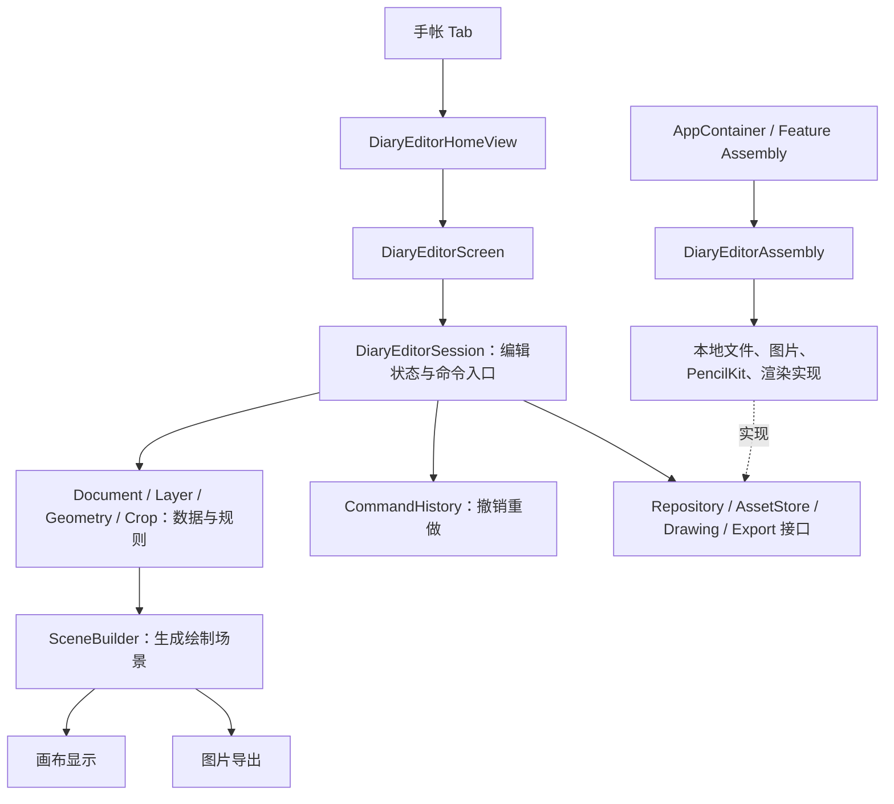

# 画布编辑器整体架构与目录设计

> 多页版本更新（2026-10-14）：手帐本、页面目录、保存发布、资源归属与预览加载，以[手帐本与多页管理详细需求](./手帐本与多页管理详细需求.md)及[多页验收清单](./手帐本多页验收清单.md)为准。本文保留单页编辑背景；与新方案冲突的旧规则不用于多页实现。新方案属于设计要求，尚未实现或验收。

日期：2026-10-14  
版本：v0.1，实施设计基线；下列新增类型和方法为拟建接口，不表示已经实现。

关联：[总需求](./手帐项目总需求文档.md)、[编辑器详细设计](./画布编辑器详细设计.md)、[画布文件设计](./画布文件设计/README.md)、[原型实施计划](./最小原型实施与验收计划.md)。

## 1. 总体结构

手帐编辑器作为现有 App 的独立功能模块 `DiaryEditor`。产品层次为手帐首页 → 编辑页面 → 图层编辑；实现划分为界面、编辑控制、数据规则、平台实现四层，由装配入口连接。



图中的箭头主要表示调用或组装关系。源码依赖约束：Domain 不导入 SwiftUI、UIKit、PencilKit；Application 依赖 Domain 及平台接口；Infrastructure 实现这些接口；Presentation 使用编辑会话及展示适配。Assembly 可以看到各层，负责创建具体对象。

不需要一开始拆成多个 Swift Package。首先在同一功能目录内明确职责，等真正需要独立构建或跨功能复用时再拆包。

## 2. 现有接入点

| 已有文件 | 职责 | 后续接入方式 |
| --- | --- | --- |
| `Projects/App/Sources/App/AppCoordinatorView.swift` | 主 Tab 和导航 | 已有手帐 Tab，继续承接首页入口 |
| `Projects/App/Sources/App/AppContainer.swift` | App 依赖与工厂装配 | 增加手帐功能工厂，并传入稳定 ownerScope |
| `Projects/App/Sources/App/Architecture/FeatureAssemblies.swift` | 功能装配组织 | 按现有方式组装手帐依赖 |
| `Projects/Features/DiaryEditor/Presentation/DiaryEditorHomeView.swift` | 当前占位首页 | 后续展示文档列表、新建及打开入口 |

上述路径相对代码目录 `TravelDiaryClient/`，而不是仓库根。当前已存在手帐首页占位，下面目录树中的其他文件属于拟建项。

App 负责账号身份和顶层导航，手帐模块负责作品。View 不自行查找全局账号，不在 body 内创建文件仓库，不把每个工程服务都直接传进每个子视图。

## 3. 推荐目录结构

代码放在仓库内 `TravelDiaryClient/Projects/Features/DiaryEditor/`。

```text
DiaryEditor/
├── DiaryEditorAssembly.swift
│
├── Domain/
│   ├── DiaryDocument.swift
│   ├── DiaryPage.swift
│   ├── DiaryLayer.swift
│   ├── DiaryAsset.swift
│   ├── DiaryGeometry.swift
│   ├── DiaryLayerTree.swift
│   ├── DiaryPhotoCrop.swift
│   └── DiaryValidation.swift
│
├── Application/
│   ├── DiaryLibraryModel.swift
│   ├── DiaryEditorSession.swift
│   ├── DiaryEditorState.swift
│   ├── DiaryEditCommand.swift
│   ├── DiaryCommandHistory.swift
│   ├── DiaryInteractionController.swift
│   ├── DiaryAutosaveCoordinator.swift
│   ├── DiaryExportCoordinator.swift
│   └── Ports/
│       ├── DiaryDocumentRepository.swift
│       ├── DiaryAssetStore.swift
│       ├── DiaryDrawingEngine.swift
│       └── DiaryRenderServices.swift
│
├── Infrastructure/
│   ├── Persistence/
│   │   ├── DiaryDocumentCodec.swift
│   │   ├── DiaryDocumentMigrator.swift
│   │   ├── LocalDiaryDocumentRepository.swift
│   │   └── DiaryRevisionStore.swift
│   ├── Assets/
│   │   ├── LocalDiaryAssetStore.swift
│   │   ├── DiaryImageLoader.swift
│   │   └── DiaryFontRegistry.swift
│   ├── Drawing/
│   │   └── PencilKitDiaryDrawingEngine.swift
│   └── Rendering/
│       ├── DiarySceneBuilder.swift
│       ├── DiaryTextLayoutService.swift
│       ├── DiaryPageRenderer.swift
│       └── DiaryImageExporter.swift
│
└── Presentation/
    ├── DiaryEditorHomeView.swift              # 已有
    ├── DiaryEditorScreen.swift
    ├── Canvas/
    │   ├── DiaryCanvasView.swift
    │   ├── DiaryContentView.swift
    │   ├── DiarySelectionOverlay.swift
    │   └── DiaryDrawingCanvasView.swift
    ├── Panels/
    │   ├── DiaryLayerPanel.swift
    │   ├── DiaryPhotoCropPanel.swift
    │   ├── DiaryTextEditorPanel.swift
    │   └── DiaryEditorToolbar.swift
    └── ImportExport/
        ├── DiaryPhotoPicker.swift
        └── DiaryExportSheet.swift
```

这是目标职责清单，不要求第一次提交就创建所有文件。紧密关联的小类型可以在同一文件，例如尺寸、点、矩阵、变换先放 DiaryGeometry。不要为每个枚举、按钮或单行方法单独建文件。

## 4. Domain：作品是什么，规则是什么

| 文件 | 保存/处理什么 | 核心类型或方法 |
| --- | --- | --- |
| DiaryDocument.swift | 文档 ID、标题、页面集合、资源索引 | `DiaryDocument`、`DiaryDocumentSnapshot` |
| DiaryPage.swift | 页面尺寸、背景、图层和绘画引用 | `DiaryPage`、`DiaryBackground` |
| DiaryLayer.swift | 图层共同属性和图片/文字/组内容 | `DiaryLayer`、`DiaryLayerPayload`、`DiaryTransform` 的引用 |
| DiaryAsset.swift | 资源身份、相对路径、像素尺寸、校验值 | `DiaryAssetRecord`、`DiaryDrawingReference` |
| DiaryGeometry.swift | 点、尺寸、矩阵、坐标转换 | `localMatrix`、`worldMatrix`、`inverse`、`transformPoint`、`boundingRect` |
| DiaryLayerTree.swift | 根据 ID 找节点、排序和更新 | `find`、`update`、`insert`、`remove`、`reorder`、`makeIndex` |
| DiaryPhotoCrop.swift | cover、取景偏移、焦点缩放 | `baseScale`、`displayRect`、`clampOffsets`、`zoomAround` |
| DiaryValidation.swift | 文件/模型合法性检查 | `validate(document:)`、`validate(layer:)` |

Domain 方法尽量是确定性计算：相同输入得到相同结果，不读磁盘、不改变 UI、不执行网络请求。树修改函数只处理数据；调用方必须通过命令入口使用，才能保证历史和保存完整。

内存中的 DiaryDocument 与磁盘 manifest 不必完全同形。内存可以持有已加载页面对象；磁盘 manifest 只存 pageRefs。Codec 负责转换，避免把所有页面同时写进 manifest 和页面文件。

绘画数据通过不透明 blob/ref 交给适配器处理，Domain 不持有 PKDrawing。大资源由 ID 引用，文档快照不复制全部照片字节。

## 5. Application：用户动作如何变成文档修改

### 5.1 DiaryEditorSession 是唯一编辑入口

一份打开的文档对应一个主线程编辑会话。它持有当前作品、当前页、选择、编辑范围、工具模式、历史和保存状态，协调各服务。它不包含图片解码、文件路径拼接或复杂矩阵公式。

建议接口如下，签名为设计草案，不是完整可编译代码：

```swift
@MainActor
final class DiaryEditorSession {
    func open(documentID: UUID) async throws
    func select(layerID: UUID?)
    func enterGroup(_ groupID: UUID) throws
    func leaveGroup()

    func addPhoto(from source: ImportSource, at point: DiaryPoint) async throws
    func replacePhoto(layerID: UUID, from source: ImportSource) async throws
    func addSticker(assetID: UUID, at point: DiaryPoint) throws
    func addText(_ text: String, at point: DiaryPoint) throws

    func beginInteraction(_ intent: InteractionIntent) throws
    func updateInteraction(_ update: InteractionUpdate)
    func commitInteraction() throws
    func cancelInteraction()

    func execute(_ command: DiaryEditCommand) throws
    func undo() throws
    func redo() throws
    func saveNow() async throws
    func export(_ options: ExportOptions) async throws -> URL
    func close() async throws
}
```

`at point` 必须明确为当前编辑范围本地坐标，调用前通过交互控制器转换。照片添加异步过程中捕获文档、页面、范围和会话代次；导入完成时检查目标仍有效，再创建命令，防止用户切页后插到错误位置。

`open` 只在当前会话未打开文档或已安全关闭时执行。`close` 停止输入、处理临时编辑、等待必要保存并释放资源；保存失败向界面返回错误，让用户重试或明确处理离开，不静默丢弃修改。

### 5.2 其他控制文件

| 文件 | 职责 | 核心方法 |
| --- | --- | --- |
| DiaryLibraryModel | 首页作品列表、新建、打开、删除 | `loadDocuments()`、`createDocument()`、`deleteDocument(id:)` |
| DiaryEditorState | 选择、当前范围、模式、查看变换、异步状态 | 状态类型定义；与作品数据分离 |
| DiaryEditCommand | 一次修改的 before/after、目标、资源引用 | `apply(to:)`、`revert(in:)` |
| DiaryCommandHistory | 历史栈、重做分支、预算与引用 | `record`、`undo`、`redo`、`trim` |
| DiaryInteractionController | 命中、手势仲裁、屏幕到父坐标转换 | `hitTest`、`begin`、`update`、`end`、`cancel` |
| DiaryAutosaveCoordinator | 合并保存请求、保存顺序与状态 | `schedule(snapshot:)`、`flush()`、`cancelPending()` |
| DiaryExportCoordinator | 捕获快照、预检、导出与取消、资源保留 | `export(snapshot:options:)`、`cancel()` |

`execute` 先验证命令并成功应用，再记录历史、推进文档 revision、发出保存请求。错误时三者都不推进。拖动过程在独立预览中计算，结束时产生一次命令，不能每个像素一条历史。

`undo/redo` 由 Session 调用历史操作，并走同一套 revision 和自动保存流程。History 不自行写磁盘，也不越过会话修改视图。

## 6. Ports：控制逻辑需要哪些外部能力

| 接口文件 | 建议方法 | 保证 |
| --- | --- | --- |
| DiaryDocumentRepository | `list`、`create`、`load`、`save`、`delete` | 所有方法绑定明确 ownerScope，save 返回实际已保存 revision |
| DiaryAssetStore | `importImage`、`resolveURL`、`retain`、`release` | 资源引用前可持久访问；回收考虑所有持有方 |
| DiaryDrawingEngine | `restore`、`capture`、`beginEdit`、`finishEdit`、`render` | 对外使用 blob/绘画引用与绘画事件，不泄露原生历史作为第二入口 |
| DiaryRenderServices | `buildScene`、`layoutText`、`exportImage` | 预览与导出采用一致几何、取景和排版语义 |

接口仅覆盖真实边界，不要求给每个纯计算类再套协议。Swift 并发实现中跨 actor 传递不可变、可安全传输的文档和字节数据；原生 UI 对象留在其所属线程。

## 7. Infrastructure：文件、图片、绘画与渲染

### 7.1 存储

| 文件 | 核心方法 | 边界 |
| --- | --- | --- |
| DiaryDocumentCodec | `encodeManifest`、`encodePage`、`decodeManifest`、`decodePage` | 明确 type 编码、字段默认值、版本检查 |
| DiaryDocumentMigrator | `migrate(from:to:)` | 旧协议显式升级；新版本不强制降级 |
| LocalDiaryDocumentRepository | `load`、`save`、`list`、`delete` | 组合 codec、revision store 和资源校验 |
| DiaryRevisionStore | `readCurrent`、`writeStaging`、`publish`、`recoverPrevious` | 多文件提交一致，CURRENT 最后发布 |

Repository 负责把领域作品保存/恢复；RevisionStore 只负责提交与恢复机制，不理解 UI 状态。磁盘规范统一采用[画布文件设计](./画布文件设计/01-文件结构与数据协议.md)，不在多个类里各自发明路径规则。

### 7.2 素材

| 文件 | 核心方法 | 边界 |
| --- | --- | --- |
| LocalDiaryAssetStore | `importImage`、`resolveURL`、`collectUnused` | 文件复制、方向规范化、校验值和资源生命周期 |
| DiaryImageLoader | `loadImage(asset:targetPixelSize:)`、`cancel`、`purgeCache` | 降采样与解码缓存，不改变文档几何 |
| DiaryFontRegistry | `resolve(fontID:)`、`registerAsset` | 明确字体版本；缺失字体有可见错误 |

AssetStore 管实际文件，ImageLoader 管内存中的显示资源。释放显示缓存不等于删除素材。移动照片不重新生成照片文件。

### 7.3 绘画与渲染

| 文件 | 核心方法 | 边界 |
| --- | --- | --- |
| PencilKitDiaryDrawingEngine | `restore`、`capture`、`finishEdit`、`render` | PKDrawing 与 blob 转换、一次绘画事务、回放标记 |
| DiarySceneBuilder | `build(page:resources:layout:)` | 展开变换、裁剪、可见性及组层级，保留整体透明度语义 |
| DiaryTextLayoutService | `layout(text:style:width:)` | 预览/导出统一换行及字形布局 |
| DiaryPageRenderer | `draw(scene:in:scale:)` | 绘制背景和内容；不画选择手柄 |
| DiaryImageExporter | `export(snapshot:options:)` | 加载输出所需资源、渲染页面、合成画笔、编码文件 |

Scene 仍然保留分组的合成边界，不能只扁平化成图层后逐个乘透明度。SceneBuilder 不直接读磁盘，它使用已解析的资源信息；异步资源准备由上层服务负责。

## 8. Presentation：页面与交互入口

| 文件 | 内容 | 调用方向 |
| --- | --- | --- |
| DiaryEditorHomeView | 作品列表、新建、打开入口 | LibraryModel |
| DiaryEditorScreen | 组合工具栏、画布、面板和状态 | EditorSession |
| DiaryCanvasView | 画布视口、背景工作区、输入协调 | InteractionController + Scene |
| DiaryContentView | 照片、贴纸、文字和分组显示 | 渲染服务与资源缓存 |
| DiarySelectionOverlay | 选中框、旋转缩放手柄、辅助线 | 读取选择几何，派发交互意图 |
| DiaryDrawingCanvasView | 原生绘画控件桥接 | DrawingEngine + 会话绘画命令 |
| DiaryLayerPanel | 图层列表、排序、显示与锁定 | Session.execute |
| DiaryPhotoCropPanel | 裁剪工作副本、完成与取消 | Session 的交互事务 |
| DiaryTextEditorPanel | 文本输入和样式工作副本 | 完成产生 EditText 命令 |
| DiaryEditorToolbar | 工具模式、撤销、重做、导出入口 | Session |
| DiaryPhotoPicker | 系统素材选择 | 返回临时输入供 AssetStore 导入 |
| DiaryExportSheet | 输出选项、进度、分享及失败处理 | ExportCoordinator |

不建立与 Session 重复的第二份可修改文档 ViewModel。面板可持有局部草稿，但必须通过完成/取消语义提交。SwiftUI 重新计算 body 不得触发重新导入资源或创建新编辑会话。

## 9. 最核心的八个方法

| 优先级 | 方法 | 输入 → 输出 | 为什么核心 |
| --- | --- | --- | --- |
| 1 | `Session.execute(command)` | 修改意图 → 新文档、历史和保存请求 | 所有编辑修改的统一入口 |
| 2 | `LayerTree.update(id:mutation:)` | 稳定 ID 与改动 → 更新的树 | 不受层级排序和数组下标变化影响 |
| 3 | `Geometry.worldMatrix(layerID:index:)` | 节点及祖先变换 → 页面变换 | 决定位置、大小、方向与组关系 |
| 4 | `Interaction.hitTest(screenPoint:scope:)` | 点击与当前范围 → 图层/手柄 | 决定用户到底选中谁 |
| 5 | `PhotoCrop.displayRect(...)` | 原图尺寸、外框和 crop → 图片绘制范围 | 取景重开和导出一致的基础 |
| 6 | `Repository.save(snapshot)` | 不可变快照 → 已提交 revision | 防止半份文档与错误保存状态 |
| 7 | `Repository.load(documentID)` | 文档身份 → 恢复的作品 | 恢复树、资源、坐标和可编辑内容 |
| 8 | `Exporter.export(snapshot:options:)` | 固定快照 → 成品文件 | 输出与屏幕查看状态分离 |

绘画整合的关键补充是 `DrawingEngine.finishEdit()`：生成一次前后数据变化，再交给 execute。否则笔画与照片动作无法按时间顺序一起撤销。

## 10. 典型调用流程

### 10.1 新建并添加照片

```text
首页新建
→ LibraryModel.createDocument
→ Repository.create
→ Assembly.makeEditorSession
→ Session.open
→ PhotoPicker 返回输入
→ Session.addPhoto
→ AssetStore.importImage（资源先保存）
→ 构造照片与照片组合
→ Session.execute(AddLayer)
→ 更新显示 + History.record + Autosave.schedule
```

### 10.2 拖动组内贴纸

```text
屏幕触摸
→ hitTest 选择当前组中的贴纸
→ beginInteraction 保存初始状态
→ inverse(查看矩阵 × 父世界矩阵) 转换手指位置
→ updateInteraction 更新预览
→ 松手 commitInteraction
→ execute(TransformLayer)
→ 保存组内 position，组和照片不变
```

### 10.3 关闭后重开

```text
Repository.load
→ RevisionStore.readCurrent
→ Codec 解码 manifest 和页面
→ Validate + LayerTree.makeIndex
→ SceneBuilder 计算世界矩阵和层级
→ ImageLoader / FontRegistry / DrawingEngine 恢复资源
→ 按当前手机尺寸设置查看矩阵
→ 显示原排版并继续编辑
```

### 10.4 导出

```text
Session.export
→ 结束临时交互，捕获文档快照
→ ExportCoordinator 预检并保留资源
→ 准备输出分辨率的图片及文字布局
→ SceneBuilder + PageRenderer
→ DrawingEngine 按整页范围输出画笔并合成
→ ImageExporter 编码 PNG
→ ExportSheet 分享或保存
```

## 11. 生命周期与并发

- 每份打开文档拥有一个 Session 和一个 History；首版同一文档只允许一个写入会话。
- Session、交互状态及原生视图操作在主线程协调；图片解码、文件编码与 I/O 经适当执行器异步运行。
- 保存控制器每文档串行提交，快照带 revision。已保存 revision 小于当前 revision 时，界面仍显示有待保存修改。
- Scene、文档快照与资源解码结果可独立缓存，但缓存不是文档权威来源。
- 关闭、切账号和切页使旧异步任务失效；返回结果必须核对会话代次及资源身份。
- 资源引用包括当前文档、保留修订、历史栈、未完成导入和导出快照，不能单看当前可见图层就清理文件。
- UI 原生对象的线程限制由各适配器明确处理，不能简单把整个 renderer 放进后台任务就认为线程安全。

## 12. 错误如何传递

Domain 返回无效图层、无效裁剪等数据错误；Repository 返回缺失文档、不支持版本、保存失败等；AssetStore 返回格式或导入错误；Exporter 区分资源预检、绘制、编码和系统相册保存失败。

Application 将错误转换成用户可操作状态，Presentation 显示重试、取消或重新选择。底层服务不直接弹窗，View 不解析磁盘错误码。

## 13. 文件创建顺序

| 阶段 | 先创建的文件 | 产出 |
| --- | --- | --- |
| A 数据与几何 | Domain 八个文件；Codec | 固定样例可解码，坐标与裁剪可计算 |
| B 存档基础 | Repository 接口、RevisionStore、LocalRepository、AssetStore | 样例存档可保存重开 |
| C 显示与输出 | SceneBuilder、TextLayoutService、PageRenderer、ImageExporter；Canvas/Screen | 固定页面可显示并导出 |
| D 编辑闭环 | Session、State、Command、History、Interaction、Autosave、各面板 | 添加、拖动、裁剪和文字可撤销且自动保存 |
| E 绘画及 App 接入 | DrawingEngine/Canvas、Assembly、LibraryModel、首页升级 | 顶层画笔、统一历史、实际手帐入口 |

开发过程中早期即可从手帐 Tab 接入固定样例 Screen；E 阶段再完成正式依赖与文档选择流程。Migrator 暂无旧版本时只实现版本识别，不提前编造迁移代码。多页、模板、批量导出在原型闭环通过后扩展。

## 14. 架构完成判据

1. 新增图层无需改写文件仓库和主 Tab。
2. 变更图片加载实现无需修改图层协议。
3. 页面所有修改经过统一命令与保存入口。
4. 关闭重开依赖文档数据，不依赖 View 状态或历史栈。
5. 查看缩放与导出尺寸互不混淆。
6. 照片、文字、贴纸和画笔采用可解释的一套页面坐标。
7. 目录、类型与方法按实现进度更新状态，不把拟建接口描述成已有能力。
